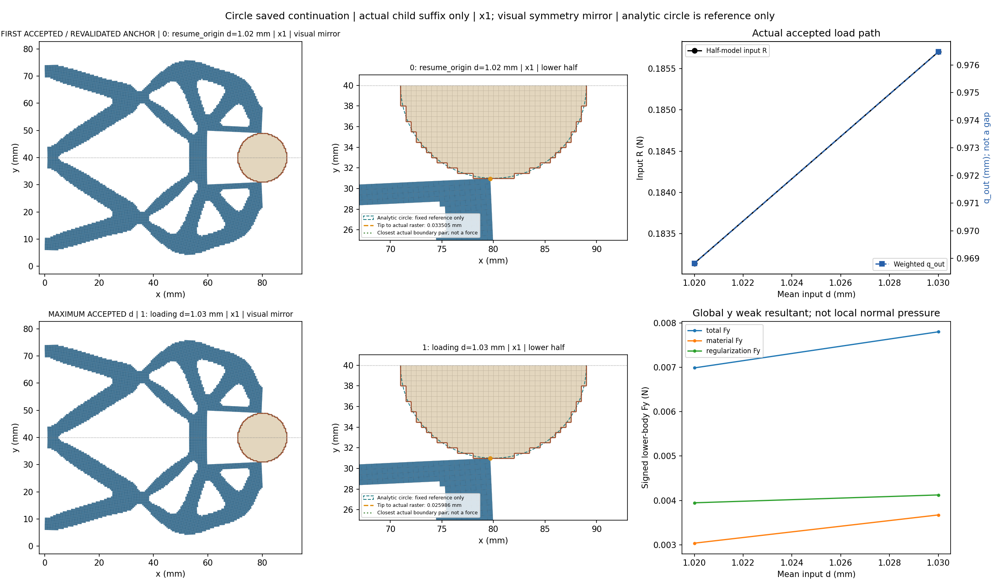
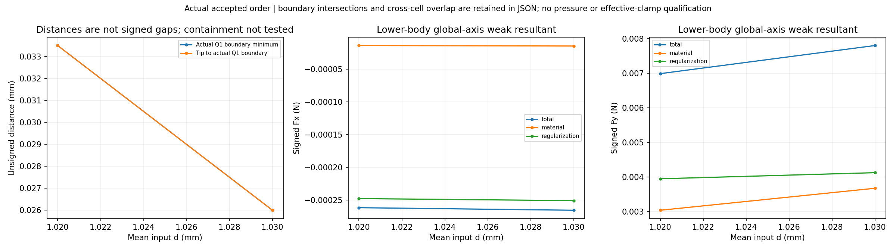
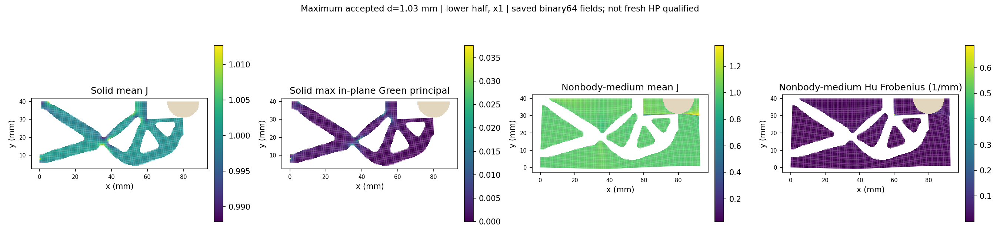
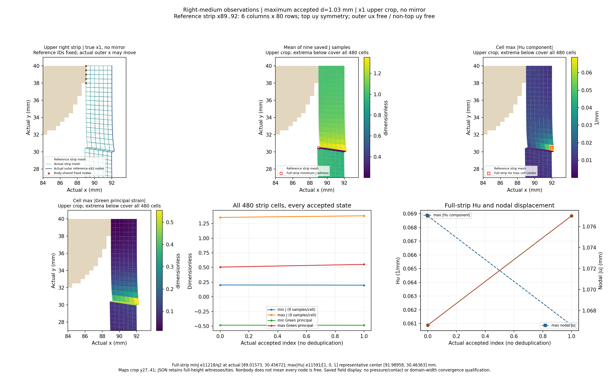
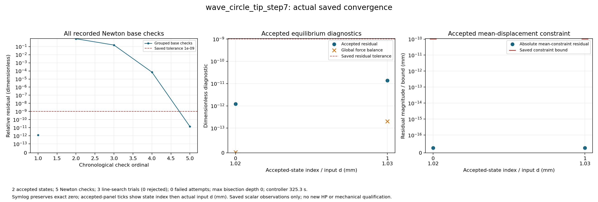
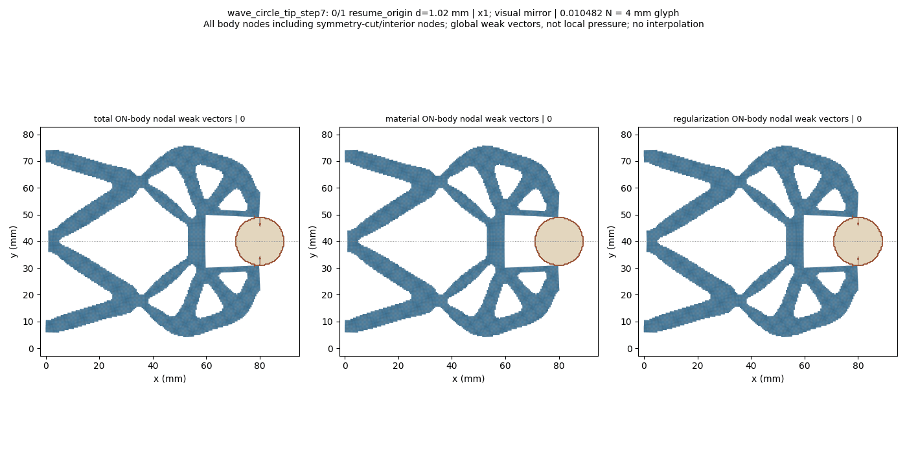

# L-CTIPSTEP7：最右尖端对向圆形工件的保存态延伸

2026-10-19；执行 **PASS**。生产 `success`，helper `pass`，outer `pass`；实际停止阶段 `final_binding_and_seal`。

整体目标是把LF给出的夹持器几何接入独立、可恢复的高保真大变形/TMC有限元分析，逐步实现对工件接近、接触后的变形与作用力及卸载响应的可审查计算。结构优化、有效夹持判定和HF5标签尚不能由单段前向计算替代。

本轮做什么及原因：复用已安装load_only显式保存态延伸接口，从已成功的1.02 mm状态重新核验平衡及SHA/有符号R，再执行唯一新目标1.03 mm。该小步用来观察最右尖端能否继续对向接近，并查看右侧介质压缩和计算成本，避免依据初始布置直接推断大行程效果。未从零重放原加载前缀，也未改默认HF源码。

半径9 mm、圆心(80,40) mm、固定工件ux/uy、右域界92 mm、正则化长度80 mm保持；下半域92×40 mm、h=0.5 mm、厚20 mm、E=1 MPa、nu=0.3、plane strain、gamma=1e-6、alpha=5e-7及原支撑/平均端口/对称保持。完整任务[0,.25,.5,.75,.90,.95,.98,1.00,1.02,1.03]仅追加1.03并将input.target改为1.03及四项说明身份；本次请求后缀[1.02,1.03]。

已完成及实际效果：保存接受态 `2`，helper回调 `2`。缺失保存结果记为null，实际二分增加的接受态全部保留。父结果SHA `d63867b2eed9469176cfd96f3d99406b7358baf5b845c59e13fe2250b4ada0f8` 与授权绑定一致，原成功与失败历史保留。

|child行|global目标|路段|d mm|输入R N|q_out mm|body Fy N|tip距离 mm|最近边界 mm|solid minJ|medium minJ|
|---:|---:|---|---:|---:|---:|---:|---:|---:|---:|---:|
|0|8|resume_origin|1.02|0.1831436048338394|0.9688228766079808|0.006986121313647189|0.03350464414994647|0.03350464414994647|0.9758502707410099|0.02244041906689209|
|1|9|loading|1.03|0.1856995754415686|0.9764698050071479|0.007798735907497663|0.025985908706346095|0.025985908706346095|0.9756590064288826|0.014938189525383425|

|d mm|右介质 minJ|右介质 maxabsHu 1/mm|右条带最大节点位移 mm|relative residual|
|---:|---:|---:|---:|---:|
|1.02|0.20272724534613745|0.060877992979509354|1.0770283707016062|1.224571016580751e-12|
|1.03|0.19901412159349638|0.0688448907313699|1.0666036522612292|1.3853469473992041e-11|

表中保留原数值。q_out是加权端口位移，不是表面间隙；输入R与工件合力为原下半模型数值。完整Fx/Fy的material/Hu/total分量、实际尖端及边界见证、分区极值与位置、原残差/约束界和整体平衡见[闭卡JSON](author/closure.json)及[显示摘要](run_001/view/wave_circle_tip_step7/summary.json)。

原验收门 `{'production_residual': '1e-9', 'average_constraint': '1e-10', 'global_force_balance': '1e-6', 'fixed_displacement_mm': '8e-11'}`；缓存检查 `{'actual_accepted_states': 2, 'minimum_J': 0.014938189525383425, 'maximum_fixed_split_sum_mm': 0.0, 'maximum_relative_residual': 1.3853469473992041e-11, 'native_constraint_bound_pass': True, 'maximum_relative_global_force_balance': 2.0302440530409943e-13, 'passed': True}`。生产调用 `{'force_calls': 8, 'force_calls_completed': 8, 'tangent_calls': 5, 'tangent_calls_completed': 5, 'solver_invocations': 1, 'JIT_calls': 0, 'HP_calls': 0}`；收敛计数 `{'accepted_states': 2, 'newton_base_checks': 5, 'inferred_check_groups': 2, 'line_search_trials': 3, 'line_search_accepted': 3, 'line_search_rejected': 0, 'failed_attempts': 0, 'linear_solves': 4, 'maximum_bisection_depth': 0, 'zero_newton_residuals': 0}`。API/solver/view等包装调用 `{'api_started': 1, 'solve_started': 1, 'solve_completed': 1, 'api_completed': 1, 'view_child_started': 1, 'view_child_completed': 1, 'convergence_plot_started': 1, 'convergence_plot_completed': 1}`。原门和非clock设置不变；minimum_increment=0.00625 mm保持，0.01 mm可直接尝试，若失败则半步0.005 mm低于原限值，按原规则停止。

路径实际标志 `{'path_kind': 'load_only', 'targets_mm': [1.02, 1.03], 'reached_displacement': 1.03, 'path_completed': True, 'loading_peak_reached': True, 'new_peak_reached': True, 'extended_segment_completed': True, 'task_target_executed': False, 'full_original_path_completed': False, 'full_extended_path_completed': False, 'unload_endpoint_reached': None}`。新峰值与延伸段完成只说明本段；task_target_executed、full_original_path_completed、full_extended_path_completed保持false，完整加载前缀没有在child中执行。没有把本段PASS授予整条路径或独立参考。

图中实际坐标×1；完整结构和动画只作对称镜像，数值没有镜像加倍。尖端按唯一参考坐标(80,30)动态查找并跟随实际位移。unsigned Q1外露边界距离、相交/near-touch、跨区凸单元重叠和数值不确定性分别记录；正距离和非零弱力不能单独认定有效接触，完整包含关系/机构自重叠尚未验证。

右侧条带固定参考x89..92、6列480cells，保留实际位移后的外界与原顶uy约束。完整条带极值覆盖80行，局部图是上部裁剪；Green应变不换算为工程压缩百分比，cellwise Hu代表点不当作独立九点量。右条带最大节点位移不是尖端间隙；其极值节点可随状态切换，具体位置见原摘要。右侧场变化不能单独证明边界污染或域宽充分。

圆形工件表面的法向随位置变化；下半体材料/Hu/总Fx/Fy是有符号弱式合力，Hu也不能当作连续表面压力。因此尚无压力、有效夹持、卸载/自由释放、稳定性、网格/域宽收敛或HF5资格；当前布置也未做新HP，旧布置参考不转授。

1.02→1.03 mm时，tip实际坐标由(79.692989507,30.966495356)变为(79.690547235,30.974014091) mm；tip及完整Q1共同最近距离由0.033504644降至0.025985909 mm。两态均无相交、near-touch、跨区重叠标志，containment仍未测试。这是unsigned Q1几何观察，不是连续圆面有符号gap、首次接触或唯一接触证明。输入R=0.185699575 N，q_out=0.976469805 mm；下半工件total Fy=0.007798735907 N，其中material=0.003674208672、Hu=0.004124527236 N，Hu占有符号total Fy约52.89%。弱式全局竖向合力不是圆面局部法向压力或其积分，镜像不加倍，不能据此授有效夹持资格。

实体minJ=0.975659006与非工件介质minJ=0.014938190分开报告；后者较上态下降33.43%，保持正值且原门通过。介质maxabsHu=0.439837816/mm。右侧480cells全条带minJ=0.199014122，见证e11218/q2，reference[89.0, 30.5]，actual[89.0157312733649, 30.456723066010362] mm；right maxabsHu=0.068844891/mm（上态1.131倍），e11591/component[1, 0, 1]，Q1代表中心actual[91.98958200902375, 30.46363099269005] mm。Hu逐单元常值，代表中心不是额外九点采样；统计覆盖全部80行，局部图上部裁剪另注明。单一域宽场变化既不证明右界污染，也不证明域宽充分。

逐态summary核实right最大位移节点本次仍为178、reference[89.0, 0.0]，actual[89.65326082699508, 0.8431450900827763] mm；norm由1.077028371降至1.066603652 mm。它不是tip距离、外界角点或卸载/更安全证据；保留非单调量并同时观察J/Hu，原门不要求该量单调。

helper `337.45882920000076`/2700 s，outer `338.2723822000007`/2760 s；controller1800 s，显示共享600 s；进程树采样峰值 `880566272` B/64 GiB，清理 `True`。四库线程配置上限16，不等于实测16核利用率；pure viewer原内部8 GiB限制保持。

原窗口封存 `38` 个输出、`63431172` B；闭卡仅继承seal并核大小。实际审查 `pass_record_audit`，像素记录 `pass_root_visual_inspection`。新测试 `0`、默认安装 `0`、wrapper新HP `0`。

错误原值：helper `未提供`；API `未提供`；outer `未提供`。生产与显示阶段状态分开保留，不覆盖历史，不进行外部重试、修复重跑、延期、force、回滚或删除。













后续决策：建议下一阶段L-CTIPSTEP8复用已安装load_only保存态延伸接口，从成功1.03 mm末态仅推进到1.04 mm（增量0.01 mm）；保持r9、圆心(80,40)、右域界92、Lr80及其余物理、非clock设置和原验收门，继续显示实际变形、尖端/完整Q1距离、反力/工件力分解、右介质和收敛。本轮只记录计划，不自动执行。

复核/恢复：主仓库origin保持https://github.com/dudaxing/Compliant-TO-TMC.git，后续开发在main。另一位置执行git clone该地址后，先读README、docs/CURRENT_STATUS.md、docs/RESUME_DEVELOPMENT.md及本卡RESULTS/NEXT_STEPS；依据仓库固定环境重建依赖，再核对protocol、author/authorization和保存态来源。不要重跑已关闭launcher或从显示数组重建锚；下一科学窗口使用公开evaluate_native(..., saved_result=..., selected_state_index=..., extend_path=True)和明确的新任务。

恢复起点命令（PowerShell；读取状态，不启动旧运行）：

```powershell
git clone https://github.com/dudaxing/Compliant-TO-TMC.git
git -C Compliant-TO-TMC status --short --branch
Get-Content -LiteralPath Compliant-TO-TMC/docs/RESUME_DEVELOPMENT.md
```

入口：[人工页](run_001/REVIEW.md) · [原结果](run_001/wave_circle_tip_step7/result.json) · [原响应](run_001/wave_circle_tip_step7/response.json) · [收敛记录](run_001/convergence/convergence.json) · [outer](step_launch.json) · [helper](run_001/execution_receipt.json) · [闭卡JSON](author/closure.json) · [实际审查](author/ACTUAL_REVIEW.md) · [像素记录](author/pixel_QA.json) · [后续](NEXT_STEPS.md)
