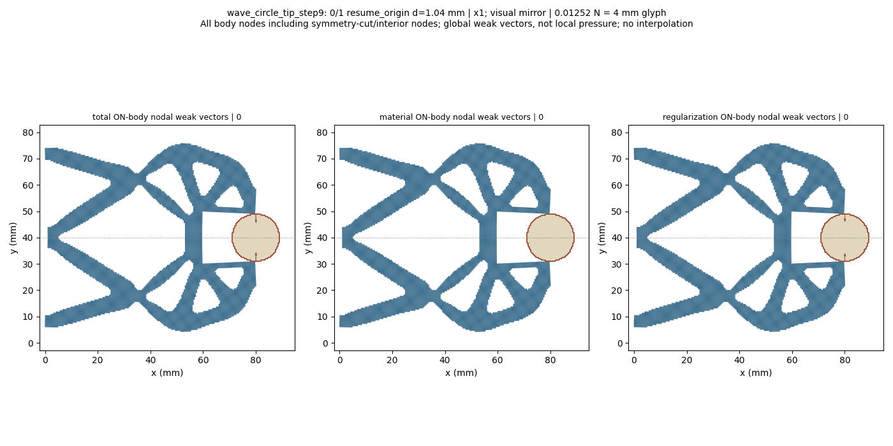
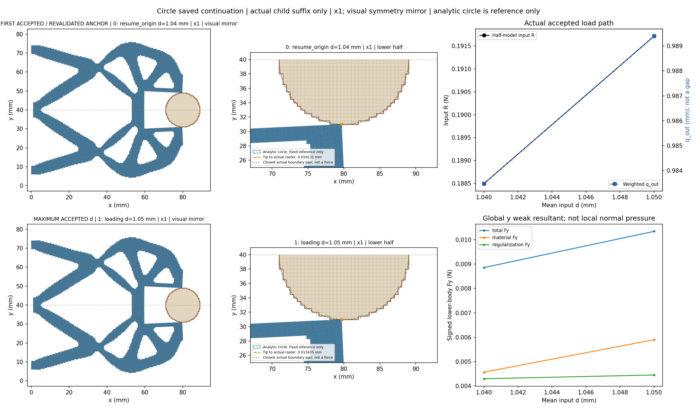
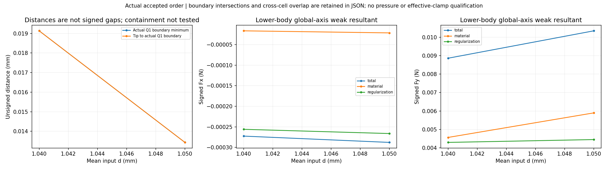
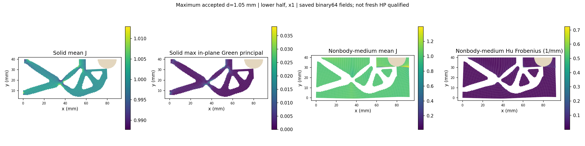
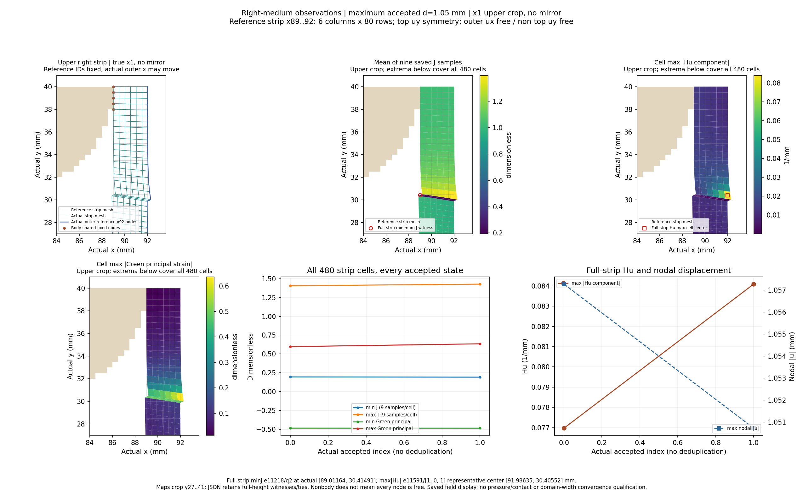
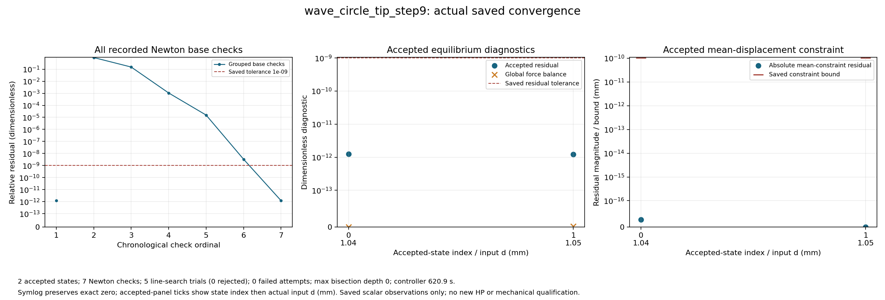

# Tip-facing circular workpiece saved extension: review

Solved lower-half wave mechanism, fixed raster circle r9 at (80,40) mm, on the92x40mm reference domain with Lr80mm. Coordinates x1; full-structure views and GIF use a visual symmetry mirror, while numerical tables retain the original lower-half values. All actual accepted states are shown, including controller bisections.

The boundary distance is unsigned between exposed Q1 edges; boundary intersection/near-touch and region overlap are separate observations. Containment is not tested. Weak-form body total includes material and Hu contributions; it is not qualified contact pressure or effective grip. Right-medium observations use the dynamically selected resident reference cells x89..92 (six columns,480cells) and the actual displaced x92 boundary; the tip is selected by reference(80,30), not an old node ID. Observations reuse the resident saved arrays; no additional physics arrays or domain-width convergence claim. Only the inherited 1.04mm anchor is freshly revalidated and extended to1.05mm; the complete0/.25/.5/.75/.9/.95/.98/1.00/1.02/1.03/1.04 prefix is not replayed. This child segment does not qualify unloading, release, stability, independent HP or HF5 qualification.

[Response](wave_circle_tip_step9/response.json) · [Result](wave_circle_tip_step9/result.json) · [Exact rows](state_table.json) · [Viewer summary](view/wave_circle_tip_step9/summary.json) · [Convergence JSON](convergence/convergence.json)

|index|leg|d (mm)|R input (N)|q out (mm)|body Fy total (N)|minimum Q1 boundary distance (mm)|
|---:|---|---:|---:|---:|---:|---:|
|0|resume_origin|1.04|0.18849743751609724|0.9834816595480069|0.00885936998869095|0.01913067004654323|
|1|loading|1.05|0.1917119776052685|0.9893918140696001|0.010344906240341959|0.013434644879975366|
