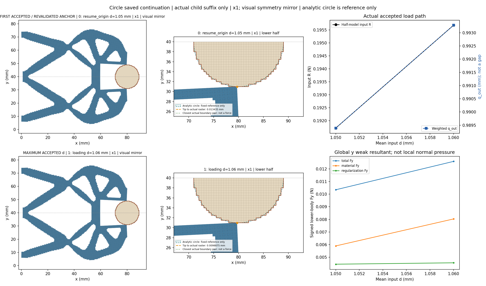
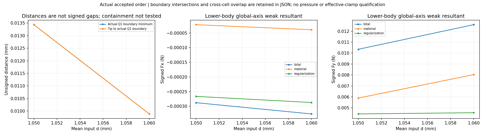
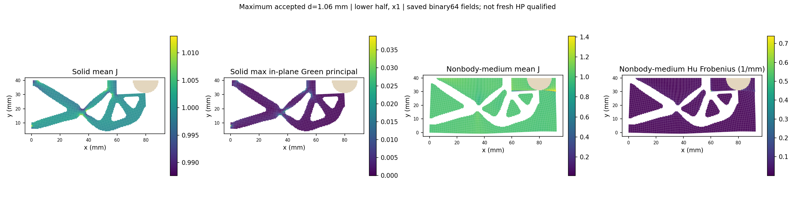
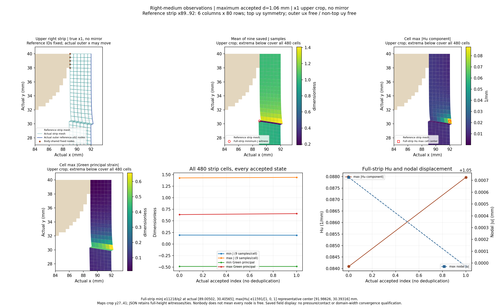
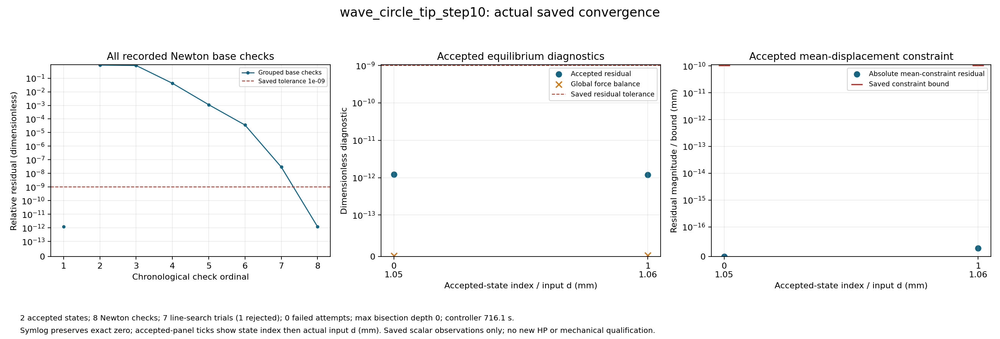
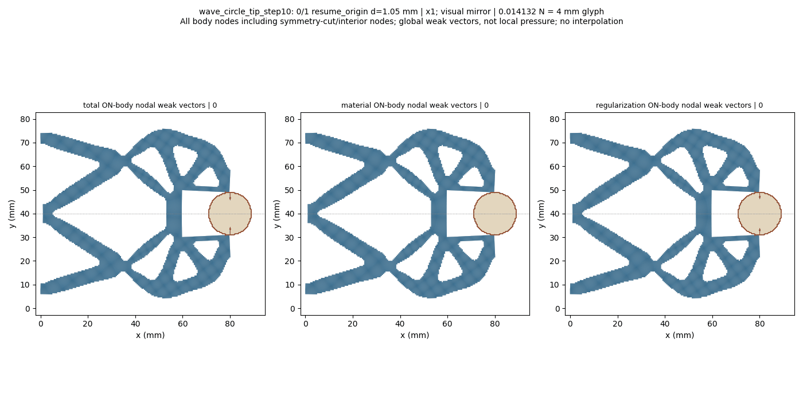

# L-CTIPSTEP10：最右尖端对向圆形工件的保存态延伸

2026-10-19；执行 **PASS**；图像QA `pass_root_visual_inspection`，本阶段完整完成 `True`。生产 `success`，helper `pass`，outer `pass`；实际停止阶段 `final_binding_and_seal`。

整体目标是把LF给出的夹持器几何接入独立、可恢复的高保真大变形/TMC有限元分析，逐步实现对工件接近、接触后的变形与作用力及卸载响应的可审查计算。结构优化、有效夹持判定和HF5标签尚不能由单段前向计算替代。

本轮做什么及原因：复用已安装load_only显式保存态延伸接口，从已成功的1.05 mm状态重新核验平衡及SHA/有符号R，再执行唯一新目标1.06 mm。该小步用来观察最右尖端能否继续对向接近，并查看右侧介质压缩和计算成本，避免依据初始布置直接推断大行程效果。未从零重放原加载前缀，也未改默认HF源码。

半径9 mm、圆心(80,40) mm、固定工件ux/uy、右域界92 mm、正则化长度80 mm保持；下半域92×40 mm、h=0.5 mm、厚20 mm、E=1 MPa、nu=0.3、plane strain、gamma=1e-6、alpha=5e-7及原支撑/平均端口/对称保持。完整任务[0,.25,.5,.75,.90,.95,.98,1.00,1.02,1.03,1.04,1.05,1.06]仅追加1.06并将input.target改为1.06及四项说明身份；本次请求后缀[1.05,1.06]。

已完成及实际效果：保存接受态 `2`，helper回调 `2`。缺失保存结果记为null，实际二分增加的接受态全部保留。父结果SHA `d9d12bb6a43a83cf95809274ec5c1362af14f644e74292b2a9e21d5754d4c404` 与授权绑定一致，原成功与失败历史保留。

|child行|global目标|路段|d mm|输入R N|q_out mm|body Fy N|tip距离 mm|最近边界 mm|solid minJ|medium minJ|
|---:|---:|---|---:|---:|---:|---:|---:|---:|---:|---:|
|0|11|resume_origin|1.05|0.1917119776052685|0.9893918140696001|0.010344906240341959|0.013434644879975366|0.013434644879975366|0.9753318497649357|0.0032268105740065082|
|1|12|loading|1.06|0.19568183324206792|0.9932854064102131|0.01259251473277105|0.009887524710265438|0.009887524710265438|0.9752281022523102|0.0009015839179744192|

|d mm|右介质 minJ|右介质 maxabsHu 1/mm|右条带最大节点位移 mm|relative residual|
|---:|---:|---:|---:|---:|
|1.05|0.19270007749393256|0.08409066184842073|1.0507256158949554|1.2186285374229884e-12|
|1.06|0.18974899507733087|0.0879638885271623|1.0499713555912025|1.2062223948858234e-12|

表中保留原数值。q_out是加权端口位移，不是表面间隙；输入R与工件合力为原下半模型数值。完整Fx/Fy的material/Hu/total分量、实际尖端及边界见证、分区极值与位置、原残差/约束界和整体平衡见[闭卡JSON](author/closure.json)及[显示摘要](run_001/view/wave_circle_tip_step10/summary.json)。

原验收门 `{'production_residual': '1e-9', 'average_constraint': '1e-10', 'global_force_balance': '1e-6', 'fixed_displacement_mm': '8e-11'}`；缓存检查 `{'actual_accepted_states': 2, 'minimum_J': 0.0009015839179744192, 'maximum_fixed_split_sum_mm': 0.0, 'maximum_relative_residual': 1.2186285374229884e-12, 'native_constraint_bound_pass': True, 'maximum_relative_global_force_balance': 3.2021337433195704e-15, 'passed': True}`。生产调用 `{'force_calls': 15, 'force_calls_completed': 14, 'tangent_calls': 8, 'tangent_calls_completed': 8, 'solver_invocations': 1, 'JIT_calls': 0, 'HP_calls': 0}`；收敛计数 `{'accepted_states': 2, 'newton_base_checks': 8, 'inferred_check_groups': 2, 'line_search_trials': 7, 'line_search_accepted': 6, 'line_search_rejected': 1, 'failed_attempts': 0, 'linear_solves': 7, 'maximum_bisection_depth': 0, 'zero_newton_residuals': 0}`。API/solver/view等包装调用 `{'api_started': 1, 'solve_started': 1, 'solve_completed': 1, 'api_completed': 1, 'view_child_started': 1, 'view_child_completed': 1, 'convergence_plot_started': 1, 'convergence_plot_completed': 1}`。原门和非clock设置不变；minimum_increment=0.00625 mm保持，0.01 mm可直接尝试，若失败则半步0.005 mm低于原限值，按原规则停止。

路径实际标志 `{'path_kind': 'load_only', 'targets_mm': [1.05, 1.06], 'reached_displacement': 1.06, 'path_completed': True, 'loading_peak_reached': True, 'new_peak_reached': True, 'extended_segment_completed': True, 'task_target_executed': False, 'full_original_path_completed': False, 'full_extended_path_completed': False, 'unload_endpoint_reached': None}`。新峰值与延伸段完成只说明本段；task_target_executed、full_original_path_completed、full_extended_path_completed保持false，完整加载前缀没有在child中执行。没有把本段PASS授予整条路径或独立参考。

图中实际坐标×1；完整结构和动画只作对称镜像，数值没有镜像加倍。尖端按唯一参考坐标(80,30)动态查找并跟随实际位移。unsigned Q1外露边界距离、相交/near-touch、跨区凸单元重叠和数值不确定性分别记录；正距离和非零弱力不能单独认定有效接触，完整包含关系/机构自重叠尚未验证。

右侧条带固定参考x89..92、6列480cells，保留实际位移后的外界与原顶uy约束。完整条带极值覆盖80行，局部图是上部裁剪；Green应变不换算为工程压缩百分比，cellwise Hu代表点不当作独立九点量。右条带最大节点位移不是尖端间隙；其极值节点可随状态切换，具体位置见原摘要。右侧场变化不能单独证明边界污染或域宽充分。

圆形工件表面的法向随位置变化；下半体材料/Hu/总Fx/Fy是有符号弱式合力，Hu也不能当作连续表面压力。因此尚无压力、有效夹持、卸载/自由释放、稳定性、网格/域宽收敛或HF5资格；当前布置也未做新HP，旧布置参考不转授。

1.05→1.06 mm仍满足全部原生产门与五图QA，内部factor1试探因invalid_J拒绝后，factor0.5接受并最终收敛，无失败目标、二分或外部重试。全非工件介质minJ由0.003226810574006508降至0.0009015839179744192（下降72.0596%），tip/完整Q1共同最近距离由13.434645降至9.887525微米。当前全介质极值没有空间见证，旧1.04 mm定位不能转授；right480cells的minJ=0.1897489950773309远高于全介质最小值，也不能代替全域定位。先让人工看清最新强压缩区与尖端/工件的空间关系，再决定是否需要独立HP以及后续加载。

新目标7次Newton检查、锚1次，共8次base checks；7次trial中6接受、1次invalid_J拒绝；F15 started/14 completed、T8、solver1、HP/JIT0。原线搜索的half-factor恢复并收敛不是外部重试或终端失败。新态全介质Hu最大绝对分量0.4682404604988441/mm；当前实际×1宽图不能给出全局极值坐标，应定位后再解释。

不把右条带新J/Hu见证转作全非工件介质见证；不把旧1.04位置转授1.05/1.06；不把保存材料/正则化弱式力升级成压力或有效夹持。

helper `732.3003708999968`/2700 s，outer `733.1957363000038`/2760 s；controller1800 s，显示共享600 s；进程树采样峰值 `889851904` B/64 GiB，清理 `True`。四库线程配置上限16，不等于实测16核利用率；pure viewer原内部8 GiB限制保持。

原窗口封存 `38` 个输出、`63611226` B；闭卡仅继承seal并核大小。实际审查 `pass_record_audit`，像素记录 `pass_root_visual_inspection`。新测试 `0`、默认安装 `0`、wrapper新HP `0`。

错误原值：helper `未提供`；API `未提供`；outer `未提供`。生产与显示阶段状态分开保留，不覆盖历史，不进行外部重试、修复重跑、延期、force、回滚或删除。













后续决策：建议下一阶段 L-CTIPLOCAL3：只观察本次1.05/1.06 mm两个保存接受态，复用既有局部观察及已修布局，生成实际×1尖端近景与全非工件介质J/Hu定位图、普通定位JSON和人工页。暂不追加1.07 mm，也不自动加入HP；待空间结果产生后再安排。该新观察范围须取得独立明确授权，本轮未实施或执行。

复核/恢复：主仓库origin保持https://github.com/dudaxing/Compliant-TO-TMC.git，后续开发在main。另一位置执行git clone该地址后，先读README、docs/CURRENT_STATUS.md、docs/RESUME_DEVELOPMENT.md及本卡RESULTS/NEXT_STEPS；依据仓库固定环境重建依赖，再核对protocol、author/authorization和保存态来源。不要重跑已关闭launcher或从显示数组重建锚；下一科学窗口使用公开evaluate_native(..., saved_result=..., selected_state_index=..., extend_path=True)和明确的新任务。

恢复起点命令（PowerShell；读取状态，不启动旧运行）：

```powershell
git clone https://github.com/dudaxing/Compliant-TO-TMC.git
git -C Compliant-TO-TMC status --short --branch
Get-Content -LiteralPath Compliant-TO-TMC/docs/RESUME_DEVELOPMENT.md
```

入口：[人工页](run_001/REVIEW.md) · [原结果](run_001/wave_circle_tip_step10/result.json) · [原响应](run_001/wave_circle_tip_step10/response.json) · [收敛记录](run_001/convergence/convergence.json) · [outer](step_launch.json) · [helper](run_001/execution_receipt.json) · [实际审查](author/ACTUAL_REVIEW.md) · [像素记录](author/pixel_QA.json) · [闭卡JSON](author/closure.json) · [后续](NEXT_STEPS.md)
