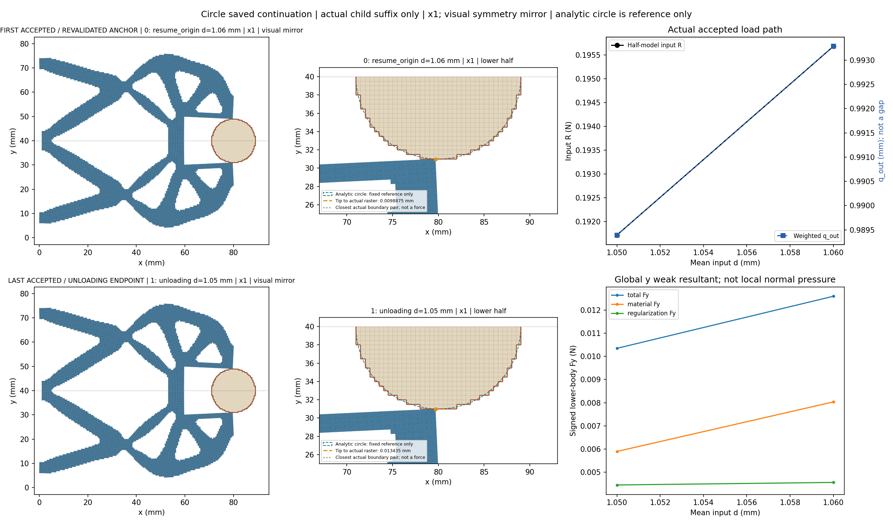
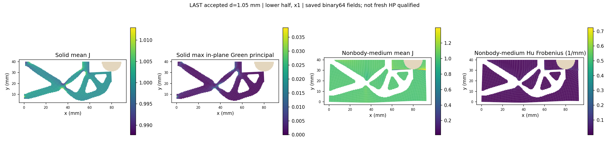
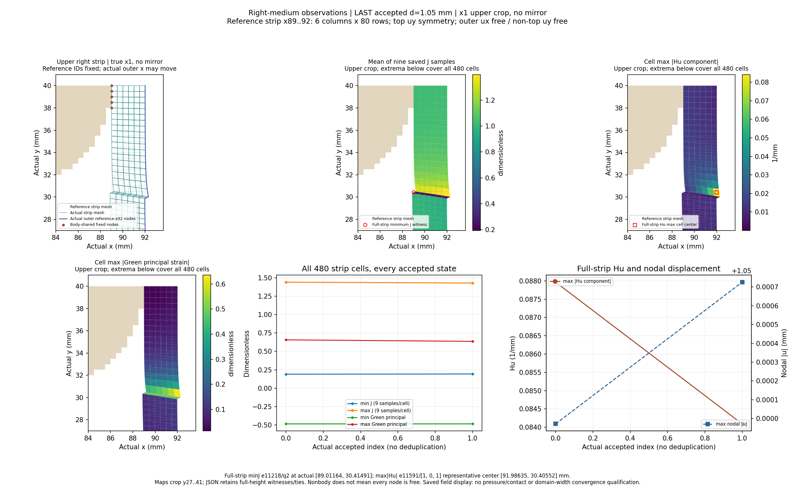
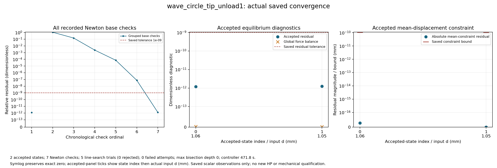
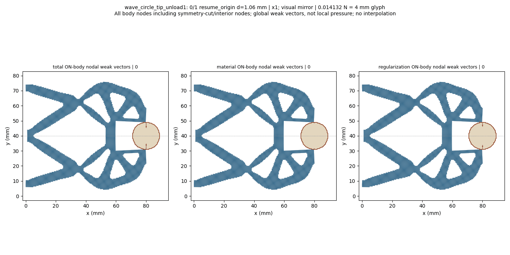

# L-CTIPUNLOAD1：最右尖端对向圆形工件的保存态延伸

2026-10-19；执行 **PASS**；图像QA `pass_root_visual_inspection`，本阶段完整完成 `True`。生产 `success`，helper `pass`，outer `pass`；实际停止阶段 `final_binding_and_seal`。

整体目标是把LF给出的夹持器几何接入独立、可恢复的高保真大变形/TMC有限元分析，逐步实现对工件接近、接触后的变形与作用力及卸载响应的可审查计算。结构优化、有效夹持判定和HF5标签尚不能由单段前向计算替代。

本轮做什么及原因：复用已安装保存态延伸接口，从已成功的1.06 mm状态重新核验平衡及SHA/有符号R，再执行唯一首次卸载目标1.05 mm。把path.kind从load_only显式改为ordered_cycle，input.target保持峰值1.06 mm；观察首次回程的实际结构、力、距离、介质与收敛，并与既有加载来源的同输入1.05 mm原值作描述性对照。未从零重放原加载前缀，也未改默认HF源码。

半径9 mm、圆心(80,40) mm、固定工件ux/uy、右域界92 mm、正则化长度80 mm保持；下半域92×40 mm、h=0.5 mm、厚20 mm、E=1 MPa、nu=0.3、plane strain、gamma=1e-6、alpha=5e-7及原支撑/平均端口/对称保持。完整任务[0,.25,.5,.75,.90,.95,.98,1.00,1.02,1.03,1.04,1.05,1.06]仅追加1.05，path.kind改为ordered_cycle、input.target保持1.06及四项说明身份；本次请求后缀[1.06,1.05]。

已完成及实际效果：保存接受态 `2`，helper回调 `2`。缺失保存结果记为null，实际二分增加的接受态全部保留。父结果SHA `3bdfd3acaf4487f0e3f485a0a8662d5bf1fc068a66f2920fe97599f46b406541` 与授权绑定一致，原成功与失败历史保留。

|child行|global目标|路段|d mm|输入R N|q_out mm|body Fy N|tip距离 mm|最近边界 mm|solid minJ|medium minJ|
|---:|---:|---|---:|---:|---:|---:|---:|---:|---:|---:|
|0|12|resume_origin|1.06|0.19568183324206792|0.9932854064102131|0.01259251473277105|0.009887524710265438|0.009887524710265438|0.9752281022523102|0.0009015839179744192|
|1|13|unloading|1.05|0.1917119776052677|0.9893918140696026|0.01034490624034115|0.013434644879971813|0.013434644879971813|0.9753318497649356|0.0032268105739974096|

|d mm|右介质 minJ|右介质 maxabsHu 1/mm|右条带最大节点位移 mm|relative residual|
|---:|---:|---:|---:|---:|
|1.06|0.18974899507733087|0.0879638885271623|1.0499713555912025|1.2062223948858234e-12|
|1.05|0.19270007749393137|0.08409066184842562|1.050725615894948|1.2377250350112658e-12|

同输入1.05 mm对照仅描述既有加载来源global11与本次卸载global13的原标量及差值；保旧摘要resume_origin原leg，不设相等门，不据差值授予可逆性、耗散或夹持资格。详细原值见[状态表](run_001/state_table.json)及人工页。

表中保留原数值。q_out是加权端口位移，不是表面间隙；输入R与工件合力为原下半模型数值。完整Fx/Fy的material/Hu/total分量、实际尖端及边界见证、分区极值与位置、原残差/约束界和整体平衡见[闭卡JSON](author/closure.json)及[显示摘要](run_001/view/wave_circle_tip_unload1/summary.json)。

原验收门 `{'production_residual': '1e-9', 'average_constraint': '1e-10', 'global_force_balance': '1e-6', 'fixed_displacement_mm': '8e-11'}`；缓存检查 `{'actual_accepted_states': 2, 'minimum_J': 0.0009015839179744192, 'maximum_fixed_split_sum_mm': 0.0, 'maximum_relative_residual': 1.2377250350112658e-12, 'native_constraint_bound_pass': True, 'maximum_relative_global_force_balance': 3.2021337433195704e-15, 'passed': True}`。生产调用 `{'force_calls': 12, 'force_calls_completed': 12, 'tangent_calls': 7, 'tangent_calls_completed': 7, 'solver_invocations': 1, 'JIT_calls': 0, 'HP_calls': 0}`；收敛计数 `{'accepted_states': 2, 'newton_base_checks': 7, 'inferred_check_groups': 2, 'line_search_trials': 5, 'line_search_accepted': 5, 'line_search_rejected': 0, 'failed_attempts': 0, 'linear_solves': 6, 'maximum_bisection_depth': 0, 'zero_newton_residuals': 0}`。API/solver/view等包装调用 `{'api_started': 1, 'solve_started': 1, 'solve_completed': 1, 'api_completed': 1, 'view_child_started': 1, 'view_child_completed': 1, 'convergence_plot_started': 1, 'convergence_plot_completed': 1}`。原门和非clock设置不变；minimum_increment=0.00625 mm保持，0.01 mm可直接尝试，若失败则半步0.005 mm低于原限值，按原规则停止。

路径实际标志 `{'path_kind': 'ordered_cycle', 'targets_mm': [1.06, 1.05], 'reached_displacement': 1.05, 'path_completed': True, 'loading_peak_reached': True, 'new_peak_reached': None, 'extended_segment_completed': None, 'task_target_executed': False, 'full_original_path_completed': False, 'full_extended_path_completed': False, 'unload_endpoint_reached': True}`。unload_endpoint_reached为true时只说明首次请求回程目标1.05完成，不代表回到零或自由释放；task_target_executed、full_original_path_completed、full_extended_path_completed保持false，完整加载前缀没有在child中执行。没有把本段PASS授予整条路径或独立参考。

图中实际坐标×1；完整结构和动画只作对称镜像，数值没有镜像加倍。尖端按唯一参考坐标(80,30)动态查找并跟随实际位移。unsigned Q1外露边界距离、相交/near-touch、跨区凸单元重叠和数值不确定性分别记录；正距离和非零弱力不能单独认定有效接触，完整包含关系/机构自重叠尚未验证。

右侧条带固定参考x89..92、6列480cells，保留实际位移后的外界与原顶uy约束。完整条带极值覆盖80行，局部图是上部裁剪；Green应变不换算为工程压缩百分比，cellwise Hu代表点不当作独立九点量。右条带最大节点位移不是尖端间隙；其极值节点可随状态切换，具体位置见原摘要。右侧场变化不能单独证明边界污染或域宽充分。

圆形工件表面的法向随位置变化；下半体材料/Hu/总Fx/Fy是有符号弱式合力，Hu也不能当作连续表面压力。因此本卡不授压力、有效夹持、完整卸载/自由释放、稳定性、网格/域宽收敛或HF5资格；本卡不新增HP，已有选定加载态参考保留其原范围，不转授当前卸载端点。

首次回程完成且原严格门、五图实际QA均通过；target6次Newton检查、5次线搜索全接受、无拒绝/失败/二分。tip/full-Q1距离由9.887525增至13.434645微米，全介质minJ由0.0009015839179744192增至0.0032268105739974096，下半工件Fy由0.01259251473277105降至0.01034490624034115 N。旧同输入1.05的13项标量差异很小，但SHA不同且未设相等门；这些是点对照，不是完整可逆性或滞回结论。已有原峰值1.06独立参考不转授新1.05态，不过目前没有具体错误要求增加一轮参考审计；继续小段实际卸载更符合功能目标。

实际1.05 mm末态R=0.1917119776052677 N、q_out=0.9893918140696026 mm（端口位移而非gap）、residual=1.2377250350112658e-12。bodyFy material/Hu=0.005895873236076284/0.004449033004264867 N。right480-cell minJ=0.19270007749393137、maxabsHu=0.08409066184842562/mm，而right最大节点位移1.050725615894948 mm相对峰值略增；不把所有观察量强设单调，也不将该量当tip距离。当前全介质极值位置没有重新定位，旧峰值位置不直接转授。

R同输入差-8.0491e-16N、mediumminJ差-9.0986e-15只是本次描述数据，没有创建等价阈值或新生产门。执行、实际LAST显示、同输入表及原窗口封存都已完成；仍没有压力、有效夹持或自由释放资格。

helper `487.55315800000244`/2700 s，outer `488.38901800000167`/2760 s；controller1800 s，显示共享600 s；进程树采样峰值 `885223424` B/64 GiB，清理 `True`。四库线程配置上限16，不等于实测16核利用率；pure viewer原内部8 GiB限制保持。

原窗口封存 `38` 个输出、`63649599` B；闭卡仅继承seal并核大小。实际审查 `pass_record_audit`，像素记录 `pass_root_visual_inspection`。新测试 `0`、默认安装 `0`、wrapper新HP `0`。

错误原值：helper `未提供`；API `未提供`；outer `未提供`。生产与显示阶段状态分开保留，不覆盖历史，不进行外部重试、修复重跑、延期、force、回滚或删除。












后续决策：建议下一阶段 L-CTIPUNLOAD2：复用既有ordered_cycle保存态延伸API，从本次成功1.05 mm末态仅继续卸载至1.00 mm，保持峰值1.06和完整前缀、原物理/设置/验收门；沿用已验证LAST显示并以既有普通JSON对照旧加载1.00标量。当前回程无具体数值矛盾需要例行新增HP，先推进这一项功能。该新目标和资源窗口须新明确授权，本轮未实施/执行，不自动展开后续卸载。

复核/恢复：主仓库origin保持https://github.com/dudaxing/Compliant-TO-TMC.git，后续开发在main。另一位置执行git clone该地址后，先读README、docs/CURRENT_STATUS.md、docs/RESUME_DEVELOPMENT.md及本卡RESULTS/NEXT_STEPS；依据仓库固定环境重建依赖，再核对protocol、author/authorization和保存态来源。不要重跑已关闭launcher或从显示数组重建锚；下一科学窗口使用公开evaluate_native(..., saved_result=..., selected_state_index=..., extend_path=True)和明确的新任务。

恢复起点命令（PowerShell；读取状态，不启动旧运行）：

```powershell
git clone https://github.com/dudaxing/Compliant-TO-TMC.git
git -C Compliant-TO-TMC status --short --branch
Get-Content -LiteralPath Compliant-TO-TMC/docs/RESUME_DEVELOPMENT.md
```

入口：[人工页](run_001/REVIEW.md) · [原结果](run_001/wave_circle_tip_unload1/result.json) · [原响应](run_001/wave_circle_tip_unload1/response.json) · [收敛记录](run_001/convergence/convergence.json) · [outer](step_launch.json) · [helper](run_001/execution_receipt.json) · [实际审查](author/ACTUAL_REVIEW.md) · [像素记录](author/pixel_QA.json) · [闭卡JSON](author/closure.json) · [后续](NEXT_STEPS.md)
