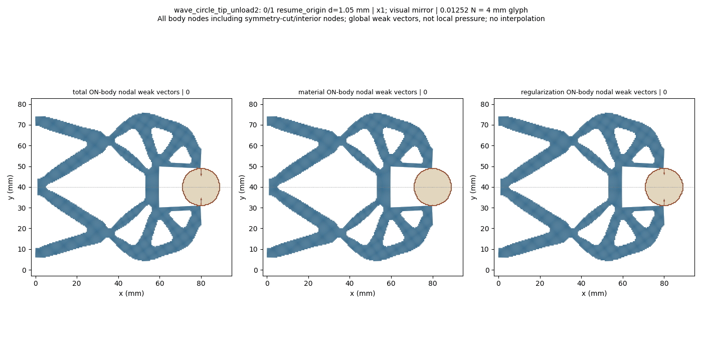
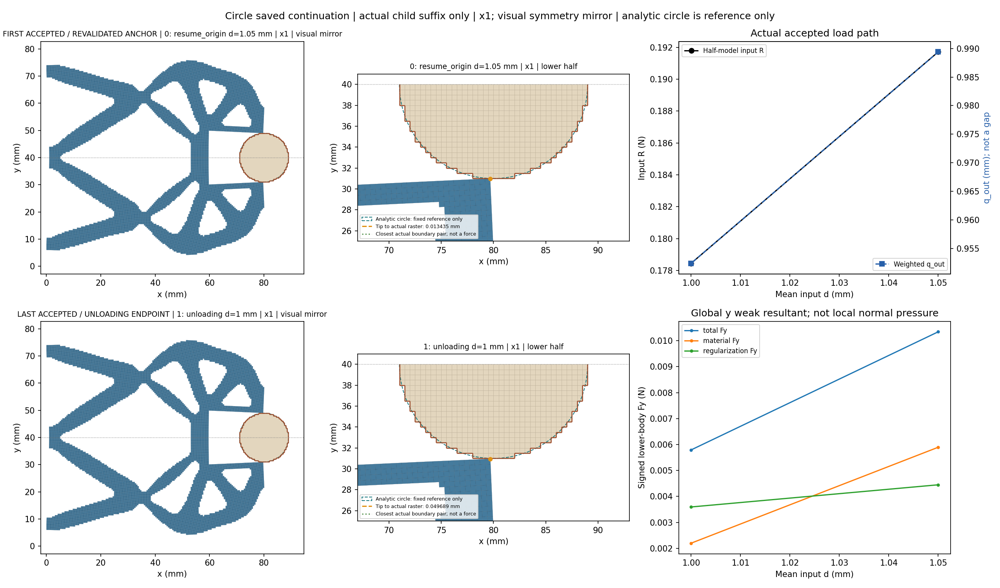
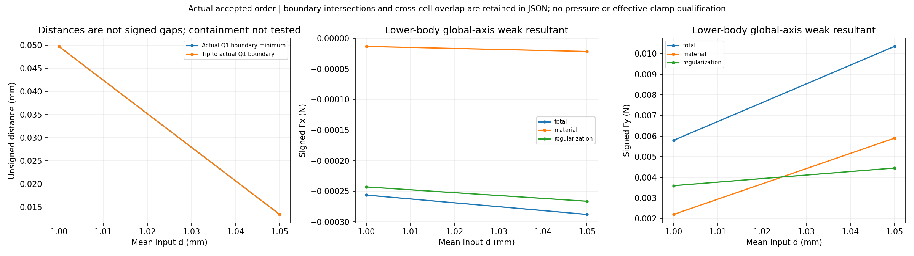
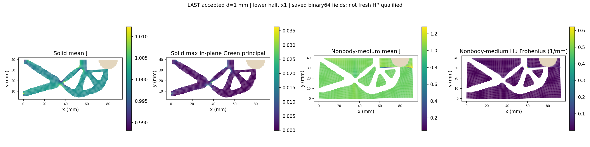
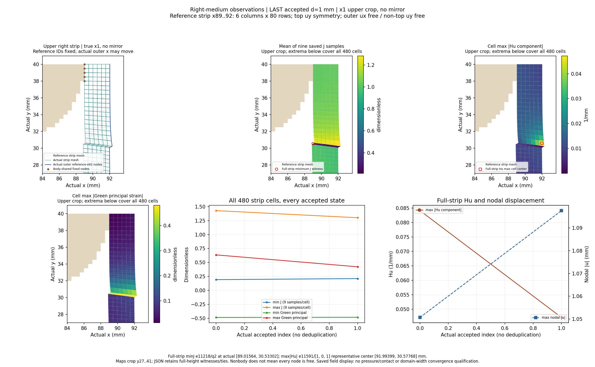
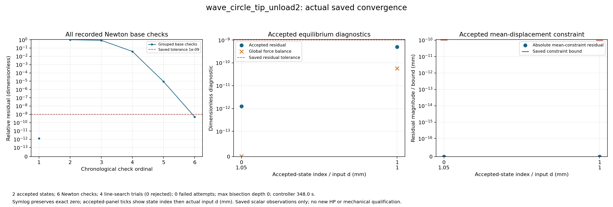

# Tip-facing circular workpiece saved extension: review

Solved lower-half wave mechanism, fixed raster circle r9 at (80,40) mm, on the92x40mm reference domain with Lr80mm. Coordinates x1; full-structure views and GIF use a visual symmetry mirror, while numerical tables retain the original lower-half values. All actual accepted states are shown, including controller bisections.

The boundary distance is unsigned between exposed Q1 edges; boundary intersection/near-touch and region overlap are separate observations. Containment is not tested. Weak-form body total includes material and Hu contributions; it is not qualified contact pressure or effective grip. Right-medium observations use the dynamically selected resident reference cells x89..92 (six columns,480cells) and the actual displaced x92 boundary; the tip is selected by reference(80,30), not an old node ID. Observations reuse the resident saved arrays; no additional physics arrays or domain-width convergence claim. Only the inherited unloading1.05mm anchor is freshly revalidated before the next unloading target1.00mm; the complete0/.25/.5/.75/.9/.95/.98/1.00/1.02/1.03/1.04/1.05/1.06/1.05 prefix is not replayed. This child segment does not visit the task peak1.06mm or qualify a complete unload/cycle, release, stability, independent HP or HF5 qualification.

[Response](wave_circle_tip_unload2/response.json) · [Result](wave_circle_tip_unload2/result.json) · [Exact rows](state_table.json) · [Viewer summary](view/wave_circle_tip_unload2/summary.json) · [Convergence JSON](convergence/convergence.json)

|index|leg|d (mm)|R input (N)|q out (mm)|body Fy total (N)|minimum Q1 boundary distance (mm)|
|---:|---|---:|---:|---:|---:|---:|
|0|resume_origin|1.05|0.1917119776052677|0.9893918140696026|0.01034490624034115|0.013434644879971813|
|1|unloading|1.0|0.17845354455643678|0.9524284256858055|0.00579420014046935|0.04968854151114499|

Same-input1.00 mm: STEP6 row0/global7 is an inherited loading state, recorded leg resume_origin; the new global14 row is unloading. Differences are descriptive only, with no equality gate or reversibility claim.

|metric|unit|loading source1.00|unloading1.00|unloading minus loading|
|---|---|---:|---:|---:|
|R_input_N|N|0.1784535445979535|0.17845354455643678|-4.15167344947065e-11|
|q_out_mm|mm|0.9524284255775324|0.9524284256858055|1.0827316820893884e-10|
|total_body_Fx_N|N|-0.00025622127133659403|-0.00025622127106209155|2.745024802082441e-13|
|total_body_Fy_N|N|0.0057942001574207685|0.00579420014046935|-1.6951418567445753e-11|
|material_body_Fx_N|N|-1.3298507356617854e-05|-1.3298507391046522e-05|-3.4428667192555953e-14|
|material_body_Fy_N|N|0.002199450898848834|0.0021994508888164535|-1.0032380308444555e-11|
|regularization_body_Fx_N|N|-0.0002429227639799762|-0.00024292276367104504|3.089311575651954e-13|
|regularization_body_Fy_N|N|0.0035947492585719338|0.0035947492516528955|-6.919038259001198e-12|
|tip_to_raster_boundary_mm|mm|0.04968854162278191|0.04968854151114499|-1.1163692192894814e-10|
|minimum_boundary_distance_mm|mm|0.04968854162278191|0.04968854151114499|-1.1163692192894814e-10|
|solid_min_J|1|0.9762585262778355|0.9762585262753055|-2.5299762285158067e-12|
|medium_min_J|1|0.03880995688549589|0.03880995637928876|-5.062071317674111e-10|
|medium_max_abs_Hu_per_mm|1/mm|0.3999404059653547|0.39994040542071757|-5.446371131867522e-10|
