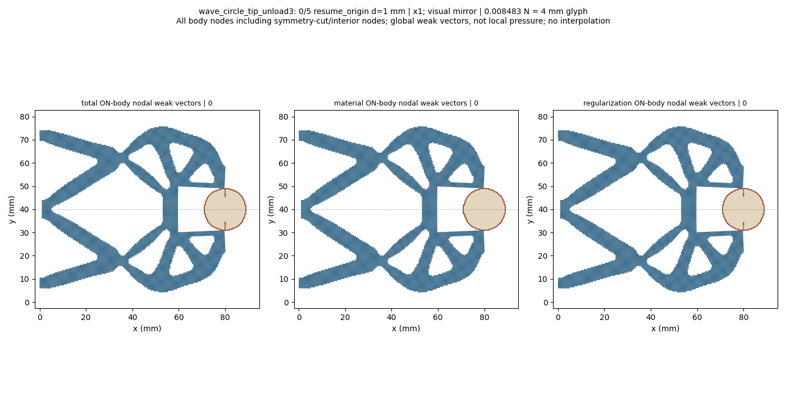
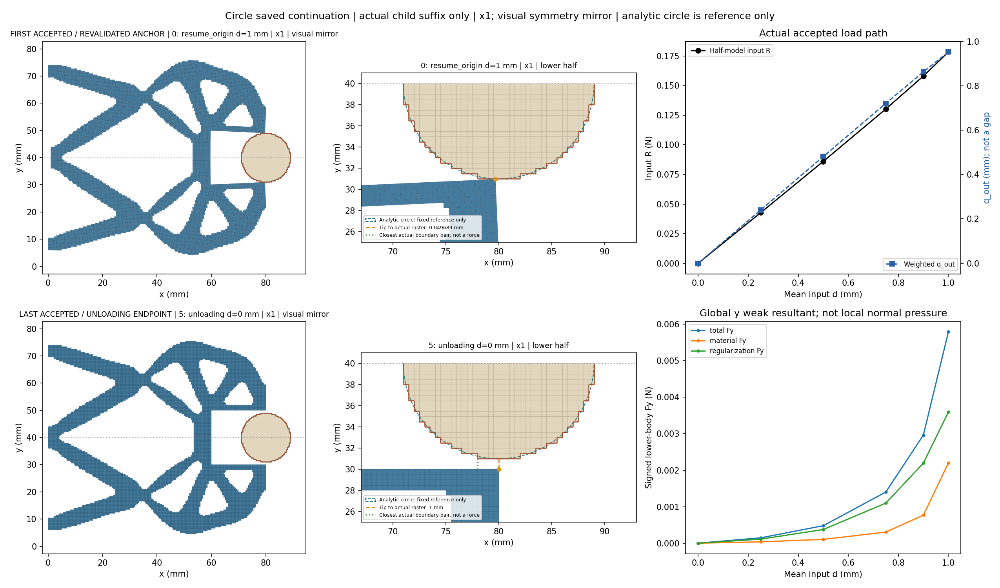
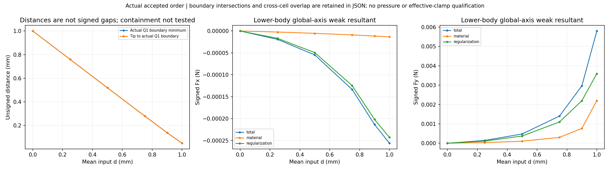
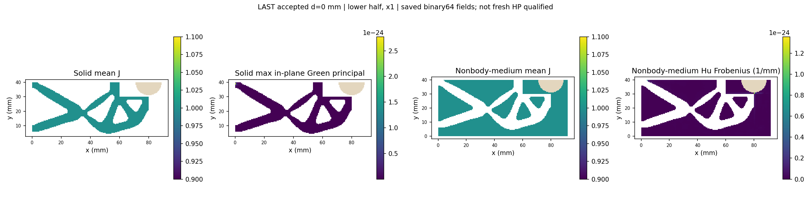
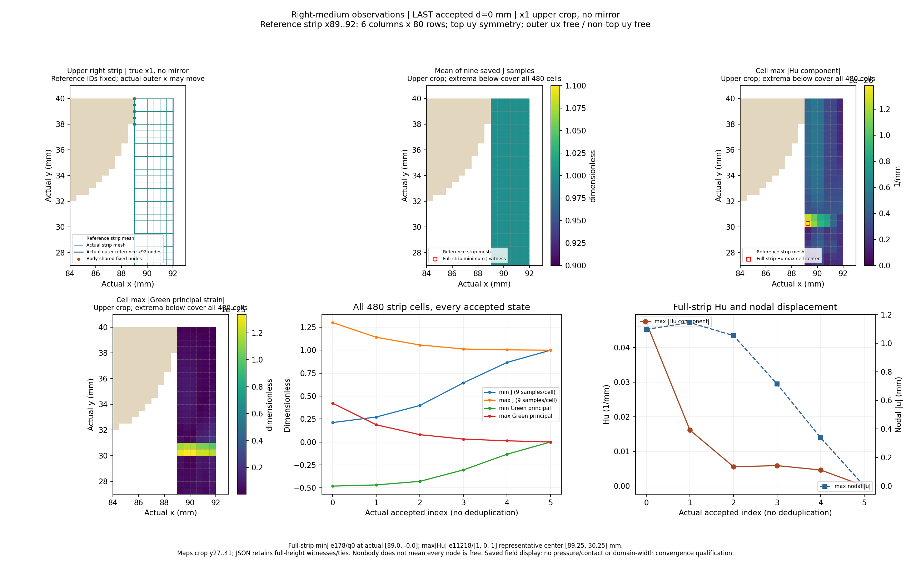
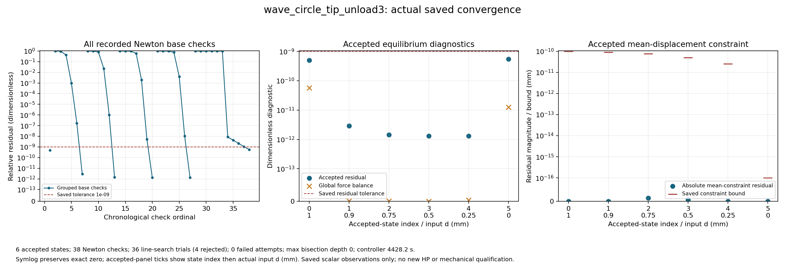

# Tip-facing circular workpiece saved extension: review

Solved lower-half wave mechanism, fixed raster circle r9 at (80,40) mm, on the92x40mm reference domain with Lr80mm. Coordinates x1; full-structure views and GIF use a visual symmetry mirror, while numerical tables retain the original lower-half values. All actual accepted states are shown, including controller bisections.

The boundary distance is unsigned between exposed Q1 edges; boundary intersection/near-touch and region overlap are separate observations. Containment is not tested. Weak-form body total includes material and Hu contributions; it is not qualified contact pressure or effective grip. Right-medium observations use the dynamically selected resident reference cells x89..92 (six columns,480cells) and the actual displaced x92 boundary; the tip is selected by reference(80,30), not an old node ID. Observations reuse the resident saved arrays; no additional physics arrays or domain-width convergence claim. Only the inherited unloading1.00mm anchor is freshly revalidated before the requested unloading targets0.90/0.75/0.50/0.25/0mm; the complete0/.25/.5/.75/.9/.95/.98/1.00/1.02/1.03/1.04/1.05/1.06/1.05/1.00 prefix is not replayed. This child segment does not visit the task peak1.06mm. Reaching zero means input completion only, without release, restored geometry or stability qualification, independent HP or HF5 qualification.

[Response](wave_circle_tip_unload3/response.json) · [Result](wave_circle_tip_unload3/result.json) · [Exact rows](state_table.json) · [Viewer summary](view/wave_circle_tip_unload3/summary.json) · [Convergence JSON](convergence/convergence.json)

|index|leg|d (mm)|R input (N)|q out (mm)|body Fy total (N)|minimum Q1 boundary distance (mm)|
|---:|---|---:|---:|---:|---:|---:|
|0|resume_origin|1.0|0.17845354455643678|0.9524284256858055|0.00579420014046935|0.04968854151114499|
|1|unloading|0.9|0.15807823081081884|0.8625531334711388|0.0029634728136028283|0.13886658198055812|
|2|unloading|0.75|0.13029373126695099|0.7209345473765181|0.0014019374851138356|0.27988491530854986|
|3|unloading|0.5|0.08602790333542186|0.48091445412449807|0.0004782806618354332|0.5193940639875763|
|4|unloading|0.25|0.04274353414710264|0.24018802342288847|0.00014591711519481153|0.7598854694338719|
|5|unloading|0.0|1.6317430051868603e-25|-8.903399720651071e-25|-1.0014711119833229e-28|1.0|

Same-input0 mm: pilot row0/global0 is the original origin state, recorded leg origin; the new global19 row is unloading. Differences are descriptive only, with no equality, recovery or reversibility gate/claim.

|metric|unit|origin0|unloading0|unloading minus origin|
|---|---|---:|---:|---:|
|R_input_N|N|0.0|1.6317430051868603e-25|1.6317430051868603e-25|
|q_out_mm|mm|0.0|-8.903399720651071e-25|-8.903399720651071e-25|
|total_body_Fx_N|N|0.0|2.743760408015235e-30|2.743760408015235e-30|
|total_body_Fy_N|N|0.0|-1.0014711119833229e-28|-1.0014711119833229e-28|
|material_body_Fx_N|N|0.0|5.2555845124385524e-30|5.2555845124385524e-30|
|material_body_Fy_N|N|0.0|-7.63565347238871e-29|-7.63565347238871e-29|
|regularization_body_Fx_N|N|0.0|-2.511824104423321e-30|-2.511824104423321e-30|
|regularization_body_Fy_N|N|0.0|-2.3790576474445087e-29|-2.3790576474445087e-29|
|tip_to_raster_boundary_mm|mm|1.0|1.0|0.0|
|minimum_boundary_distance_mm|mm|1.0|1.0|0.0|
|solid_min_J|1|1.0|1.0|0.0|
|medium_min_J|1|1.0|1.0|0.0|
|medium_max_abs_Hu_per_mm|1/mm|0.0|9.461787023894838e-25|9.461787023894838e-25|
