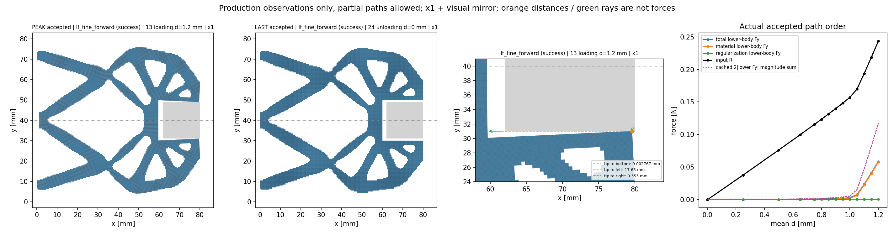
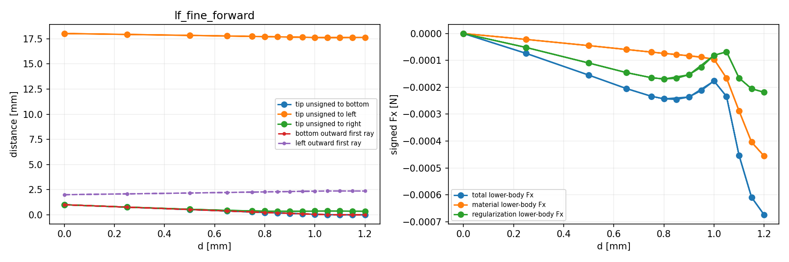
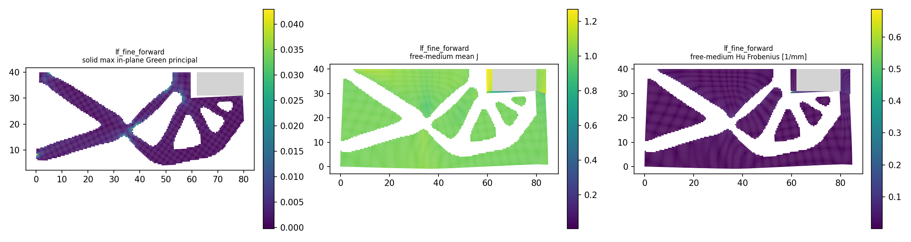

# L-FWD1 实际结果：PASS

真实执行源 main `e23a34b6fac803bab4be6bd35e980807291326c3`；原 source 卡与协议不改。本页只在唯一进程真正结束后，复制普通保存记录生成。当前结果不是已提交／已推送声明。

## 整体目标、已做工作与原因

整体目标是独立HF接收普通LF几何，分析有限变形／第三介质接触并返回位移、执行器反力、固定工件作用和可恢复状态供外部研究层消费。L-PREP1已完成输入准备；本步直接使用新gripper_native_fine派生几何，一次调用已安装evaluate_native，构模原门通过才从零完成原25目标。成功后原纯viewer独立进程显示，没有重写力核、求解器、默认源码或改变任务来取得通过。

E=1 MPa、nu=.3、厚20 mm、gamma=1e-6、alpha=5e-7、Lr80 mm，h=.5 mm、84×40 mm域及固定方体中心(71,40)/边18 mm保持。原task标签是模板历史，新LF拓扑不是旧几何的alpha单因素比较。显式mechanical/chunk256/port_projection及原settings，只新controller clock18000秒；所有25目标保持，N可含原内部二分接受态。

## 实际终态与可恢复响应

outer=pass／exit=0／invocations=1／stop=null（无停止原因）。helper保存状态=pass；若为running，它只是已结束进程留下的最后快照，不是live证据或终态计数。result保存接受态=25；原API response=success。原任务路径标志：`{"path_completed": true, "loading_peak_reached": true, "unload_endpoint_reached": true, "task_target_executed": true}`。实际model counts：`{"cells": 13440, "nodes": 13689, "dofs": 27378, "solid_cells": 4358, "medium_cells": 9082, "solid_incident_nodes": 4881, "fixed_dofs": 1546, "free_dofs": 25832}`。原failure：`null`。

[保存响应](run_001/lf_fine_forward/response.json)和[result](run_001/lf_fine_forward/result.json)只在实际存在时为恢复入口；失败若尚未构模或保存result，以上引用不表示文件必定存在。真实[启动记录](production_launch.json)、[helper收据](run_001/execution_receipt.json)和[独立终态审阅](author/independent_terminal_review.md)保留原状态。

| 接受序号 | 原目标 | leg | d mm | R N | q_out mm | total Fy N | 材料 Fy N | Hu Fy N | 全域 min J | 残差 |
| --- | --- | --- | --- | --- | --- | --- | --- | --- | --- | --- |
| 0 | 0 | origin | 0.0 | 0.0 | 0.0 | 0.0 | 0.0 | 0.0 | 1.0 | 0.0 |
| 1 | 1 | loading | 0.25 | 0.037854547374020546 | 0.23909665892141302 | 0.00013344193749676822 | 8.302589244641377e-05 | 5.04160450503545e-05 | 0.7598942257617486 | 1.4565460547696826e-12 |
| 2 | 2 | loading | 0.5 | 0.07624835727107876 | 0.4792732955273436 | 0.00034791873300466907 | 0.0002147193965801673 | 0.00013319933642450178 | 0.5177396181452025 | 1.4914221396596871e-12 |
| 3 | 3 | loading | 0.65 | 0.09964489401643574 | 0.6236175873090358 | 0.0005706905981692431 | 0.0003477627145265266 | 0.00022292788364271682 | 0.3718097672450691 | 1.5820230575762293e-12 |
| 4 | 4 | loading | 0.75 | 0.11547555266462388 | 0.7197181208181082 | 0.0008106409806487593 | 0.0004888091606311455 | 0.0003218318200176138 | 0.2746699196974146 | 1.5744390094082155e-12 |
| 5 | 5 | loading | 0.8 | 0.12349197544927787 | 0.7676450180454775 | 0.000980663982008471 | 0.0005900587697921685 | 0.0003906052122163018 | 0.22597422267043274 | 1.5745018683039579e-12 |
| 6 | 6 | loading | 0.85 | 0.1315994892772922 | 0.815426534744897 | 0.0012032207932244235 | 0.0007278235723269786 | 0.0004753972208974448 | 0.17705670472480037 | 1.5641509328689634e-12 |
| 7 | 7 | loading | 0.9 | 0.13982830002259447 | 0.8629832998645012 | 0.001505047235809303 | 0.0009295066362677686 | 0.0005755405995415344 | 0.12824572747094443 | 1.5210822225773129e-12 |
| 8 | 8 | loading | 0.95 | 0.14824318436446116 | 0.9101463091332906 | 0.001948089476714919 | 0.0012631846011087167 | 0.0006849048756062012 | 0.07994206601232197 | 1.4248540596487919e-12 |
| 9 | 9 | loading | 1.0 | 0.1570856627508772 | 0.9562882328478115 | 0.0027773810011731386 | 0.0019890256711860457 | 0.0007883553299870927 | 0.03332353401077178 | 1.4146595308367737e-12 |
| 10 | 10 | loading | 1.05 | 0.17001726317051954 | 0.9918014910526954 | 0.007747408704194757 | 0.00693850384186097 | 0.0008089048623337869 | 0.0006559681738243094 | 1.3564604955933843e-12 |
| 11 | 11 | loading | 1.1 | 0.1935034715249691 | 0.999646922646046 | 0.02352577169749422 | 0.022813379451641004 | 0.0007123922458532155 | 9.714643655993125e-05 | 1.3191496564683101e-12 |
| 12 | 12 | loading | 1.15 | 0.21840264448882726 | 1.0040020510120604 | 0.04082067991987402 | 0.04011853640466989 | 0.0007021435152041327 | 5.379020545824522e-05 | 1.8997449760597274e-11 |
| 13 | 13 | loading | 1.2 | 0.24365768726879147 | 1.0075199349775577 | 0.058511988483089014 | 0.057794579410338345 | 0.0007174090727506572 | 3.775081792887928e-05 | 1.6609071210827426e-12 |
| 14 | 14 | unloading | 1.15 | 0.21840264448883007 | 1.0040020510120526 | 0.040820679918698664 | 0.04011853640349446 | 0.0007021435152042035 | 5.379020545830729e-05 | 1.3068934038469725e-12 |
| 15 | 15 | unloading | 1.1 | 0.19350347152496913 | 0.999646922646046 | 0.023525771697494112 | 0.02281337945164089 | 0.0007123922458532223 | 9.714643655993198e-05 | 1.3149068996363668e-12 |
| 16 | 16 | unloading | 1.05 | 0.1700172631705196 | 0.9918014910526953 | 0.007747408704194823 | 0.006938503841861044 | 0.0008089048623337788 | 0.000655968173824588 | 1.3756365688756604e-12 |
| 17 | 17 | unloading | 1.0 | 0.1570856627508773 | 0.9562882328478113 | 0.0027773810011731603 | 0.0019890256711860613 | 0.0007883553299871001 | 0.033323534010771316 | 1.3959635173095306e-12 |
| 18 | 18 | unloading | 0.9 | 0.1398283000225944 | 0.8629832998645014 | 0.0015050472358093135 | 0.0009295066362677687 | 0.000575540599541545 | 0.12824572747094432 | 1.4881380222095078e-12 |
| 19 | 19 | unloading | 0.8 | 0.12349197544927784 | 0.7676450180454776 | 0.0009806639820084723 | 0.0005900587697921688 | 0.0003906052122163032 | 0.22597422267043263 | 1.5612058533559085e-12 |
| 20 | 20 | unloading | 0.75 | 0.1154755526646239 | 0.719718120818108 | 0.0008106409806487518 | 0.0004888091606311453 | 0.000321831820017607 | 0.2746699196974146 | 1.5491779393635195e-12 |
| 21 | 21 | unloading | 0.65 | 0.09964489401643577 | 0.6236175873090357 | 0.0005706905981692445 | 0.0003477627145265266 | 0.0002229278836427179 | 0.37180976724506937 | 1.6317196565634084e-12 |
| 22 | 22 | unloading | 0.5 | 0.07624835727107877 | 0.47927329552734366 | 0.0003479187330046682 | 0.00021471939658016735 | 0.00013319933642450078 | 0.5177396181452025 | 1.479952975076325e-12 |
| 23 | 23 | unloading | 0.25 | 0.03785454737402055 | 0.239096658921413 | 0.00013344193749676827 | 8.302589244641377e-05 | 5.04160450503545e-05 | 0.7598942257617487 | 1.4616110439338299e-12 |
| 24 | 24 | unloading | 0.0 | 2.2860557944094164e-25 | -9.354407277384072e-25 | -1.1990387348021945e-27 | -2.9106500903713792e-28 | -9.079737257650565e-28 | 1.0 | 5.532949669672032e-10 |

R是输入执行器ON-model的下半模型作用，q_out是加权输出端口位移。total/material/Hu Fy均为固定下半体ON-body有符号弱式合力；保持反力与之相反，镜像完整装配净力和2|Fy|幅值都不能替代局部总压力或合格夹持力。本表只复制已保存值，没有重新求力／积分／差值／比例。

## 实际显示与几何观察

[真实接受态N帧GIF](run_001/view/lf_fine_forward/actual_states.gif)；仅链接已封存产物，未再次解码。

| 序号 | d mm | tip→bottom mm | tip→left mm | tip→right mm | bottom ray mm | left ray mm | free-medium min J | free-medium max abs(Hu) 1/mm |
| --- | --- | --- | --- | --- | --- | --- | --- | --- |
| 0 | 0.0 | 1.0 | 18.027756377319946 | 1.0 | 1.0 | 2.0 | 1.0 | 0.0 |
| 1 | 0.25 | 0.7609740342266491 | 17.936878959625197 | 0.7650916906251986 | 0.7609740342266491 | 2.0803634688726382 | 0.7598942257617486 | 0.04613415269457058 |
| 2 | 0.5 | 0.5210256544012282 | 17.840824661045463 | 0.5470694401513428 | 0.5210256544012282 | 2.1664442450161507 | 0.5177396181452025 | 0.10938534271098471 |
| 3 | 0.65 | 0.37692913907750736 | 17.78095239372128 | 0.4379770001899965 | 0.37692913907750736 | 2.2206976696331515 | 0.3718097672450691 | 0.15986198992108958 |
| 4 | 0.75 | 0.2810689026719011 | 17.740287251219424 | 0.38420307679718885 | 0.2810689026719011 | 2.2578454068528533 | 0.2746699196974146 | 0.2009213992165979 |
| 5 | 0.8 | 0.23329464731239824 | 17.71979195848783 | 0.36579501751985305 | 0.23329464731239824 | 2.276675252698332 | 0.22597422267043274 | 0.22416751919871103 |
| 6 | 0.85 | 0.18569392086632774 | 17.69923126746385 | 0.35430353578318224 | 0.18569392086632774 | 2.295648534379253 | 0.17705670472480037 | 0.24935753675934091 |
| 7 | 0.9 | 0.1383524271912897 | 17.678657135649075 | 0.3503581879430696 | 0.1383524271912897 | 2.3147302671987533 | 0.12824572747094443 | 0.2763626739460837 |
| 8 | 0.95 | 0.09144795885358903 | 17.658180899139886 | 0.35406915424609026 | 0.09144795885358903 | 2.33384012985662 | 0.07994206601232197 | 0.3048368264257365 |
| 9 | 1.0 | 0.04562916310277387 | 17.638220568545847 | 0.3647041069820916 | 0.04562916310277387 | 2.3526632835049037 | 0.03332353401077178 | 0.3346437877677385 |
| 10 | 1.05 | 0.01103329834709399 | 17.625348321564648 | 0.37481755756661883 | 0.01103329834709399 | 2.3663974771113474 | 0.0006559681738243094 | 0.36804539399761516 |
| 11 | 1.1 | 0.005820361679170105 | 17.631224130635253 | 0.3688227582487243 | 0.005820361679170105 | 2.366608205574562 | 9.714643655993125e-05 | 0.41294477478865754 |
| 12 | 1.15 | 0.003889368629174328 | 17.638987691976762 | 0.3610336872603255 | 0.003889368629174328 | 2.365152890779659 | 5.379020545824522e-05 | 0.43236659856840254 |
| 13 | 1.2 | 0.002767290909318376 | 17.64705999104797 | 0.35295107447852603 | 0.002767290909318376 | 2.363404966636846 | 3.775081792887928e-05 | 0.43816062190479066 |
| 14 | 1.15 | 0.0038893686291814333 | 17.638987691976777 | 0.3610336872603113 | 0.0038893686291814333 | 2.365152890779658 | 5.379020545830729e-05 | 0.4323665985683257 |
| 15 | 1.1 | 0.005820361679170105 | 17.631224130635253 | 0.3688227582487243 | 0.005820361679170105 | 2.366608205574562 | 9.714643655993198e-05 | 0.41294477478865743 |
| 16 | 1.05 | 0.01103329834709399 | 17.625348321564648 | 0.37481755756661883 | 0.01103329834709399 | 2.3663974771113474 | 0.000655968173824588 | 0.3680453939976157 |
| 17 | 1.0 | 0.04562916310277387 | 17.638220568545847 | 0.3647041069820916 | 0.04562916310277387 | 2.3526632835049037 | 0.033323534010771316 | 0.33464378776773795 |
| 18 | 0.9 | 0.1383524271912897 | 17.678657135649075 | 0.3503581879430696 | 0.1383524271912897 | 2.3147302671987533 | 0.12824572747094432 | 0.27636267394608405 |
| 19 | 0.8 | 0.23329464731239824 | 17.71979195848783 | 0.36579501751985305 | 0.23329464731239824 | 2.276675252698332 | 0.22597422267043263 | 0.22416751919871114 |
| 20 | 0.75 | 0.2810689026719011 | 17.740287251219424 | 0.38420307679718885 | 0.2810689026719011 | 2.2578454068528533 | 0.2746699196974146 | 0.20092139921659757 |
| 21 | 0.65 | 0.37692913907750736 | 17.78095239372128 | 0.4379770001899965 | 0.37692913907750736 | 2.2206976696331515 | 0.37180976724506937 | 0.15986198992108958 |
| 22 | 0.5 | 0.5210256544012282 | 17.840824661045463 | 0.5470694401513428 | 0.5210256544012282 | 2.1664442450161507 | 0.5177396181452025 | 0.10938534271098477 |
| 23 | 0.25 | 0.7609740342266491 | 17.936878959625197 | 0.7650916906251986 | 0.7609740342266491 | 2.0803634688726382 | 0.7598942257617487 | 0.04613415269457061 |
| 24 | 0.0 | 1.0 | 18.027756377319946 | 1.0 | 1.0 | 2.0 | 1.0 | 7.005905253715333e-25 |

纯viewer只从新model/state/forces观察，未提供reference。距离是参考(80,30)节点到有限表面的无符号距离；射线null表示无交点，不能当零间隙。绿色射线和距离虚线为几何见证，不是力。镜像只用于显示；全域minJ与自由介质minJ、全域max分量Hu与图示Hu Frobenius范围不同。加载与卸载采样不完全相同，连线分离不能单独证明滞回。新GIF只记录原viewer全N帧，闭窗不再次解码；root原PNG一次QA记录见[像素记录](author/pixel_QA.json)，不存在时不宣称检查完成。

## 原门、计数、资源与身份封存

原cached gates：`{"actual_accepted_states": 25, "minimum_J": 3.775081792887928e-05, "maximum_fixed_split_sum_mm": 0.0, "maximum_relative_residual": 5.532949669672032e-10, "native_constraint_bound_pass": true, "maximum_relative_global_force_balance": 1.2987962345362044e-11, "passed": true}`。计数原值：`{"api_started": 1, "api_completed": 1, "model_started": 1, "model_completed": 1, "solve_started": 1, "solve_completed": 1, "force_started": 389, "force_completed": 347, "tangent_started": 183, "tangent_completed": 183, "save_started": 1, "save_completed": 1, "summary_started": 1, "summary_completed": 1, "view_child_started": 1, "view_child_completed": 1}`。F/T开始与完成分开，原invalid_J／回溯／二分属于内部试探，不能当外部重跑；监测只限NativeMean既有别名。

controller18000／helper19000／outer19060秒、viewer最多600共享helper剩余、采样8GiB。outer实际12922.065238300012秒／childwall12921.52755639999秒／treeRSS1931960320B；helper实际12920.589909099974秒／RSS1936846848B。合作stop和真实child wait，非OS硬cap，无force或延期；旧UTC解析的负耗时不作运行计时证据。

all66bindings unchanged原记录=True；seal=complete_inside_original_helper_window。科学产物身份只继承本次闭helper outputs+stat，闭窗不补数组、CSV、PNG或GIF hash/header/decode。unsealed partial路径：`[]`；若有身份缺口，出版工具必须停止，文档不会虚构完整封存。损坏普通JSON原字节仍保留，解析问题：`[]`；不将其当成已观察结果。

没有新HP、测试、默认安装、LF重转换或优化。独立参考／局部总压力／有效夹持／释放／稳定性／HF5均不升级，MPM未实现。完整输入回零只说明真实输入端点达到；构模或路径失败不被partial cached门掩盖。旧失败／旧HP／source era历史保持。

## 下一步

完整新LF前向生产和实际显示已通过；下一步依据本次真实峰值／关键卸载保存态准备独立HP80/120范围与新资源卡，不能搬移旧几何HP，也不重做已完成接口或完整路径。
