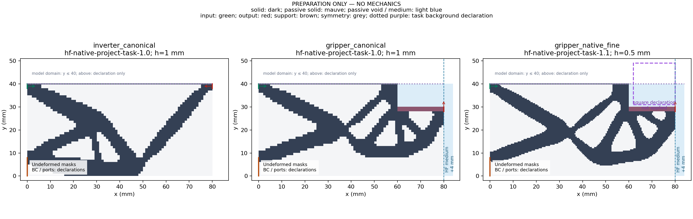

# L-PREP1 实际结果：PASS

2026-10-14（Asia/Seoul）。直接批准原文为“批准按 L-PREP1 卡执行”；授权执行来源 main `004efde5b2b9952bc4a9e6c7e756b8a520f24cde`。本页记录一次真实执行及封存，不改写原源准备卡和此前失败／参考历史。

## 整体目标、本步工作与作用

整体目标是独立 HF 接收普通 LF 几何，执行 TMC 非线性前向评价并给外部研究层可比较的响应。现有求解、续算／延伸及保存态显示已落地；本步处理输入接线，复用原 LF v2 转换、显式右扩域和任务校验，减少手工更新 geometry ID／SHA 的错误。

一次安装两个全新默认入口，并实际完成三个输入准备及九个有限反例。返回几何、任务和 manifest 路径；原 LF 四掩码、尺寸、h、端口和单位精确保留。两个夹持器仅新增4 mm passive_void列，其他任务字段与显式模板完全相等。原默认代码及力核、切线、门、已保存结果保持。

## 实际结果与可恢复文件

| 输入 | 调用与任务 | h (mm) | 最终数组 shape_yx | 物理域 (mm) | 原列以外新增 |
| --- | --- | --- | --- | --- | --- |
| inverter_canonical | API／task1.0 | 1 | [40,80] | 80×40 | 0 |
| gripper_canonical | API／task1.0 | 1 | [40,84] | 84×40 | 4列 passive_void |
| gripper_native_fine | 已安装 CLI 的 __main__／task1.1 | 0.5 | [80,168] | 84×40 | 8列 passive_void |

三个 case 的 mask_exact／task_non_geometry_exact 均为 true。API分别核显式 repo_root（mock 不同 cwd）和默认实际 cwd；CLI使用真实 argv／stdout／SystemExit0，同解释器 runpy 入口通过，不声称新解释器启动测试。fine 原二十五目标、square(71,40)／side18 mm、E／γ／α／Lr和所有非geometry字段保持，本卡未执行该路径。

九个负例全部按预期拒绝：bool、NaN、Inf、负宽度、非整列宽度、已有输出、family不符、descriptor pin不符、非法task schema。已有输出哨兵不变；非整列例只用 mock converter 写普通 stub descriptor，保 partial，不读取数组，不冒称真实转换异常试验。

三份 [输入 manifest](run_001/cases/inverter_canonical/input_manifest.json)／[canonical manifest](run_001/cases/gripper_canonical/input_manifest.json)／[fine manifest](run_001/cases/gripper_native_fine/input_manifest.json) 提供 case 相对输出与 LF 快照位置、原模板SHA及几何身份。跨机器应携带整个 case，重新以新 case 根解析相对路径；执行记录中的绝对路径仅为本机历史。LF 快照位于 native_geometry/sources，原扩域 metadata 的继承 provenance 不重写，以 input_manifest 的快照位置为准。

## 一次实际显示

三个面板使用一致 mm 尺度：深色为原实体，紫褐为 passive_solid，浅蓝为 passive_void／medium，两个右侧4 mm新增域可辨。绿色输入／红色输出箭头只表示声明的参考方向。fine 的虚线 square 是模板声明，工件未应用；y≤40是实际材料域，上方为声明显示。标题明确 preparation only／no mechanics。一次原分辨率像素检查通过，没有重绘或读取旧媒体。

## 资源、读取、封存及独立核对

唯一外层真实进程 session77371，从初始 chunk74b7f0 经同一 handle 的 terminal chunk0caf80 结束，exit0；invocations1、stop_reason=null。实际 outer21.479693799978122秒，childwall16.109152899996843秒，helper记录7.938718400022481秒；采样进程树峰值166240256字节，均在原180／240秒、8 GiB额度内。这些计时范围不同，全部原值保存。

两安装／三准备／两API／一CLI／九反例／三对账／十一个loader／一图的 started=completed。实际观测八个不同decoded NPZ；四十四字段读取是原源码清单的静态依据（field_reads_monitored=false），不冒称逐字段动态监测。另有三份原字节 LF snapshot NPZ，不解码。

helper在原窗口内封存30产物、276693字节，其中8NPZ／1PNG，其余普通记录；execution_receipt自身另存。所有23源绑定保持。闭窗后仅普通证据核对、新二进制producer身份＋stat，以及卡允许的一次新PNG像素查看；不补科学hash、解码、测试或图。独立终态审阅通过，详见 [审阅报告](author/independent_terminal_review.md)、[真实执行回执](run_001/execution_receipt.json) 和 [启动记录](preparation_launch.json)。

## 默认入口与资格边界

已安装 [prepare_native_lf_inputs](../../../hf_repo/src/hf_eval/lf_native_inputs.py)（148行）及 [CLI](../../../hf_repo/scripts/prepare_native_lf_inputs.py)（31行），与冻结候选同字节。准备参数只支持有限int／float／None，不接受bool；正宽度必须为原dx整数列数，无新阈值、重采样、细分或LF优化。原 `__init__.py` 及其他既有源码保持。

本步没有构模／F／T／HP／平衡求解，机械hooks没有动态插桩；零调用范围由已审源码与实际路径限定。准备PASS不能代替工件／网格／约束构模兼容、接触压力、有效夹持、稳定性、完整路径或HF5资格。MPM尚未实现，也未生成批量标签或排名。

下一步应复用本步真实准备包，做最小的实际前向接线：先核明确几何与任务能构模，再由现有evaluate_native取得反力、位移和实际变形。根据该结果规划下个阶段，不重做转换器或已闭参考。
