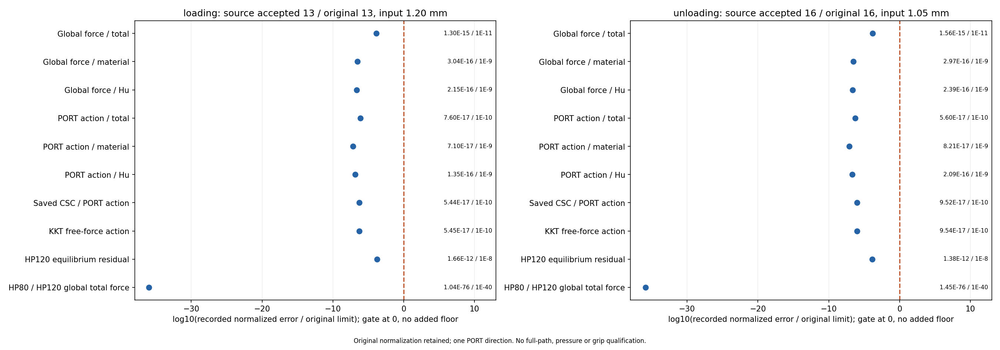

# L-REF1实际闭卡：PASS

2026-10-15记录；计算于2026-10-14 23:49–23:53（Asia/Seoul）完成。用户直接批准后，root观察唯一session53525实际终态；源`799bdc9709fa2fc92f573f3801b243f24e370983`、协议`d6512016bc169183e6f857d0bab18185aa66e1aec3847ccbdb30a9450b9a2125`。outer=pass，helper=pass，实际tool exit=0。本记录来自普通保存摘要和独立实际审阅；本writer未读取科学或媒体字节，发布另由真实commit/push/恢复回执确认。

整体目标是HF独立读取LF普通几何，在一致任务下提供非线性/TMC反力、位移、固定工件弱式合力和保存变形，供外部研究层比较；HF不优化、不调用dmftd。L-PREP1已准备真实LF输入；L-FWD1已完成25目标0→1.20→0 mm及变形显示。本步核最接近工件的峰值accepted13/loading1.20 mm，以及作用衰减段accepted16/unloading1.05 mm，避免重复平衡求解。

本步实际PASS。复用原B850/aa86数学方法、11依赖、同13440单元/27378DOF、三力和同一PORT方向切线、CSC/KKT与工件投影；物理参数、生产settings与十五门保持。实际完成记录如下；缺失记录为null，未从空行表发明0计数：

```json
{
  "HP_calls_started": 4,
  "HP_calls_completed": 4,
  "accepted_mechanical_states_completed": 2,
  "workpiece_states_completed": 2,
  "checks_completed": 161528,
  "plot_started": 1,
  "plot_completed": 1,
  "JAX_module_loaded": true,
  "AD_or_JIT_calls_by_wrapper": 0
}
```

| accepted/original | leg | d mm | R N | qin mm | qout mm | total Fx N | total Fy N | material Fx N | material Fy N | Hu Fx N | Hu Fy N | 原tip-to-bottom mm |
| --- | --- | --- | --- | --- | --- | --- | --- | --- | --- | --- | --- | --- |
| 13 | loading | 1.2 | 0.24365768726879147 | 1.2 | 1.0075199349775577 | -0.0006742600875024061 | 0.058511988483089014 | -0.0004558545974952895 | 0.057794579410338345 | -0.00021840549000711666 | 0.0007174090727506572 | 0.002767290909318376 |
| 16 | unloading | 1.05 | 0.1700172631705196 | 1.05 | 0.9918014910526953 | -0.00023421537140910727 | 0.007747408704194823 | -0.00016610321752466461 | 0.006938503841861044 | -6.811215388444269e-05 | 0.0008089048623337788 | 0.01103329834709399 |

以上R/q、signed下半工件Fx/Fy及有限尖端距离复制自L-FWD1普通result/view相同state SHA行。工件力是固定体弱式节点合力，包含材料与Hu，不是连续压力或有效夹持力；距离沿用原viewer几何诊断，本卡没有新变形图或GIF。

| accepted/original | 显示项 | 原normalized error | 原limit | 原pass gate |
| --- | --- | --- | --- | --- |
| 13 | Global force / total | 1.300591E-15 | 1.000000E-11 | True |
| 13 | Global force / material | 3.042677E-16 | 1.000000E-9 | True |
| 13 | Global force / Hu | 2.153193E-16 | 1.000000E-9 | True |
| 13 | PORT action / total | 7.601326E-17 | 1.000000E-10 | True |
| 13 | PORT action / material | 7.103292E-17 | 1.000000E-9 | True |
| 13 | PORT action / Hu | 1.349576E-16 | 1.000000E-9 | True |
| 13 | Saved CSC / PORT action | 5.437545E-17 | 1.000000E-10 | True |
| 13 | KKT free-force action | 5.449893E-17 | 1.000000E-10 | True |
| 13 | HP120 equilibrium residual | 1.660929E-12 | 1.000000E-8 | True |
| 13 | HP80 / HP120 global total force | 1.044813E-76 | 1.000000E-40 | True |
| 16 | Global force / total | 1.564447E-15 | 1.000000E-11 | True |
| 16 | Global force / material | 2.965875E-16 | 1.000000E-9 | True |
| 16 | Global force / Hu | 2.391882E-16 | 1.000000E-9 | True |
| 16 | PORT action / total | 5.599140E-17 | 1.000000E-10 | True |
| 16 | PORT action / material | 8.214645E-17 | 1.000000E-9 | True |
| 16 | PORT action / Hu | 2.085823E-16 | 1.000000E-9 | True |
| 16 | Saved CSC / PORT action | 9.524656E-17 | 1.000000E-10 | True |
| 16 | KKT free-force action | 9.538215E-17 | 1.000000E-10 | True |
| 16 | HP120 equilibrium residual | 1.375625E-12 | 1.000000E-8 | True |
| 16 | HP80 / HP120 global total force | 1.446322E-76 | 1.000000E-40 | True |

显示项仅格式化原误差字符串，未重算数学门。十项显示不替代十五门；原分母/floor与完整精度在本次普通raw摘要，工件误差不解释为Fy百分比。原十五门如下：

```json
{
  "production_residual": "1e-9",
  "independent_residual": "1e-8",
  "force_evaluation": "1e-9",
  "average_constraint": "1e-10",
  "global_force_balance": "1e-6",
  "fixed_displacement_mm": "8e-11",
  "hp80_hp120": "1e-40",
  "total_force": "1e-11",
  "material_force": "1e-9",
  "regularization_force": "1e-9",
  "total_tangent": "1e-10",
  "material_tangent": "1e-9",
  "regularization_tangent": "1e-9",
  "augmented_force_tangent": "1e-10",
  "augmented_constraint_tangent": "1e-10"
}
```



实际root像素QA（成功时恰一次original检查，不补画）：

```json
{
  "card": "L-REF1",
  "status": "pass_observation_only",
  "scope": "One authorized visual inspection of the one new PNG; no redraw or new scientific evaluation",
  "path": "lf_data_preparation/native_interface_001/lf_reference_001/run_001/reference/reference_observations.png",
  "inspection_calls": 1,
  "tool": "tools.view_image",
  "detail": "original",
  "both_panels_readable": true,
  "source_indices_displayed": [
    13,
    16
  ],
  "targets_mm_displayed": [
    1.2,
    1.05
  ],
  "entries_per_panel": 10,
  "labels_units_and_gate_visible": true,
  "all_displayed_error_ratios_left_of_zero_gate": true,
  "scientific_acceptance_derived_from_pixels": false,
  "source": "Actual root view_image result in this approved execution turn",
  "scientific_gzip_NPZ_CSV_read_or_hashed_after_window": false,
  "post_window_PNG_hash_computed": false,
  "full_path_pressure_or_clamping_qualification_added": false
}
```

原合同helper900/outer960秒、采样8GiB；实际helper回执236.08301380003104秒，child终端墙钟238.16885169997113秒，outer246.24258319998626秒，树采样峰1279688704B。采样/合作stop不是OS硬上限。继承依赖可能导入注册JAX，wrapper AD/JIT调用按实际生命周期记录，不声称未导入。新生产F/T、solver、API、测试、安装、外部重试/修复/延期/force均未执行；闭窗不补科学hash或解码。

通过只取得这两态4次HP80/120与原方向参考。原L-FWD1结果/response及25目标完成状态保持；full25参考、全部切线列、压力、有效夹持、自由工件释放、稳定性、一般LF/HF5资格均不升级，public API reference仍not_provided。历史失败各归原source/result，不拼接资格。

下一步优先复用现有摘要API，关联同L-FWD1完整25生产态、这两态4HP和已有变形媒体，便于外部研究层调用；完整25态参考仍为false，不新增求解、HP或压力资格，并另拟具体执行卡。当前两态严格PASS支持进入这一步，无须重复旧数学审计。闭卡剩余墙钟不是许可。

```json
{
  "outer_stop_reason": null,
  "outer_failure": null,
  "helper_error": null,
  "final_write_stop": null,
  "output_identity_seal": "complete_inside_original_helper_window",
  "unavailable_ordinary_records": {}
}
```

[原峰值摘要](run_001/reference/accepted_013/summary.json) · [原卸载摘要](run_001/reference/accepted_016/summary.json) · [顶层摘要](run_001/reference/summary.json) · [执行回执](run_001/reference/execution_receipt.json) · [独立审阅](author/independent_terminal_review.md) · [root终态](author/root_terminal_confirmation.json) · [具体卡](L-REF1_CARD.md) · [原LF前向结果](../lf_forward_001/RESULTS.md)。
