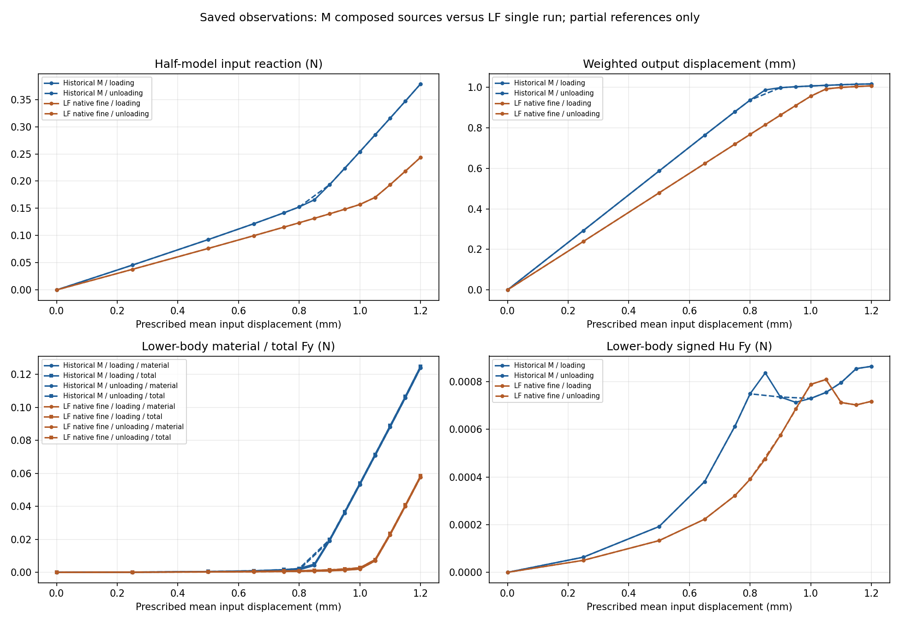
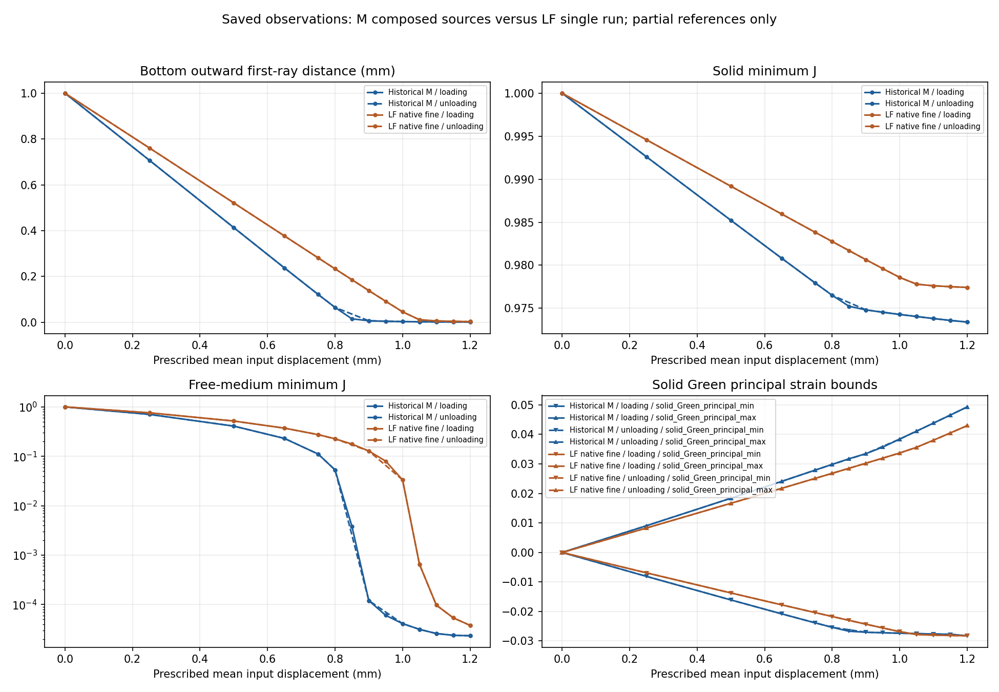

# 已有两设计：同任务保存态对照

目标是让外部研究层比较已有物理响应；本次只读取普通JSON并画标量，没有重新求解或计算参考。
两例同h0.5、84×40 mm域、E1 MPa、nu0.3、厚20 mm、gamma1e-6、alpha5e-7、Lr80 mm、固定side18方体center(71,40)。
Historical M是五段保存观测，原加载failed/time_limit保留；LF是一次完整25目标生产。两者不是全路径同源码实验或正式排名。

Signed fixed lower-body weak-form resultants; material and Hu retained; no pressure or effective-clamp qualification
Saved viewer bottom_first_ray_mm: first ray along the finite bottom-face outward normal; not node-window clearance or tip_to_bottom_mm
Saved global minimum_J, solid_min_J and free-medium medium_min_J remain separate; Green principal bounds belong to solid

读取后的50条原值及25对身份保存在 [comparison.json](comparison.json)。没有派生差值、比例、压力或接触门。

| 目标 | 路段 | d mm | M R N | LF R N | M qout mm | LF qout mm | M total Fy N | LF total Fy N |
|---:|---|---:|---:|---:|---:|---:|---:|---:|
| 0 | origin | 0 | 0 | 0 | 0 | 0 | 0 | 0 |
| 1 | loading | 0.25 | 0.04566571116 | 0.03785454737 | 0.2927993097 | 0.2390966589 | 0.0001699658217 | 0.0001334419375 |
| 2 | loading | 0.5 | 0.09253330651 | 0.07624835727 | 0.5872328829 | 0.4792732955 | 0.0004992322814 | 0.000347918733 |
| 3 | loading | 0.65 | 0.1216258354 | 0.09964489402 | 0.7636240549 | 0.6236175873 | 0.0009607329068 | 0.0005706905982 |
| 4 | loading | 0.75 | 0.1418548575 | 0.1154755527 | 0.8799478056 | 0.7197181208 | 0.001642869042 | 0.0008106409806 |
| 5 | loading | 0.8 | 0.1525438535 | 0.1234919754 | 0.9368588284 | 0.767645018 | 0.002345158866 | 0.000980663982 |
| 6 | loading | 0.85 | 0.1656818482 | 0.1315994893 | 0.9873593769 | 0.8154265347 | 0.005023464048 | 0.001203220793 |
| 7 | loading | 0.9 | 0.1934133655 | 0.1398283 | 0.9983217851 | 0.8629832999 | 0.01984300446 | 0.001505047236 |
| 8 | loading | 0.95 | 0.223498809 | 0.1482431844 | 1.003190104 | 0.9101463091 | 0.03669623264 | 0.001948089477 |
| 9 | loading | 1 | 0.2541367335 | 0.1570856628 | 1.006721866 | 0.9562882328 | 0.05401566115 | 0.002777381001 |
| 10 | loading | 1.05 | 0.284972092 | 0.1700172632 | 1.009829904 | 0.9918014911 | 0.07148692864 | 0.007747408704 |
| 11 | loading | 1.1 | 0.3158860167 | 0.1935034715 | 1.01277637 | 0.9996469226 | 0.08897847109 | 0.0235257717 |
| 12 | loading | 1.15 | 0.3470376815 | 0.2184026445 | 1.015317424 | 1.004002051 | 0.1067128755 | 0.04082067992 |
| 13 | loading | 1.2 | 0.378654272 | 0.2436576873 | 1.016934534 | 1.007519935 | 0.1249212163 | 0.05851198848 |
| 14 | unloading | 1.15 | 0.3470376815 | 0.2184026445 | 1.015317424 | 1.004002051 | 0.1067128755 | 0.04082067992 |
| 15 | unloading | 1.1 | 0.3158860167 | 0.1935034715 | 1.01277637 | 0.9996469226 | 0.08897847109 | 0.0235257717 |
| 16 | unloading | 1.05 | 0.284972092 | 0.1700172632 | 1.009829904 | 0.9918014911 | 0.07148692864 | 0.007747408704 |
| 17 | unloading | 1 | 0.2541367335 | 0.1570856628 | 1.006721866 | 0.9562882328 | 0.05401566115 | 0.002777381001 |
| 18 | unloading | 0.9 | 0.1934133655 | 0.1398283 | 0.9983217851 | 0.8629832999 | 0.01984300446 | 0.001505047236 |
| 19 | unloading | 0.8 | 0.1525438535 | 0.1234919754 | 0.9368588284 | 0.767645018 | 0.002345158866 | 0.000980663982 |
| 20 | unloading | 0.75 | 0.1418548575 | 0.1154755527 | 0.8799478056 | 0.7197181208 | 0.001642869042 | 0.0008106409806 |
| 21 | unloading | 0.65 | 0.1216258354 | 0.09964489402 | 0.7636240549 | 0.6236175873 | 0.0009607329068 | 0.0005706905982 |
| 22 | unloading | 0.5 | 0.09253330651 | 0.07624835727 | 0.5872328829 | 0.4792732955 | 0.0004992322814 | 0.000347918733 |
| 23 | unloading | 0.25 | 0.04566571116 | 0.03785454737 | 0.2927993097 | 0.2390966589 | 0.0001699658217 | 0.0001334419375 |
| 24 | unloading | 0 | -1.373249064e-26 | 2.286055794e-25 | -9.479993934e-25 | -9.354407277e-25 | -3.344678679e-27 | -1.199038735e-27 |

## 来源与参考范围

M的global13参考属于RESUME child0锚点，只列原result/state出处，不授ALPHA父结果资格。
LF只有13/16两态已有参考；M的13/14/15及18/19也只属于所列原子段。全路径参考、压力、有效夹持、稳定性及HF5均未通过。
加载实线、卸载虚线；两设计固定配色。连线保留采样顺序，不插值、不从不同采样连线判断滞回。J对数仅作显示。

卸载曲线复用原最后加载峰值点作为显示起点，使1.20→1.15 mm真实段可见；不新增保存态或配对行。

### Historical M

| 来源 | 原状态 | 源result SHA | native_mean SHA |
|---|---|---|---|
| M-ALPHA1 | failed | `c8be41801bc6f5dff682d148b479d1ada16b38c637203c45abcacbbdc62526cb` | `379856e9b3fc226928361a09d4028c60af7aeabf74b19024d227f806cf351998` |
| M-RESUME1 | success | `b8767867620a9d88abedb676671ceda006191ed6cdbb9b96aa6cddc43d335259` | `f16a492b6e2196ad2d6f89984f488182b970ddb6c8b5ec4daf92706265b631f5` |
| M-EXTEND2 | success | `797970c54ce3637d7b9c4e4048c7ef959e8bafbf4fdab3ca9291f5805e2f306e` | `34aba7347790fafa7f03511a42aa9876649b8ce4f8c98b3efdb5a0e664288401` |
| M-UNLOAD1 | success | `867bed44f4c0ab4a0a81c7a098c733b9077bc6f6780e8a0af962ded07e9281ea` | `34aba7347790fafa7f03511a42aa9876649b8ce4f8c98b3efdb5a0e664288401` |
| M-UNLOAD2 | success | `d9dbc8b5f64b10848ac6c880aeae36715cb1cb5df74b34c308f7b74fb4d037d8` | `34aba7347790fafa7f03511a42aa9876649b8ce4f8c98b3efdb5a0e664288401` |

| 目标 | 主来源child | 原参考来源child | 匹配主来源 |
|---:|---|---|---|
| 0 | M-ALPHA1:0 | 未覆盖 | 否 |
| 1 | M-ALPHA1:1 | 未覆盖 | 否 |
| 2 | M-ALPHA1:2 | 未覆盖 | 否 |
| 3 | M-ALPHA1:3 | 未覆盖 | 否 |
| 4 | M-ALPHA1:4 | 未覆盖 | 否 |
| 5 | M-ALPHA1:5 | 未覆盖 | 否 |
| 6 | M-ALPHA1:6 | 未覆盖 | 否 |
| 7 | M-ALPHA1:7 | 未覆盖 | 否 |
| 8 | M-ALPHA1:8 | 未覆盖 | 否 |
| 9 | M-ALPHA1:9 | 未覆盖 | 否 |
| 10 | M-ALPHA1:10 | 未覆盖 | 否 |
| 11 | M-ALPHA1:11 | 未覆盖 | 否 |
| 12 | M-ALPHA1:12 | 未覆盖 | 否 |
| 13 | M-ALPHA1:13 | M-RESUME1:0 | False |
| 14 | M-RESUME1:1 | M-RESUME1:1 | True |
| 15 | M-EXTEND2:1 | M-EXTEND2:1 | True |
| 16 | M-UNLOAD1:1 | 未覆盖 | 否 |
| 17 | M-UNLOAD2:1 | 未覆盖 | 否 |
| 18 | M-UNLOAD2:2 | M-UNLOAD2:2 | True |
| 19 | M-UNLOAD2:3 | M-UNLOAD2:3 | True |
| 20 | M-UNLOAD2:4 | 未覆盖 | 否 |
| 21 | M-UNLOAD2:5 | 未覆盖 | 否 |
| 22 | M-UNLOAD2:6 | 未覆盖 | 否 |
| 23 | M-UNLOAD2:7 | 未覆盖 | 否 |
| 24 | M-UNLOAD2:8 | 未覆盖 | 否 |

已有实际变形／参考媒体只提供链接，本次未读取或stat检查：

- [actual_states.gif](<../../../../functional_views/native_alpha_partial_20261011/complete_001/run_001/view/alpha_half/actual_states.gif>)
- [actual_states.gif](<../../saved_continuation_001/run_001/view/resumed_alpha_half/actual_states.gif>)
- [actual_states.gif](<../../saved_extension_002/run_001/view/extended_alpha_half/actual_states.gif>)
- [actual_states.gif](<../../saved_extension_003/run_001/view/unloaded_alpha_half/actual_states.gif>)
- [actual_states.gif](<../../saved_extension_004/run_001/view/unloaded_alpha_half/actual_states.gif>)

### LF native fine

| 来源 | 原状态 | 源result SHA | native_mean SHA |
|---|---|---|---|
| L-FWD1 | success | `bfb711b5b948e188eb275f201f4a6dcca210687598a928d8772fa6359aa8888b` | `34aba7347790fafa7f03511a42aa9876649b8ce4f8c98b3efdb5a0e664288401` |

| 目标 | 主来源child | 原参考来源child | 匹配主来源 |
|---:|---|---|---|
| 0 | L-FWD1:0 | 未覆盖 | 否 |
| 1 | L-FWD1:1 | 未覆盖 | 否 |
| 2 | L-FWD1:2 | 未覆盖 | 否 |
| 3 | L-FWD1:3 | 未覆盖 | 否 |
| 4 | L-FWD1:4 | 未覆盖 | 否 |
| 5 | L-FWD1:5 | 未覆盖 | 否 |
| 6 | L-FWD1:6 | 未覆盖 | 否 |
| 7 | L-FWD1:7 | 未覆盖 | 否 |
| 8 | L-FWD1:8 | 未覆盖 | 否 |
| 9 | L-FWD1:9 | 未覆盖 | 否 |
| 10 | L-FWD1:10 | 未覆盖 | 否 |
| 11 | L-FWD1:11 | 未覆盖 | 否 |
| 12 | L-FWD1:12 | 未覆盖 | 否 |
| 13 | L-FWD1:13 | L-FWD1:13 | True |
| 14 | L-FWD1:14 | 未覆盖 | 否 |
| 15 | L-FWD1:15 | 未覆盖 | 否 |
| 16 | L-FWD1:16 | L-FWD1:16 | True |
| 17 | L-FWD1:17 | 未覆盖 | 否 |
| 18 | L-FWD1:18 | 未覆盖 | 否 |
| 19 | L-FWD1:19 | 未覆盖 | 否 |
| 20 | L-FWD1:20 | 未覆盖 | 否 |
| 21 | L-FWD1:21 | 未覆盖 | 否 |
| 22 | L-FWD1:22 | 未覆盖 | 否 |
| 23 | L-FWD1:23 | 未覆盖 | 否 |
| 24 | L-FWD1:24 | 未覆盖 | 否 |

已有实际变形／参考媒体只提供链接，本次未读取或stat检查：

- [comparison.png](<../../lf_forward_001/run_001/view/comparison.png>)
- [distances_forces.png](<../../lf_forward_001/run_001/view/distances_forces.png>)
- [peak_fields.png](<../../lf_forward_001/run_001/view/peak_fields.png>)
- [actual_states.gif](<../../lf_forward_001/run_001/view/lf_fine_forward/actual_states.gif>)
- [reference_observations.png](<../../lf_reference_001/run_001/reference/reference_observations.png>)
