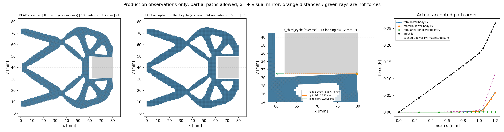
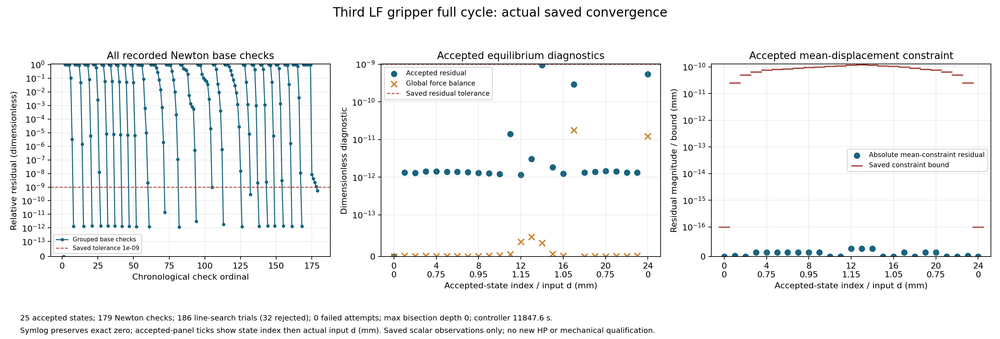
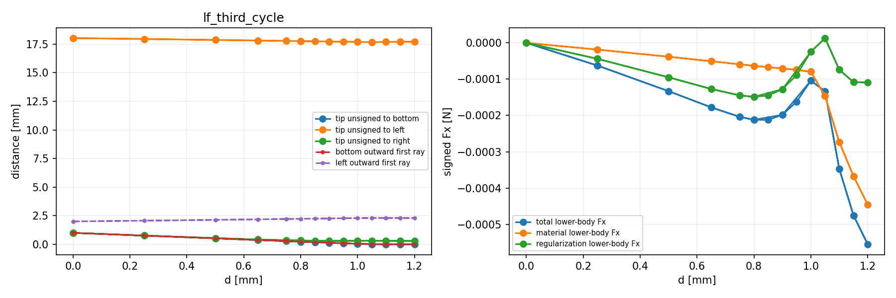
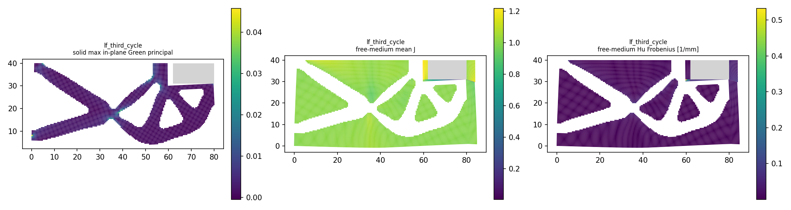

# L-CYCLE1实际结果：第三个LF原25目标完整循环PASS

2026-10-15（Asia/Seoul）。按用户直接请求从零执行一次0→1.20→0mm，25个原目标全部接受，完整保存、实际显示和收敛观察均成功。源基线main 080273b3ed583a0f7e33f3524500533aa7a4831b；新包装按protocol逐项SHA绑定。科学版本0.5.0，默认HF机械源码不改。

## 整体目标、实施内容与理由

整体目标是独立HF读取普通LF几何，在明确物理任务下返回有限变形/TMC响应、输入反力、工件作用、可恢复状态和实际变形，供现有研究层比较与选择。已完成两结构的完整路径与保存态对照；第三wave结构经L-THIRD1输入/未变形兼容检查及L-PILOT1小行程成功后，本轮推进其近接触承载、峰值及完整卸载。这样可以用新的真实拓扑检验现有前向功能，无需先扩展优化器或改写力核。

本轮复用evaluate_native、原构模/力/切线/平衡/保存及pure viewer；新增一次完整周期执行包装和按真实状态顺序显示的普通JSON收敛观察器。未改材料、网格、工件、边界、生产门或默认源码，未重复已有控制器测试。前3态与独立pilot的15个共享字段（含状态SHA）逐项相同，复现了从零计算前缀；本轮未使用pilot状态或矩阵warm start。

## 保持的物理任务

第三LF来源gripper__refine__kin_1e+00__kout_1e+00__wave，HF geometry_id为5e99dfa60343c1c2da0a921b8ddb7402319e2ad5157aa0135c89a83f1a2c3b4f。h0.5mm、84×40mm下半域、厚20mm、13440单元/27378DOF；LF实体4349单元，背景介质9091单元（含固定工件覆盖区域，显示中的自由介质分区另排除工件）。E1MPa、nu0.3、平面应变，gamma1e-6、alpha5e-7、Lr80mm，固定方体中心(71,40)mm、边18mm。输入平均位移沿+x，输出加权位移沿+y，原支撑/对称和归一化梯形端口保持。

原task文件字节不改，25目标为[0,.25,.5,.65,.75,.8,.85,.9,.95,1,1.05,1.1,1.15,1.2,1.15,1.1,1.05,1,.9,.8,.75,.65,.5,.25,0]。保mechanical/chunk256/port_projection和原数值设置，仅使用新18000秒controller时钟。task_id/purpose/description中的旧alpha研究文字属于继承历史，不代表本轮另做alpha单因素试验；本轮有效研究范围见[L-CYCLE1_SCOPE.md](L-CYCLE1_SCOPE.md)。

## 实际承载与卸载效果

| 阶段/状态 | d mm | 输入R N | 加权q_out mm | bottom有限面首射线 mm | 下半工件总Fy N | Newton检查 |
|---|---:|---:|---:|---:|---:|---:|
| 初始0 | 0 | 0 | 0 | 1 | 0 | 1 |
| 加载9 | 1.00 | 0.176300828893 | 0.958196277224 | 0.043693885814 | 0.002949934326 | 5 |
| 加载10 | 1.05 | 0.190234577411 | 0.993341031590 | 0.009434779851 | 0.008036759567 | 9 |
| 加载11 | 1.10 | 0.214775197845 | 1.000320577132 | 0.005057577820 | 0.024005829538 | 11 |
| 峰值13 | 1.20 | 0.266484675829 | 1.007764959547 | 0.002374315317 | 0.058810520523 | 12 |
| 首卸14 | 1.15 | 0.240427573175 | 1.004550074763 | 0.003224978116 | 0.041193729459 | 11 |
| 卸载16 | 1.05 | 0.190234577411 | 0.993341031590 | 0.009434779851 | 0.008036759567 | 13 |
| 卸载17 | 1.00 | 0.176300828874 | 0.958196277271 | 0.043693885765 | 0.002949934314 | 6 |
| 回零24 | 0 | 1.680210619199e-25 | -9.681342790936e-25 | 1 | -1.203542512244e-27 | 11 |

本轮得到明确的近接触承载响应：约1.05mm起输出运动增长明显减缓，输入继续增加主要伴随工件作用上升；1.20mm时底部有限面射线间隔约2.374μm，尖端坐标(79.71148753817627,30.997625684683264)mm。25态raw_overlap、strict_overlap及roundoff_ambiguous均false，bottom/left射线均有严格正命中。TMC保留强压缩的正间隔第三介质，不能写成数学零间隔的硬接触。

峰值下半工件作用（模型/介质ON-body，N）：

| 分量 | Fx | Fy |
|---|---:|---:|
| 材料 | -0.00044567079809577144 | 0.057949540313744045 |
| Hu正则化 | -0.00010932567679190934 | 0.0008609802092131098 |
| 总量 | -0.0005549964748876809 | 0.058810520522957155 |

法向承载以材料项为主。镜像双侧法向作用幅值和为0.11762104104591431N；完整工件净力为[-0.0011099929497753618,0]N，保持反力与ON-body作用相反。双侧幅值和与净力含义不同，这些固定工件弱式合力也不是连续压力或可移动工件稳定夹持的认证。

峰值实体minJ=0.974696130419154，实体面内Green主应变范围[-0.029415590974532595,0.04576907524996128]；自由介质minJ=3.864531151258951e-5。强压缩主要发生在第三介质，不能用全域极小J宣告实体塌缩。Hu各指标不必在峰值最大：自由介质最大绝对Hu为0.33158562138177317/mm，位于首卸14；峰值为0.3311456131435907/mm。

卸载全部完成，作用逐步下降、底部间隔恢复。回零时尖端(80,30)mm，bottom/left有限射线为1/2mm，实体/自由介质minJ均1；实体面内Green主应变范围约±2.768052962991946e-24。表中保留微小残值及负号，不作阈值裁剪。这说明所保存观测量数值上回归原点，未新增全DOF位移范数检查，不宣称所有位移字节严格回零或自由工件释放/稳定。

10个正同位移原目标配对中，最大绝对差均在加载9/卸载17的1.00mm。卸载减加载：ΔR=-1.8199497464621572e-11N、Δq_out=+4.775724260497327e-11mm、ΔFy=-1.176035267433373e-11N、Δbottom首射线=-4.871125725003367e-11mm。标量路径接近重合，未据此测定耗散能或稳定性；0.85/0.95mm没有原卸载配对，未插值补点。

## 收敛、调用及资源

179次Newton基检查、186次线搜索试探（154接受、32拒绝）、178次线性求解，failed_attempts=0、最大二分深度0。32次拒绝包括23 invalid_J、4 unsupported_arithmetic_range和5 Armijo拒绝；它们是原控制器内部试探，未进入接受态，也不是外部重跑。F开始365/完成338的27次差额恰为前两类拒绝；T开始/完成均179。不能把failed_attempts=0写成没有拒绝试探。

最大接受相对残差9.60874323664482e-10在首卸1.15mm，低于原1e-9门但接近该门；回零残差5.425680076590201e-10。最大整体力平衡相对误差1.7739388560869973e-11，全部平均约束满足原逐态bound，固定DOF位移最大0；所有接受J保持正。最多13次Newton检查发生于卸载1.05mm，回零用了11次。原门未放宽。

构模/求解/API/缓存保存/摘要/原pure viewer/普通收敛观察各一次；显示/保存/摘要不增加F/T，HP0、无新默认安装。JIT_calls=0保留原计数语义，不等于无JAX编译。原equilibrium/independent_HP/HF producer flags保持false，制造资格pending。

唯一启动chunk4479dc/session23357，真实终态0f2edf exit0。outer PASS、invocations1、stop=null，11944.207851400017秒（约199.1分钟），树采样峰1939759104B；helper11939.350347200001秒、采样峰1939066880B。result evaluation11847.74448709999秒，原path累计11847.636396999995秒；viewer child43.98842470004456秒。原controller18000/viewer600/helper19000/outer19060秒、8GiB窗口满足；无外部重试、修复重跑、延期或force。219份输出共642347444B在原helper窗口封存，源码/输入绑定最终保持。完整资源与身份见[helper收据](run_001/execution_receipt.json)、[outer收据](cycle_launch.json)及[独立实际审阅](author/ACTUAL_REVIEW.md)。

## 实际图像与恢复入口

[25个真实接受态动画](run_001/view/lf_third_cycle/actual_states.gif) · [全25态物理标量](run_001/view/lf_third_cycle/summary.json) · [完整收敛原记录](run_001/convergence/convergence.json) · [API响应](run_001/lf_third_cycle/response.json) · [自带模型/来源的可恢复result](run_001/lf_third_cycle/result.json) · [四PNG各一次像素检查](author/pixel_QA.json)。

图使用真实×1位移及明确镜像，工件固定。橙色尖端距离/绿色射线是几何诊断，不是力箭头；距离图较大的tip-to-left尺度会压缩微小bottom曲线，精确值见表/JSON。q_out是加权输出位移，不是间隙；node-window、单尖端有限面距离和有限面首射线各有定义，峰值left节点窗口2.2985794898516403mm与finite-ray2.2972654980881524mm并不相同。J场颜色是单元均值，不能代替最小积分点J；Hu Frobenius与最大绝对分量亦不同。加载/卸载曲线近重合源于实际标量，未平均合并；收敛图按真实状态索引显示两段，红残差线不是橙色整体力平衡的验收门。四PNG均各检查一次，无重绘；GIF只含25真实帧，无插值，帧数由原viewer核验，未额外解码GIF。

result/model/source_geometry和25态state/forces/tangents/矩阵随本目录保存，可按显式repo从其他目录读取；不依赖旧LF运行环境或ZIP。现有response的views/independent_reference仍为not_provided，因为它先于纯viewer产生，本轮未执行API媒体/参考关联。后续恢复应先读本报告及[开发恢复入口](../../../docs/RESUME_DEVELOPMENT.md)，复用保存态，不原地重启已关闭的execute_cycle.py。

## 当前结论与下一步

第三个LF已完成输入→独立非线性完整循环→可恢复保存→实际变形/反力/收敛显示，原物理条件与门保持。固定方体附近出现强第三介质压缩、输出受限和显著法向承载；卸载观测量恢复至初始数值附近。完整生产路径完成尚未授第三例独立HP、连续压力、有效夹持、自由体释放/稳定性或HF5资格。

结果支持先对峰值13及首卸14做保存态独立参考；首卸14同时具有最大自由介质Hu与最接近原停止门的接受残差，优先于继续增行程或改参数。通过后复用现有消费者与三设计同定义对照，具体见[NEXT_STEPS.md](NEXT_STEPS.md)。本轮全部旧结果、原失败历史和既有两例资格范围保持。
