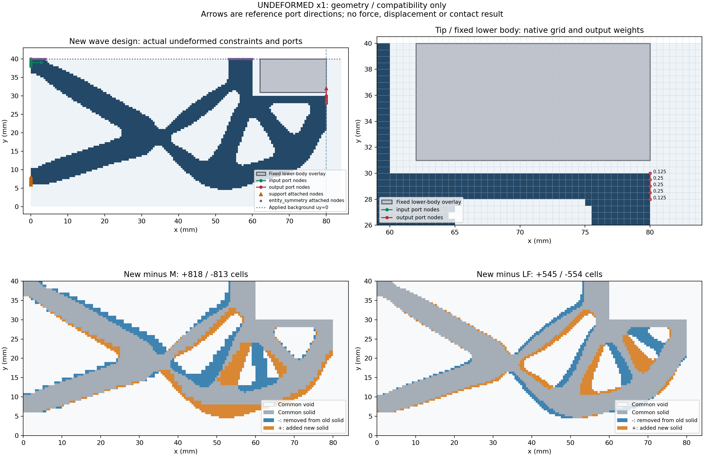

# L-THIRD1 实际结果：输入与未变形兼容性PASS

2026-10-15（Asia/Seoul）。直接用户请求授权后唯一执行；源基线main `ace8e9206affaef5d7ce633440e5508c065dfda6`，新候选单独SHA绑定。科学版本0.5.0与默认HF源码保持。本页记录实际结果，不代表已推送声明。

## 整体目标、工作及原因

整体目标是独立HF从普通LF几何生成明确物理任务下的有限变形/TMC前向结果，返回位移、反力、固定工件作用和可人工检查的变形，供研究层比较/选择。已有两例真实路径和保存对照；本阶段增加第三个不同结构，检验相同输入合同、网格、端口和工件约束是否可复用，避免针对前两例写特例。HF不包含优化器。

按原生0.5mm夹持器目录序排除已有两LF身份后，选择`gripper__refine__kin_1e+00__kout_1e+00__wave`，未使用LF性能值。提取原design.json/npz两成员；复用prepare_native_lf_inputs、build_native_project、write_native_project各一次，没有改默认源码或新增力核。来源事实与原LF诊断分开，附件内容仅作为数据。

## 实际检查与效果

41项显式兼容检查全部满足。原80×40mm中的solid/design/passive_solid/passive_void四掩码逐格无损；仅右侧8列添加4mm纯介质。原细网格任务除几何身份外完全一致：E1MPa、nu0.3、厚20mm、gamma1e-6、alpha5e-7、Lr80mm，固定方体中心(71,40)/边18mm，原25目标0→1.20→0mm仅保存未执行。

| 项目 | 实际值 |
|---|---:|
| 原生网格 | 0.5mm，80×168单元，84×40mm |
| 总单元／节点／DOF | 13440／13689／27378 |
| 实体／介质单元 | 4349／9091 |
| 合并固定／自由DOF | 1548／25830 |
| 支撑原选节点／实际实体附着 | 17／5 |
| 输入、输出端口附着 | 各5／5 |
| 固定工件单元／节点／DOF | 648／703／1406 |
| 与M不同实体单元（新增／减少） | 1631（818／813） |
| 与第二LF不同实体单元（新增／减少） | 1099（545／554） |

实际同网格solid掩码比较证明这是第三个结构，而非仅凭LF ID或单元数不同。共享边连通组件1，原support/input/output_attachment及port_support_component_link五项原门通过；端口方向、五点权重[0.125,0.25,0.25,0.25,0.125]、合并固定/自由DOF划分、工件覆盖与原被动空区相容。

原qualification总体仍为pending：制造最小特征没有经过验证，体积分数上限未设置；没有改为总体PASS。实体设计区体积分数约0.3538006757，作为测量记录。原工件节点线距离诊断left=2mm、bottom=1mm，只是同水平/垂直线最近节点的初始距离，不是全局表面最小间隙或接触起点。

新HF geometry ID：`5e99dfa60343c1c2da0a921b8ddb7402319e2ad5157aa0135c89a83f1a2c3b4f`；新task semantic SHA：`5c9941a569b69e9b4265eb3da73e7ba60deb991970033650ef56cb67a5b3749e`。

## 可视化与可恢复输入

图为未变形×1，下半工件固定覆盖区域位于[62,80]×[31,40]mm；箭头只显示参考端口方向。两差异图保留共同实体灰色，新增橙色、减少蓝色，便于定位结构差异。一次像素检查通过，图例局部遮挡已在[QA记录](author/pixel_QA.json)说明，没有重新绘图。

后续计算直接使用[case几何](run_001/case/derived_geometry/geometry.json)与[完整25目标task](run_001/case/task.json)；[model](run_001/model/model.json)自带源geometry快照和普通model.npz，[原两成员](run_001/sources/design.json)保留。读取已准备case/model不需要原本机80MB ZIP、LF环境或旧工作目录。原来源绝对路径只作provenance；从项目根解析本目录。完整来源/协议/授权/独审均在本目录，复核不需读取原旧变形态。

## 执行证据与边界

唯一启动`bd517b/session99661`，实际终态`eaecff exit0`。outer PASS，invocations=1，stop=null，耗时18.719126秒，进程树采样峰198811648B；helper17.130607秒、峰187965440B，满足180/240秒和1GiB新窗口。输入/构模/写model/绘图各一次，两旧输入geometry读取各一次，16份输出共741149B在原helper窗口内SHA封存；[helper receipt](run_001/execution_receipt.json)、[outer receipt](third_input_launch.json)、[stdout](third_input_stdout.log)保留。

新增F/T/HP/平衡求解均0，基于冻结源码调用路径和实际事件，不声称用全局hook监控所有函数，也不声称零JAX导入。无测试套件重跑或默认安装；有意义的验证是本次实际源/四掩码/端口/工件/DOF检查。归档运行前整档SHA一次和两提取成员SHA均通过，不伪称运行后又整档读取。实际独立审阅记录另见author/ACTUAL_REVIEW.md与actual_review.json。

本阶段只有输入与未变形兼容性，不证明机械可收敛、力大小、接触、压力、有效夹持、释放、稳定性、全路径独参或HF5资格；旧两例资格不转移给本例。

## 下一步

优先独立小行程pilot 0→0.25→0.50mm并显示真实变形、反力和分区J；成功后另从零完成原25目标。当前短load_only任务不能直接续成完整循环，重复前缀成本是明确取舍，详见[具体计划与预算](NEXT_STEPS.md)。本轮没有启动该数值阶段。
