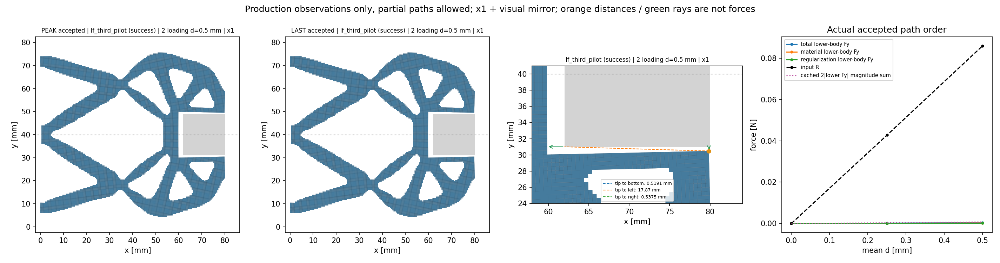
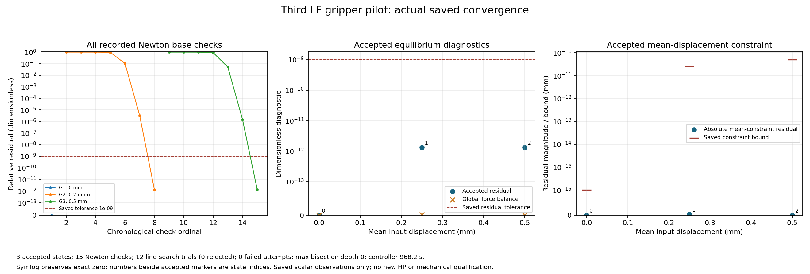
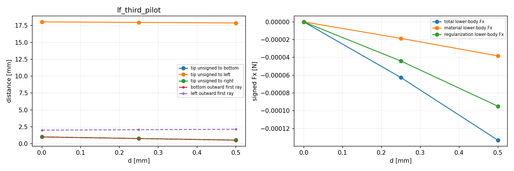
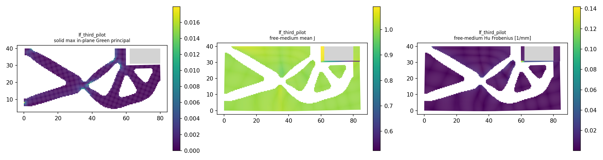

# L-PILOT1实际结果：第三个LF小行程试算PASS

2026-10-15（Asia/Seoul）。用户直接授权后的唯一执行，原基线main e010d20938ae38f66a8b6a6fae9df8291fe1a59a；新源码和必要元数据修复分别绑定于protocol。科学版本0.5.0；本结果不代表已提交/推送声明。

## 整体目标、当前功能与实施理由

整体目标是独立HF读取普通LF几何，在明确物理任务下返回有限变形/TMC响应、输入反力、工件作用和可恢复状态及变形图，供研究层比较与选择。已有两结构完整路径/保存对照；L-THIRD1已证明第三wave结构输入和未变形约束相容。本步让第三例产生真实响应，以检验现有入口、有限变形、反力和显示能否复用，而非先扩展内核或优化器。

本次独立load_only路径为0→0.25→0.50mm，保原25目标task字节。E1MPa、nu0.3、厚20mm、h0.5mm、84×40mm域、gamma1e-6、alpha5e-7、Lr80mm、方体中心(71,40)/边18mm及固定/端口边界保持。原mechanical/chunk256/port_projection与生产门保持，只采用本次1800秒controller clock。

## 必要修复、测试和单次真实执行

启动前静读发现load_only记录缺original_target_index/leg，既有pure viewer和progress会取键失败。仅取消两个路径标签的ordered_cycle条件，使既有advance参数对load_only也写入标签；递归/求解/状态SHA/机械语句未改。对应现有test仅将过时absence断言换为确切标签，不增加该用例的求解。

三项既有单胞注入控制器测试一次通过（14.92秒）：default加载合同、ordered_cycle重复目标/独立dense代数、descending二分与回滚。它们不代表夹持器材料或接触资格，不混入下面生产F/T计数。独立源静审和AST检查通过，未跑全套测试。

新pilot task修改input.target/path及三说明字段task_id/purpose/parameter_origin；其余物理内容与原完整task精确对账。description仍是继承模板的旧alpha/卸载说明，只作历史文本；实际有效合同以本次load_only path、明确task_id和保存状态为准，未回写已绑定输入或成功结果。

随后一次evaluate_native从零完成三目标；构模/求解/缓存保存/摘要/原pure viewer/收敛观察各一次。真实生产27次F、15次T，HP0。保存/摘要/显示/收敛不增加F/T；没有旧状态、旧矩阵warm start或默认内核改写。JIT_calls=0保原计数语义，不等于没有JAX编译。

## 实际物理结果

| 输入d mm | 输入R N | 加权q_out mm | bottom首射线 mm | 下半工件总Fy N | 实体minJ | 自由介质minJ | Newton检查 | 相对残差 |
|---|---:|---:|---:|---:|---:|---:|---:|---:|
| 0.00 | 0 | 0 | 1 | 0 | 1 | 1 | 1 | 0 |
| 0.25 | 0.04272814528 | 0.240214897 | 0.7598536213 | 0.0001344049649 | 0.9939678494 | 0.7589524595 | 7 | 1.3149e-12 |
| 0.50 | 0.08593082816 | 0.4811512139 | 0.5191397666 | 0.0003512425566 | 0.9879518031 | 0.5164004669 | 7 | 1.3074e-12 |

R为输入执行器ON-model有符号作用；q_out是平均端口位移，不是间隙。Fy为模型/介质ON固定下半工件的弱式合力，保持反力相反；镜像后的净力、两侧幅值和不能替代接触压力或有效夹持力。

0.5mm下半工件Fy：材料0.0002156916134184984N，Hu 0.00013555094315994133N，总0.0003512425565784398N。结构向工件底面闭合；bottom首射线仍约0.51914mm、无raw/strict overlap和roundoff ambiguity，因此本试算没有到达实际夹持阶段。小的工件作用可在几何接触前经第三介质传递，不能用非零力宣告接触。

实体minJ约0.98795、面内Green主应变范围约[-0.0135295,0.0179587]；全域minJ=0.51640来自自由介质。应区分介质压缩与实体畸变。这里的有限表面射线距离也不是全局最小间隙，不与旧node-window或平均端口位移混用。

## 收敛、资源及效果

15次Newton基检查（1/7/7），12个线搜索试探全部接受，无拒绝、失败尝试或二分；14次线性求解。非零增量初期相对残差接近1，随后下降到约1.3e-12，真实顺序/全部原行在convergence.json中保留，未插值或按同d合并。

最大接受残差1.3149319289386153e-12；平均约束门全部满足，最大整体力平衡相对误差1.7741499286526041e-15，最大固定DOF位移0。原生产门保持，独立HP/equilibrium/HF producer flags全部false；生产收敛不授独立参考或有效夹持资格。

唯一启动567baa/session37992，终态9a4efc exit0；outer PASS、invocations1、stop=null，耗时1013.6499084000243秒，树采样峰848691200B。helper1011.0132517000311秒、采样峰845869056B；controller968.2397345000063秒。原1800/600/2700/2760秒、8GiB窗口满足。44份输出共56739676B在原helper窗口封存；不在闭卡后重新解码/重算科学数组。接收进度记录保留三个真实状态及SHA，源码/输入绑定最终保持。

## 可视化与恢复入口

[三真实接受态GIF](run_001/view/lf_third_pilot/actual_states.gif) · [逐态物理标量](run_001/view/lf_third_pilot/summary.json) · [完整收敛原记录](run_001/convergence/convergence.json) · [原API响应](run_001/lf_third_pilot/response.json) · [可恢复result](run_001/lf_third_pilot/result.json) · [helper收据](run_001/execution_receipt.json) · [outer收据](pilot_launch.json) · [四PNG各一次QA](author/pixel_QA.json)。

图为实际×1及明确显示镜像，工件保持固定；peak与last均为0.5mm同一态，不是两次独立结果。R比工件弱式力大，公共力轴压缩了Fy小曲线；精确值见表/JSON。距离图左侧大距离压缩bottom曲线，原值未丢失。J场颜色为单元平均，不等于最小积分点J；Hu Frobenius与最大绝对分量不是同一量。GIF只含3个真实接受态，无插值。所有新PNG均已各一次人工像素检查，无重绘。

result/model/source_geometry及每态state/forces/tangents/矩阵自带新结果目录，可从另一工作目录按显式repo读取；原LF环境、ZIP和旧工作目录不参与本次数值计算。当前load_only结果尚不能通过既有resume接口接为完整循环。

## 结论和下一步

第三例的输入→非线性前向→缓存保存/摘要→实际变形/反力/收敛显示已贯通。当前结果支持下一步从零执行保留25目标的0→1.20→0mm完整循环，无需先调整材料、放宽门或重写力核；是否发生有效接触及近接触计算困难须由后续真实状态判断。

具体范围、资源依据和停止分支见[NEXT_STEPS.md](NEXT_STEPS.md)。本轮没有执行完整循环、新HP、压力、释放、稳定性或HF5验收。原制造pending和历史失败结果保持，不把本次小任务PASS升级成整个项目完成。
