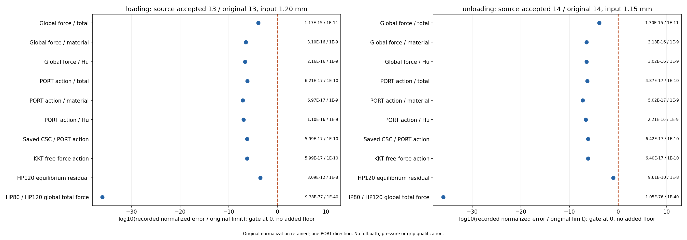

# L-TREF1实际结果：第三LF峰值与首卸独立参考PASS

2026-10-15（Asia/Seoul）。按当前用户直接请求，唯一一次核accepted/original13（loading1.20mm）和14（unloading1.15mm），两态HP80/120共4次全部完成，原十五门保持且通过；一次双面板误差PNG/JSON完成。源基线main 69d7ab7b2818f875194bd0ac77d482e9b86dd487，新包装由protocol逐项SHA冻结，默认HF源码和原生产结果不改。

## 整体目标、前序进度和本轮理由

整体目标是独立HF读取普通LF几何，为明确物理任务返回可比较、可恢复的有限变形/TMC响应和实际变形。第三wave已完成输入兼容、短行程试算及L-CYCLE1原25目标0→1.20→0mm完整循环。峰值下半固定工件法向作用0.058810520523N（双侧幅值和0.117621041046N），底部有限面首射线约2.374μm；首卸法向作用0.041193729459N，回零观测量恢复。

本轮独立核对最关键的两个保存态：13覆盖最大承载/最小介质J；14覆盖最大自由介质Hu和最接近原生产停止门的接受残差。目标是判断已有力、导数、组装及工件合力是否可靠，再决定下一功能；没有重新求解夹持器、增行程或调参数。

## 实现与真实覆盖

原B850 CoreAudit.run_state、aa86 WorkpieceCycleAudit.workpiece_checks和pure plot保持原字节；新loader只适配第三LF路径、13/14身份、实际producer收据及机械源码SHA，新授权包装使用当前直接用户原话与冻结源码，未沿用旧L-REF1批准或虚构候选已先发布。

两态来自同一成功result，各核全13440单元/27378DOF。每态材料/Hu/总单元力及PORT方向作用各322560项；860160个局部矩阵条目用于原CSC组装身份核对。保实际b_in/max(abs(b_in))、固定分量零、deltaR=0、Decimal3000精确散射及Inexact trap；三全局力、三切线作用、CSC方向、KKT、工件节点去重/holding/mirror投影均按原方法通过。独立检查一个PORT方向，不代表所有切线列都已独立核对。

本参考在同一保存位形重新计算高精内力和方向导数，未做高精平衡求解；原状态、矩阵、响应和生产资格字节保持。准备期仅读普通源码/JSON，10份NPZ仅继承原seal/stat；本次新窗口绑定10份、9份解码，source_geometry NPZ仅作raw provenance。11个参考依赖unique basename平铺归档，原先的嵌套归档问题不重引入。

## 数值结果与误差可视化

| 指标（保原归一化） | 峰值13 / loading1.20 | 首卸14 / unloading1.15 | 原门 |
|---|---:|---:|---:|
| 全局总力 | 1.166941E-15 | 1.298960E-15 | 1e-11 |
| 全局材料力 | 3.098268E-16 | 3.176351E-16 | 1e-9 |
| 全局Hu力 | 2.157008E-16 | 3.019001E-16 | 1e-9 |
| PORT总切线作用 | 6.212332E-17 | 4.866404E-17 | 1e-10 |
| PORT材料切线作用 | 6.970099E-17 | 5.021899E-17 | 1e-9 |
| PORT Hu切线作用 | 1.102260E-16 | 2.208851E-16 | 1e-9 |
| 保存CSC / PORT作用 | 5.994636E-17 | 6.417022E-17 | 1e-10 |
| KKT自由力作用 | 5.989076E-17 | 6.396097E-17 | 1e-10 |
| HP120独立平衡残差 | 3.088500E-12 | 9.608743E-10 | 1e-8 |
| HP80/120全局总力一致性 | 9.377298E-77 | 1.049088E-76 | 1e-40 |

两态工件合力投影检查均通过；物理定义仍是模型/介质ON固定下半工件的材料/Hu/总弱式作用，保持反力反号。本轮支持这两个承载/回撤保存态的数值正确性，不新增压力或自由体稳定夹持资格。

首卸HP120独立残差约9.608743211e-10，原独参门为1e-8；原生产残差9.608743237e-10仍按原1e-9门核对，两门用途不同，未放宽生产门。HP80/120的约1e-76一致性是两种参考精度间的一致程度，不意味着生产数值具有76位精度。所有误差保原分母/floor/归一化，不能把它们全部解释为简单相对百分比。

横轴log10(原记录归一化误差/原门)，虚线0为该项原门，左侧通过。每态图显示10项原检查，原十五门及单元/组装/投影检查仍见完整普通摘要/封存归档。无新增显示floor、无补点或改门，精确零由原plot单独标识。本次PNG已原分辨率检查一次，无重绘；两态标签、数字和门可读。图中独立平衡残差用1e-8门，未把它当成生产1e-9门。

## 执行、资源与恢复

初始chunk c92479/session29713，真实终态cc46ab exit0。outer PASS、invocations1、stop=null，282.4748330999864秒（约4.71分钟），进程树采样峰1282338816B；helper 280.4561333999736秒、采样峰1273786368B。原helper900/outer960秒、采样8GiB窗口满足，HP开始/完成4/4、两机械态/两工件态、plot开始/完成1/1，161495项检查完成。无新生产F/T、构模、平衡求解、测试、API关联或默认安装，无外部重试、修复重跑、延期或force。

42份输出共167633763B在原helper窗口封存，39份源码/输入绑定保持。闭窗后只读普通摘要/记录，对NPZ/gzip/媒体沿用原封存SHA加stat；除授权的一次新PNG像素检查，不额外解码科学归档或旧媒体。导入参考依赖会注册JAX，wrapper没有AD/JIT调用，不声称模块未加载。

[两态普通完整摘要](run_001/reference/summary.json) · [误差原值JSON](run_001/reference/reference_observations.json) · [helper收据](run_001/reference/execution_receipt.json) · [outer收据](reference_launch.json) · [静态审阅](author/SOURCE_REVIEW.md) · [实际独审](author/ACTUAL_REVIEW.md) · [像素检查](author/pixel_QA.json)。高精局部/全局结果、原元素门、方程/作用和工件核对归档路径及SHA均在summary中。

13态SHA：63100f5293ddf36e5e7522b0636bdb211ea8f31179b7618fa5ba6a65e5d10b50；14态SHA：b340a6f12532b850d6f395e5e4d920de8822bf39c2467d675e6d985666f42916。本轮参考绑定原result SHA 07095457a3d1d4d7e9c398f9886384f06aaab2aebab13c52511ea6b62447b924，生产路径/工件/材料/网格均保持。[原25态生产结果](../lf_third_cycle_001/RESULTS.md)、[实际变形与反力](../lf_third_cycle_001/run_001/view/comparison.png)、[25帧真实动画](../lf_third_cycle_001/run_001/view/lf_third_cycle/actual_states.gif)供人工对照，本轮没有重新读取/绘制这些旧媒体。

## 当前结论与下一步

两态独立参考PASS，原力/切线方向/CSC/KKT与工件投影未发现需要先修内核的问题。范围仍为2/25选定态、同一PORT方向；原producer flags、制造pending及全路径/全部列/压力/有效夹持/自由体稳定性/HF5未完成状态保持。

下一步优先直接复用默认公共摘要与研究层消费者，关联第三例全25态、这两态参考和既有媒体，形成可消费25行表与人工检查页，再供三设计同定义对照；不先改默认源码或重复旧变更测试。该后续关联/消费/三设计计算本轮未执行，具体见[NEXT_STEPS.md](NEXT_STEPS.md)。
