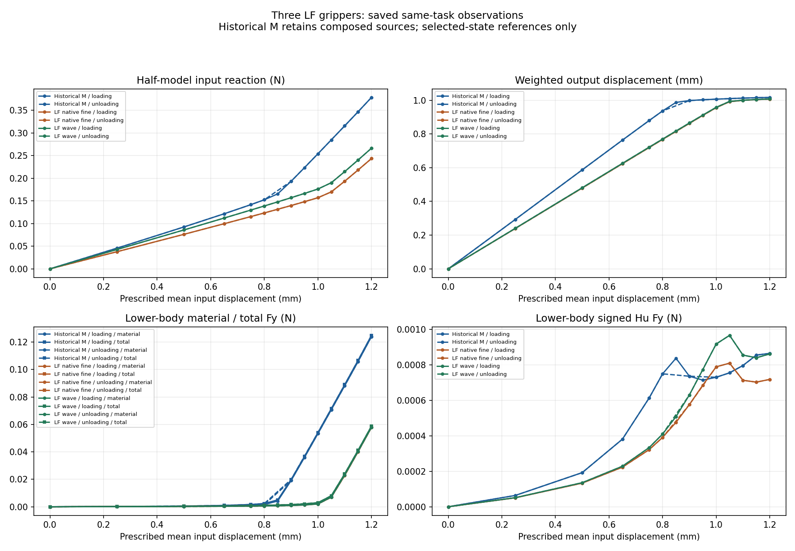
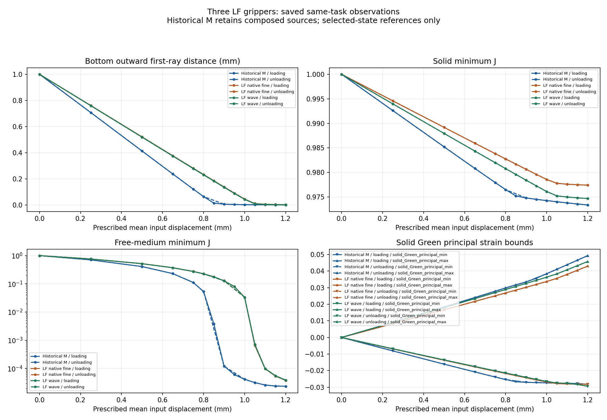

# L-TCOMP1实际结果：三设计同定义保存态对照PASS

2026-10-16。当前用户明确批准“按L-TCOMP1卡实施并执行”。在main基线d8d19e14035664d4b5bd573300e46df7ee81d368上，一次读取10份既有普通JSON，形成75条原值、25组三方对应、两张标量PNG和人工检查页；没有新HF API、F/T/HP/构模/平衡求解、测试或默认安装。

## 整体目标与本轮作用

整体目标是HF独立读取普通LF几何，在明确任务下返回可比较、可恢复的有限变形/TMC响应和实际变形，供研究层研究与优选。三例已有前向循环和有限独立参考；第三例L-TUSE1已完成标准交付。本轮把这些已有功能接到三方描述性比较，使结构差异与反力、工件承载、逼近和卸载可以对照查看。

实现仅在新研究层入口example/compare_three_saved.py及执行包装中。旧两例designs完整继承；第三例复用旧_contract/_row/_source/_add_reference与配对逻辑绑定原result/model/消费表/viewer/reference。三方按(original_target_index,leg,d_mm)顺序对齐，不按d去重、不补原路径没有的卸载点；旧M分段、失败、alias和源epoch均保留。

三例材料/网格/工件/端口/边界声明及九项非clock settings一致；实际实体单元和附着节点数量随拓扑不同，不强行改为相等。wave的controller8cdc与LF2/M后期8c1不同，既有静态diff只涉及元数据条件，不能称新动态等价或三例同源码实验。第三例旧task prose仅作来源，实际path25和result一致；不修改已封存task。准备证据见[物理核对](author/physics_preflight.md)。

## 可检查结果

[完整75行原值与25组三方](run_001/comparison.json) · [人工检查页](run_001/REVIEW.md) · [helper收据](run_001/execution_receipt.json) · [outer收据](comparison_launch.json)。

| 设计 | 原目标 | 输入R N | q_out mm | 下半工件总Fy N | bottom有限首射线 mm | 实体minJ | 自由介质minJ |
|---|---:|---:|---:|---:|---:|---:|---:|
| Historical M | 13 | 0.37865427196 | 1.0169345343 | 0.1249212163 | 0.000969660206483 | 0.973394763046 | 2.32830095625e-05 |
| Historical M | 24 | -1.37324906426e-26 | -9.47999393351e-25 | -3.34467867947e-27 | 1 | 1 | 1 |
| LF native fine | 13 | 0.243657687269 | 1.00751993498 | 0.0585119884831 | 0.00276729090932 | 0.977419767532 | 3.77508179289e-05 |
| LF native fine | 24 | 2.28605579441e-25 | -9.35440727738e-25 | -1.1990387348e-27 | 1 | 1 | 1 |
| LF wave | 13 | 0.266484675829 | 1.00776495955 | 0.058810520523 | 0.00237431531674 | 0.974696130419 | 3.86453115126e-05 |
| LF wave | 24 | 1.6802106192e-25 | -9.68134279094e-25 | -1.20354251224e-27 | 1 | 1 | 1 |

表中13为1.20mm峰值，24为卸载回零；全部数值均来自保存态，不计算新差值/比例或正式排名。输入R是半模型反力，Fy为模型/介质ON固定下半工件的有符号弱式合力，含材料与Hu；不等于连续压力或自由工件有效夹持认证。q_out不是间隙；global minJ、solid minJ与free-medium minJ分开保留。

物理观察：M在原1.00mm时q_out已约1.00672mm、下半工件总Fy约0.05402N；LF2/wave同目标q_out约0.95629/0.95820mm，Fy约0.00278/0.00295N。两例LF在1.05mm附近输出运动明显减缓，随后输入继续增加时工件作用上升；1.20mm两者q_out约1.00752/1.00776mm、Fy约0.05851/0.05881N，输入R则约0.24366/0.26648N。它们表明输出受限与第三介质承载响应可被同定义读取，不据此制作效率评分。

历史M部分加载/卸载标量曲线可见分离，LF2/wave图上接近重合；源epoch/分段不同使其不能直接归因于拓扑，亦未据此测定耗散能或稳定性。三例回零显示的反力/工件作用接近数值零、bottom首射线恢复1mm、实体/自由介质J均1；这不是全DOF严格归零或自由体释放证明。峰值实体J仍约0.973–0.977，自由介质J约数个1e-5，不能将第三介质强压缩解释为实体塌缩。

图仅使用已有原标量。三种设计固定配色，加载实线/卸载虚线；卸载显示起点复用其原峰值，不增加状态。自由介质J的对数只作显示，不截断、加floor或改门；其他图义与原viewer一致。18份旧媒体只stat/链接，不读取或解码；M峰值/回零分别链接ALPHA与UNLOAD2，旧箭头独立尺度不能直接比较长度。

## 参考和保留范围

- Historical M：主源参考[14, 15, 18, 19]；仅alias记录[13]。
- LF native fine：主源参考[13, 16]；仅alias记录[]。
- LF wave：主源参考[13, 14]；仅alias记录[]。

M13的RESUME child0参考不授ALPHA主源资格；各例全路径独参、全部切线列、连续压力、有效夹持、自由体释放/稳定性及HF5资格均不升级。制造pending和原失败历史保持。共同任务成立也不能消除源epoch历史差异。

## 执行和记录

唯一终端569994 exit0，outer/helper PASS，invocations1、stop=null。outer 5.5968424秒，树采样峰122273792B；helper 3.1450918秒，采样峰120668160B，满足helper180/outer240秒、采样1GiB。比较开始/完成1/1，10普通JSON、18旧媒体stat、两个plot均完成；4份输出在原helper窗口封存，输入/源码绑定保持。

两张新PNG按授权各检查一次，不重绘；像素结论见[像素记录](author/pixel_QA.json)。没有外部重试、修复重跑、延期或force。默认HF源码/原数学门/原结果不改，未读NPZ/科学gzip/CSV或旧媒体payload。独立审阅见[源码](author/SOURCE_REVIEW.md)和[实际结果](author/ACTUAL_REVIEW.md)。本项目整体目标仍未完成。

## 结果驱动的下一步

后续功能选择见[NEXT_STEPS.md](NEXT_STEPS.md)。本轮仅交付保存态描述性对照，未执行新批处理、物理路径或全路径参考，也未生成正式标签和最终排名。
