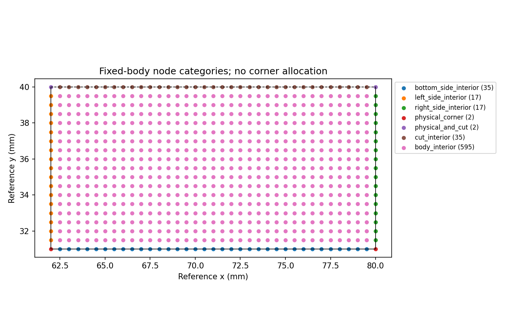
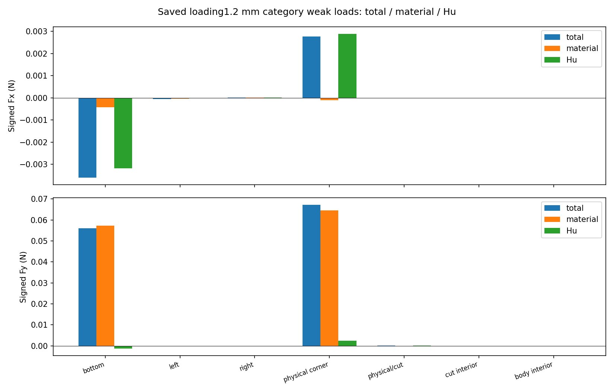
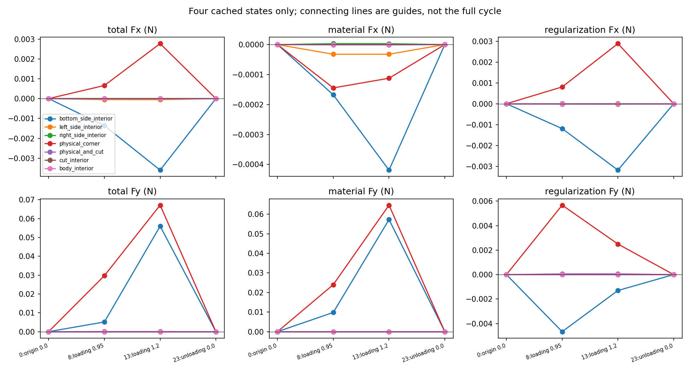

# M-LEDGER1：四保存态的节点载荷账本与三图已通过

2026-10-11（Asia/Seoul），用户明确批准“批准按 M-LEDGER1 卡执行”后，唯一启动实际 PASS：exit0、stop_reason null、ledger开始／完成1／1、PNG写入3；helper 4.1037824000 s／outer 4.4357795000 s，采样自身 RSS 98844672 B／tree RSS 103079936 B。17份绑定不变，首错停止合同保持，没有重试、修复重跑、延期或force。本窗口已经关闭。

[账本JSON](run_001/ledger.json) · [四态节点CSV](run_001/selected_nodes.csv) · [七类载荷CSV](run_001/category_loads.csv) · [helper实际收据](run_001/execution_receipt.json) · [outer实际收据](ledger_launch.json) · [实际stdout](ledger_stdout.log) · [直接授权记录](author/authorization_record.json) · [独立终态审阅](author/terminal_review.json) · [只读物理解读／下一步依据](author/physical_next_scope.json) · [原冻结执行卡](M-LEDGER1_CARD.md) · [原冻结协议](protocol.json)。终态报告原字节SHA为`414fc49ff2d276c5a18bf1926823b779062610ebb04d3fac24e07b449646075a`，物理解读原字节SHA为`a3072ed1b67ac7dcbb6831446bcd99549b409138d963bf6751d88db9bb1ca0dc`；卡／协议中的prepared字段及授权记录execution_started=false是执行前历史快照，当前事实以实际收据为准。

## 整体目标、已经做了什么、为何整理载荷

整体目标是读取普通LF几何，独立完成HF有限变形／第三介质接触(TMC)前向评估，给外部研究提供可核对的反力、工件载荷、结构变形与加载／卸载响应，并保留能换目录或换机器继续开发的上下文。HF不优化、不运行dmftd；继续main开发，origin保持https://github.com/dudaxing/Compliant-TO-TMC.git。

此前已完成当前固定方形工件h0.5细网格完整24态加载／卸载、M-VIEW1真实变形图、M-REF2自身48／48保存态HP参考及M-LINK1的同身份参考／图件API关联。本步复用既有节点表，直接回答载荷来自底边、左右边、角点还是对称切面，以及材料／Hu有符号分量如何抵消。新增122行[stdlib公共读取函数](../../../hf_repo/src/hf_eval/saved_workpiece_loads.py)与151行[薄caller](execute_saved_ledger.py)，不复制力核或原观察器。

本次实际处理原态0、8、13、23：初始、加载0.95mm（此前保存的最大Hu分量态）、加载峰值1.2mm、卸载0。每态703标准节点，共2812节点行与28类别行。旧24态身份仅登记输入，**本次新账本和新图严格四态，尚无全24新账本**。每节点仅一类；两物理角点与两个物理／切面交点独立保留，不向两侧平分。

## 实际功能、算术口径与成本

原index／original_target_index／leg／d／state SHA、标准node ID、固定工件参考x/y及六个total／material／regularization(Hu) Fx/Fy原文本列保持，包括signed zero和卸载微小残量。ON-body有符号弱式力单位N，原厚度20mm已经包含；没有重新乘厚度、除面积或清零。total独立保留，没有强制逐节点total=material+Hu。

实际账本的直接whole fsum精确复现原nodal／case六分量；七类回并旧四组的counts与力沿用原`8·2^-52·节点L1`舍入界，无绝对误差地板，零界要求零差。独立终态审阅读取保存比较标志、原节点文字／身份、rawSHA与PNG头，PASS；它没有再分类、重求和或重跑数学参考，不称为新增独立科学测试。主Agent已实际查看三PNG，确认位置／图例／分量／四态口径可读；图件没有再次渲染。

新增账本调用1次、Matplotlib图3张。新增NPZ／F／T／HP／模型／平衡求解／原观察器调用为0，是冻结来源调用路径依据，未装动态mechanical hooks；本次确实新增CSV分类／汇总与渲染，不能写成“新增计算和绘图为0”。helper时间／RSS是末checkpoint后、成功收据构造及写入前快照；outer给出完整launcher终态。180／240秒和采样8GiB为本卡额度，采样RSS不是OS硬内存限制；未改变依赖、严格编译选项或原力学资格。

## 四态整体载荷与峰值七类分解

当前物理任务保持84×40mm下半域、h0.5、固定方形中心(71,40)mm／边长18mm，工件参考边界x62／80、y31／40，E1MPa、ν0.3、厚度20mm，平均输入0→1.2→0mm。以下来自新账本保存标量，仅格式化展示；完整精度及原文字在CSV／JSON内。

| 原索引／leg／d(mm) | total Fx(N) | total Fy(N) | material Fx(N) | material Fy(N) | Hu Fx(N) | Hu Fy(N) |
|---|---:|---:|---:|---:|---:|---:|
| 0／origin／0 | 0 | 0 | 0 | 0 | 0 | 0 |
| 8／loading／0.95 | -0.0007419509497756116 | 0.034889988688896 | -0.0003419495937627791 | 0.03381054217322995 | -0.0004000013560128327 | 0.001079446515666051 |
| 13／loading／1.2 | -0.0008760157046173312 | 0.1231794016016504 | -0.000561226821740675 | 0.1219125570587214 | -0.0003147888828766561 | 0.001266844542929009 |
| 23／unloading／0 | 1.069277210424861e-27 | -4.553785362498083e-27 | 1.11440905521507e-28 | -2.945761133576429e-28 | 9.578363049033545e-28 | -4.25920924914044e-27 |

峰值原13／loading1.2mm，类别载荷如下。bottom、left、right内点不含角点；y40为对称切面，交点不能自动当成接触面载荷。

| 类别 | 节点数 | total Fx(N) | total Fy(N) | material Fx(N) | material Fy(N) | Hu Fx(N) | Hu Fy(N) |
|---|---:|---:|---:|---:|---:|---:|---:|
| 底边内点 | 35 | -0.003600809923200197 | 0.05598073770422696 | -0.0004190378867617786 | 0.05728049784882566 | -0.003181772036438418 | -0.001299760144598709 |
| 左边内点 | 17 | -5.16891794684633e-05 | -1.276030221182351e-06 | -3.208366872730164e-05 | 1.016590396565434e-07 | -1.960551074116165e-05 | -1.377689260838894e-06 |
| 右边内点 | 17 | 6.757712215883769e-06 | -1.1889466852547e-06 | 3.144602756365564e-06 | -8.929319858297814e-06 | 3.613109459518204e-06 | 7.740373173043089e-06 |
| 两物理角点 | 2 | 0.002770976730558103 | 0.06713797604048814 | -0.0001123064693961819 | 0.06464143998555917 | 0.002883283199954284 | 0.002496536054928965 |
| 物理／切面交点 | 2 | -1.251044722658014e-06 | 6.315283384176389e-05 | -9.433996117784603e-07 | -5.531148447844631e-07 | -3.076451108795532e-07 | 6.370594868654836e-05 |
| 切面内点 | 35 | 0 | 0 | 0 | 0 | 0 | 0 |
| 身体内部 | 595 | 0 | 0 | 0 | 0 | 0 | 0 |

峰值整体Fy=0.1231794016016504N，材料Fy=0.1219125570587214N，Hu Fy=0.001266844542929009N。底边内点Fy=0.05598073770422696N，两物理角点Fy=0.06713797604048814N。右下角node10638(80,31)mm单点Fy=0.06722898497035161N；左下角node10602 Fy=-9.100892986346916e-05N。它把离散弱式载荷定位到右尖端／底边区域，**不能据此断言真实连续接触压力集中在单个数学点**；节点基函数与Hu项均会影响角点的广义载荷归属。

加载0.95mm时，底边Hu Fy=-0.004663838767376595N，角点Hu Fy=0.005676849155230292N，而整体Hu Fy仅0.001079446515666051N。峰值也保留底边负Hu与角点正Hu。整体Hu净值会隐藏分区抵消，仅看总力比例不足以判断局部Hu影响；这一保存结果本身不是新的求解器缺陷结论。Fx同样存在抵消，六个有符号分量都应保留。

四态cut_interior及body_interior的保存类别合力均为0；这只是这些类别的保存合力事实，不是逐节点零力证明或完整24态结论。physical_and_cut交点仍有独立载荷，不分给物理侧或切面。卸载末态原微小Fx/Fy及材料／Hu值完整保留，不据近零量计算占比。

## 三张新图与原结构变形

位置图显示固定工件参考节点，x/y为mm，**没有力箭头，也不是变形钳尖坐标**。载荷由下面的有符号分量图展示。

峰值柱形图分开Fx／Fy和total／material／Hu，角点、对称切面交点独立。

四态图只展示0／8／13／23保存样本；连线作阅读引导，不能当作新完整加载／卸载曲线。加载／卸载共有位移的分区关系尚需全24账本回答；0.95mm只有加载保存态。

原结构的实际×1变形及工件节点力箭头继续看[既有M-VIEW1原24帧GIF](../../../functional_views/native_nested_cycle_20261009/complete_001/run_001/view/fixed_square/actual_states.gif)；本卡没有重求解或重做旧动画。原M-CYCLE1结果、M-REF2参考、M-LINK1response、M-VIEW1图件／phase和producer flags保持历史字节。

## 当前边界与下一步依据

这里的力是作用在固定下半工件上的节点弱式力，保持反力与之相反号。镜像关系的完整工件净力(2Fx,0)与两侧法向幅值和2|Fy|是不同量；它们均不能证明释放后稳定夹持、摩擦保持或有效夹持。节点力不能直接除面积命名为压力，物理角点没有本账本提供的唯一法向压力。

最近下一步是**准备全24保存态的同七类载荷账本与紧凑路径图**，复用本公共函数，保留加载／卸载原顺序及各自分支；对比同d的有符号分区向量，找出bottom／right-corner Hu抵消如何建立、随卸载如何改变，并与本四态输出核对。原整体／四旧组闭合合同保持。它不需要新平衡路径，但属于新分类／显示范围；本窗口已关闭，下一卡尚未授权或执行，具体来源／预算须另行冻结与审阅。

之后根据全24结果选择外邻材料Piola P trace诊断的最少态。固定工件是介质中的运动学overlay，其内部F=I、P／Hu=0，不能取工件内部P解释非零载荷。现有P只含材料，P·N不能作为材料＋Hu总边界力或总压力；总边界力重建还需处理物理侧、对称切面、角点与离散余项，并与声明的弱式一致。

当前自身HP参考仍限精确模型／任务的24接受态及原5节点PORT切线方向，非全部切线列资格；两网格只有敏感性，非网格／域收敛。压力／有效夹持、总边界力重建、自由体／摩擦、圆体自身任务、全列切线、正式HF5标签／批量排名仍未完成。开发目标没有缩为本四态观察。本报告和四入口的完整旧正文均可逐层追溯，源码／实际输出／原资格分别保留。
