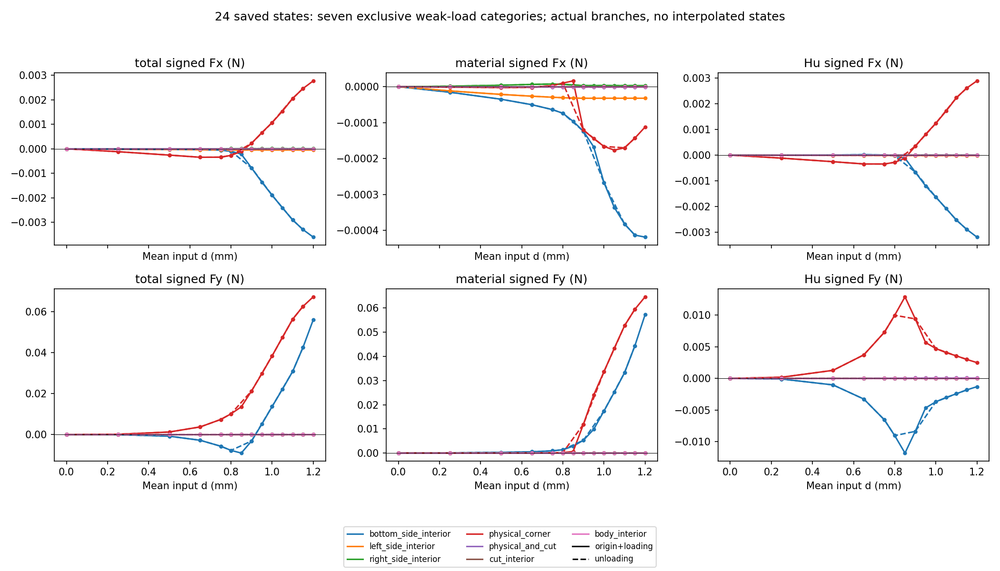
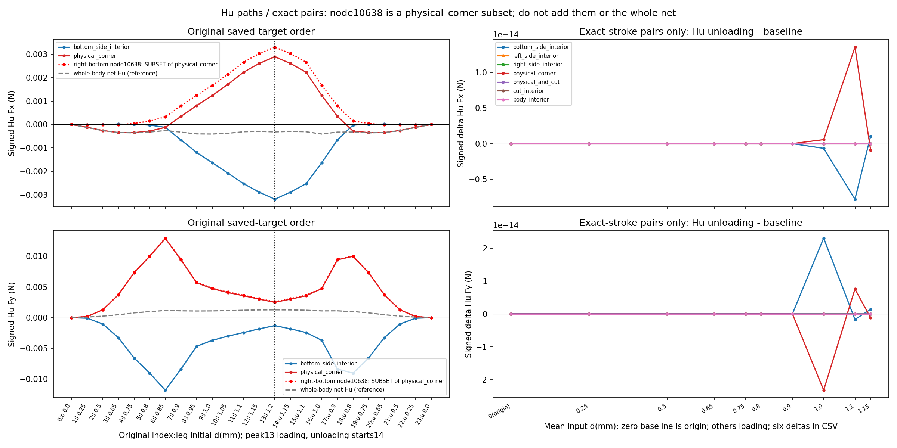

# M-LEDGER2：全24保存态账本与加载／卸载分支已通过

2026-10-11（Asia/Seoul），用户明确批准“批准按 M-LEDGER2 卡执行”后的唯一启动实际PASS：exit0、stop_reason null、ledger开始／完成1／1、PNG写入2；helper 2.0611876000 s／outer 2.4078435000 s，采样自身 RSS 147402752 B／tree RSS 162406400 B。40份绑定保持，无重试、修复重跑、延期或force。本窗口已经关闭。

[全24账本JSON](run_001/ledger.json) · [原节点文本CSV](run_001/all_nodes.csv) · [七类六分量CSV](run_001/category_loads.csv) · [精确同d配对及六差CSV](run_001/paired_branch_differences.csv) · [helper收据](run_001/execution_receipt.json) · [outer收据](ledger_launch.json) · [stdout](ledger_stdout.log) · [直接授权记录](author/authorization_record.json) · [独立终态审阅](author/terminal_review.json) · [只读物理解读／下一步依据](author/physical_next_scope.json) · [原冻结卡](M-LEDGER2_CARD.md) · [原协议](protocol.json)。终态报告原字节SHA`b471e2cdf06706f9439ac9eee21cf63d1736038bccd27ae5520d51931a475396`，物理解读SHA`9e6affded84f07f5f03aa4e2dc5a4b868d138d7c7d3e4220b002f7d48a5ed63e`。原卡／协议的prepared和授权记录execution_started=false保留执行前历史；实际收据证明当前运行事实。

## 整体目标、已有工作与这一步的理由

整体目标是读取普通LF几何，独立完成HF有限变形／第三介质接触(TMC)前向评估，提供可核对的反力、工件载荷、实际变形和加载／卸载响应，供外部研究层比较，并能跨目录／机器恢复继续开发。HF不优化、不调用dmftd；继续main，origin保持https://github.com/dudaxing/Compliant-TO-TMC.git。

此前已有h0.5细网格24接受态完整循环、M-VIEW1真实变形、M-REF2自身48次保存态HP参考和M-LINK1关联入口。M-LEDGER1四态账本显示底边负Hu与角点正Hu抵消，整体净值不足以解释局部载荷。本次复用原[公共stdlib函数](../../../hf_repo/src/hf_eval/saved_workpiece_loads.py)，由192行[薄caller](execute_full_saved_ledger.py)唯一调用selected_states=None，完成原0..23全24态保存表处理，并展示载荷抵消如何随原目标序列及卸载改变。

原703身体节点每态完整，16872原节点行、168七类行。原身份／node ID／参考坐标及六力字符串保持，包括signed zero和卸载微小残量；七类互斥，角点与物理／切面交点独立，不分摊到相邻侧。原whole直接精确对账与旧四组8·2^-52·节点L1闭合通过，无绝对误差地板、不强制total=material+Hu。原0／8／13／23完整保存态对象与M-LEDGER1逐项一致，直接比较已算数据，未二次分类或求和。

独立终态审阅核对保存身份、原文字／rawSHA、已存闭合记录与配对标量减法，PASS；没有重新分类、fsum、HP或绘图，不是新增独立科学试验。主Agent已实际查看两PNG，原图保持。公共模块原qualification字符串保留，其中no full24 qualification指力核科学资格；caller的processing_scope明确本次确已完成全24保存表处理，两者不能混淆。

## 实际功能效果、资源与完整数值入口

新增保存表分类／汇总1次、精确配对六分量标量差及两Matplotlib图。新增NPZ／F／T／HP／模型构造／平衡求解／原观察器为0，是冻结来源调用路径依据，未动态监控mechanical hooks。本卡没有重求解旧循环，未重画旧位置图／峰值图／GIF。helper时间／RSS是末checkpoint后、成功收据构造／写入前快照；outer为完整launcher终态。原180／240秒、采样8GiB额度保持；RSS采样不是OS硬限制，依赖和严格科学源码未改。

物理任务保持84×40mm下半域、h0.5、固定方形中心(71,40)mm／边长18mm、身体x62..80／y31..40，E1MPa、ν0.3、厚度20mm，原平均输入0→1.2→0mm。以下是已存整体载荷，15位有效数字仅作紧凑显示；CSV／JSON保存完整精度和原节点文字。N单位的节点弱式力已经含原厚度，不再乘厚度。

| 原索引／leg／d(mm) | total Fx(N) | total Fy(N) | material Fx(N) | material Fy(N) | Hu Fx(N) | Hu Fy(N) |
|---|---:|---:|---:|---:|---:|---:|
| 0／origin／0 | 0 | 0 | 0 | 0 | 0 | 0 |
| 1／loading／0.25 | -0.000150972242003623 | 0.000195939154977703 | -2.69767448503564e-05 | 0.000106343705640709 | -0.000123995497153266 | 8.9595449336994e-05 |
| 2／loading／0.5 | -0.000317649678427964 | 0.000554673957869097 | -5.52416212441104e-05 | 0.000307073004394079 | -0.000262408057183854 | 0.000247600953475018 |
| 3／loading／0.65 | -0.000415536058454968 | 0.00104828046166042 | -7.27431409071814e-05 | 0.000578411738604916 | -0.000342792917547787 | 0.000469868723055504 |
| 4／loading／0.75 | -0.000439030176074464 | 0.00179258480625971 | -8.33709870957316e-05 | 0.00101632402574543 | -0.000355659188978732 | 0.000776260780514275 |
| 5／loading／0.8 | -0.000409582222532579 | 0.00252839824807689 | -8.87311331235457e-05 | 0.0015448697952023 | -0.000320851089409033 | 0.000983528452874597 |
| 6／loading／0.85 | -0.000366110162377146 | 0.00463657755012594 | -0.000108741158802398 | 0.00347907536302436 | -0.000257369003574748 | 0.00115750218710158 |
| 7／loading／0.9 | -0.00059815139534017 | 0.0182759556115877 | -0.000274515191786722 | 0.0171701553718689 | -0.000323636203553448 | 0.00110580023971883 |
| 8／loading／0.95 | -0.000741950949775612 | 0.034889988688896 | -0.000341949593762779 | 0.03381054217323 | -0.000400001356012833 | 0.00107944651566605 |
| 9／loading／1 | -0.000868886468612131 | 0.0521790298902158 | -0.000463249807919498 | 0.0510845975695903 | -0.000405636660692634 | 0.00109443232062549 |
| 10／loading／1.05 | -0.000917577175918433 | 0.0696105864770317 | -0.000542724975476533 | 0.0684752692085786 | -0.0003748522004419 | 0.00113531726845307 |
| 11／loading／1.1 | -0.000891516390571985 | 0.0871287802127745 | -0.000582698140363666 | 0.0859185747300612 | -0.000308818250208319 | 0.00121020548271331 |
| 12／loading／1.15 | -0.000880901138345927 | 0.105021105754739 | -0.00058658758110511 | 0.103765903399251 | -0.000294313557240817 | 0.00125520235548812 |
| 13／loading／1.2 | -0.000876015704617331 | 0.12317940160165 | -0.000561226821740675 | 0.121912557058721 | -0.000314788882876656 | 0.00126684454292901 |
| 14／unloading／1.15 | -0.00088090113834562 | 0.10502110575478 | -0.000586587581104968 | 0.103765903399292 | -0.000294313557240651 | 0.00125520235548833 |
| 15／unloading／1.1 | -0.00089151639054749 | 0.0871287802111354 | -0.00058269814034493 | 0.0859185747284162 | -0.00030881825020256 | 0.00121020548271915 |
| 16／unloading／1 | -0.000868886468398755 | 0.0521790298549852 | -0.000463249807706028 | 0.0510845975343598 | -0.000405636660692727 | 0.00109443232062536 |
| 17／unloading／0.9 | -0.000598151395340127 | 0.0182759556115854 | -0.000274515191786691 | 0.0171701553718666 | -0.000323636203553436 | 0.00110580023971883 |
| 18／unloading／0.8 | -0.000409582222532575 | 0.00252839824807691 | -8.87311331235457e-05 | 0.0015448697952023 | -0.000320851089409029 | 0.000983528452874616 |
| 19／unloading／0.75 | -0.000439030176074466 | 0.0017925848062597 | -8.33709870957317e-05 | 0.00101632402574543 | -0.000355659188978734 | 0.000776260780514269 |
| 20／unloading／0.65 | -0.00041553605845497 | 0.0010482804616604 | -7.27431409071815e-05 | 0.000578411738604916 | -0.000342792917547788 | 0.000469868723055489 |
| 21／unloading／0.5 | -0.000317649678427966 | 0.000554673957869095 | -5.52416212441104e-05 | 0.000307073004394079 | -0.000262408057183856 | 0.000247600953475015 |
| 22／unloading／0.25 | -0.000150972242003623 | 0.000195939154977703 | -2.69767448503564e-05 | 0.000106343705640709 | -0.000123995497153266 | 8.95954493369945e-05 |
| 23／unloading／0 | 1.06927721042486e-27 | -4.55378536249808e-27 | 1.11440905521507e-28 | -2.94576113357643e-28 | 9.57836304903354e-28 | -4.25920924914044e-27 |

原峰值输入反力R=0.37870645239539324N、平均输出q_out=1.0166993609101365mm；这是M-CYCLE1已有结果，本卡不重新计算。峰值工件下半Fy=0.12317940160165043N，不等于完整镜像净Fy；镜像净力为(2Fx,0)，两侧法向幅值和2|Fy|是另一个量。holding反力与ON-body力相反号，固定体结果不证明释放后稳定夹持。

## Hu局部载荷与精确同位移差

本次全路径账本把局部Hu Fy极值定位到原6／loading0.85mm，区别于原8／loading0.95mm的积分点Hu最大分量记录。节点弱式载荷和Hu场分量是不同量，极值态无需相同；不能把M-LEDGER1选0.95mm称为已取到分区载荷最大值。下面展示0.85／0.95／峰值1.2mm的保存分量。

| 原索引／d(mm) | 底边Hu Fx(N) | 底边Hu Fy(N) | 两角点Hu Fx(N) | 两角点Hu Fy(N) | 右下角Hu Fx(N) | 右下角Hu Fy(N) | whole Hu Fx(N) | whole Hu Fy(N) |
|---|---:|---:|---:|---:|---:|---:|---:|---:|
| 6／loading／0.85 | -0.000120354261665073 | -0.0117942306466053 | -0.000122047025336434 | 0.0128926966729033 | 0.0003277385288119 | 0.0129522180029422 | -0.000257369003574748 | 0.00115750218710158 |
| 8／loading／0.95 | -0.00119141022930386 | -0.00466383876737659 | 0.00080617473457562 | 0.00567684915523029 | 0.00124443583754351 | 0.00575560151521382 | -0.000400001356012833 | 0.00107944651566605 |
| 13／loading／1.2 | -0.00318177203643842 | -0.00129976014459871 | 0.00288328319995428 | 0.00249653605492897 | 0.00329461262556842 | 0.00259198960690497 | -0.000314788882876656 | 0.00126684454292901 |

node10638(80,31)mm是physical_corner两角点类别的子集，不能与该类别相加，也不能与whole净值相加。底边与角点有符号抵消，whole净Hu不能替代局部说明。节点广义弱载荷包含基函数归属和Hu项，本表不证明真实连续压力集中在单个点，也不把角点向量除面积变成压力。

精确同d有9个非零loading／unloading对，另有origin0／unloading0基线，共10对70类别行。baseline_leg=origin保持；没有unloading0.85／0.95／1.05／1.2记录，不插值或制造峰值卸载。下表是物理解读报告直接读取配对CSV得到的六列最大绝对差所在行，展示其**原有符号差**；只是保存标量选择，没有重分类、重新求差或力求和。差是unloading减baseline，类别向量不归给单独节点。

| 分量 | 最大绝对差所在类别 | d(mm) | baseline → unloading原索引 | 原有符号差(N) |
|---|---|---:|---|---:|
| total_Fx_N | physical_corner | 1 | 9／loading → 16／unloading | 2.11891051579705e-13 |
| total_Fy_N | physical_corner | 1 | 9／loading → 16／unloading | -3.50738604826262e-11 |
| material_Fx_N | physical_corner | 1 | 9／loading → 16／unloading | 2.11324149368766e-13 |
| material_Fy_N | physical_corner | 1 | 9／loading → 16／unloading | -3.50506776380932e-11 |
| Hu_Fx_N | physical_corner | 1.1 | 11／loading → 15／unloading | 1.35286747082741e-14 |
| Hu_Fy_N | physical_corner | 1 | 9／loading → 16／unloading | -2.31932528738099e-14 |

全部差值保持原数量级与方向，不加显著性门、不清零、不做近零占比。保存样本基本沿已有路径回返的数值现象，不能自动解释为物理耗散、迟滞资格、唯一平衡支或网格收敛。

## 两张实际新图与原结构变形

第一图是七互斥类别的total／material／Hu × Fx／Fy六面板。origin+loading实线／点，实际unloading虚线／点；各支只连接原保存样本，峰值13保留loading身份，卸载从14开始。

第二图左列显示原24目标序列的Hu Fx／Fy（底边、两角点、右下角子集与whole净值），右列只显示10个精确配对的七类Hu差；全部六分量差在CSV，零位移明确为origin基线。**显示局限：左下Hu Fy面板图例遮住部分卸载底边蓝色曲线；原CSV／JSON完整，按本卡保持原图，不再渲染。**右列的微小刻度是原差值，没有归零。

实际结构的×1变形和工件节点弱式力箭头继续查看[既有24帧GIF](../../../functional_views/native_nested_cycle_20261009/complete_001/run_001/view/fixed_square/actual_states.gif)。本卡没有新增结构变形、应力场或平衡求解；旧结果／参考／图件／producer flags保持原历史字节。

## 下一步与尚未完成的能力

最近仅准备读取**原6／loading0.85mm和原13／loading1.2mm两态已保存的工件外邻单元材料P**，核对外邻归属、原solid／medium材料相位及采样位置并可视化，再审视与现有材料弱力的关系。两态分别代表强局部Hu抵消和峰值载荷；不新增本构／force调用。普通view JSON／CSV没有现成外邻P表，但原state.json声明forces.npz中的stress_first_piola为float64[13440,9,2,2]。本次只读声明及源码，未解码NPZ、复核其档案SHA或读取P数值，真正读数组属下一卡范围，尚未授权或执行。

原tmc_kernel.py的9采样点是xi／eta∈{-1,0,1}，Simpson一维权1／4／1，含单元边界点，xi慢／eta快；不能称为内点Gauss或默认需要插值P。后续仍需按原points核对外邻边界三点索引、参考身体法向、所属边和单独线权重，不能把“材料P数组已保存”说成“外邻边界迹／线积分已准备完成”。具体来源、预算、采样定义与最小显示方案需另行冻结和独立审阅；当前只推荐，不增加物理资格。

固定工件是运动学overlay，内部F=I、P／Hu=0，不能用内部P解释外传载荷。材料P本身不含厚度；未来参考边界P·N线积分需乘厚度20mm一次，使用线积分权重，不能把已含面积×厚度的体积分权重拿来作线权重。原节点N力已经含厚度，不能重复乘。材料P·N仍只解释材料分量，不是材料＋Hu总边界力或总压力；总边界力重建还需物理侧／切面／角点／离散余项的定义。

原HP参考仍限精确模型／任务的24接受态及5节点PORT方向，不是全列切线或应力HP；两网格只是敏感性。总边界力、压力／有效夹持、自由体／摩擦、圆体任务、网格／域收敛、全列切线、正式HF5标签／批量排名仍未完成。本步扩展了可解释的保存态载荷功能，整体开发目标没有缩为账本整理。四当前入口完整旧正文及本次源码／报告原字节归档，供审查对照。
