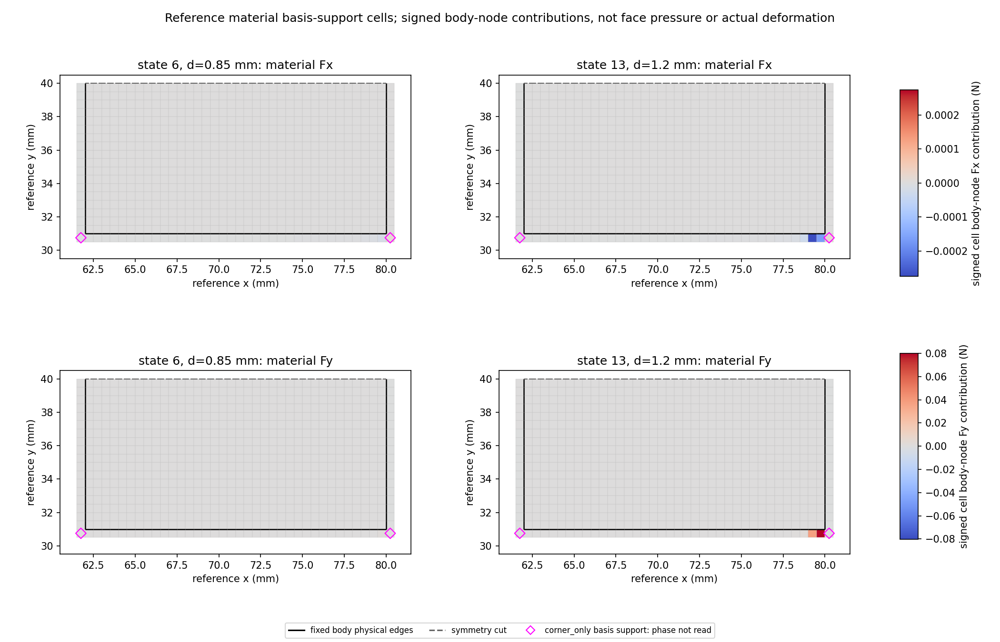
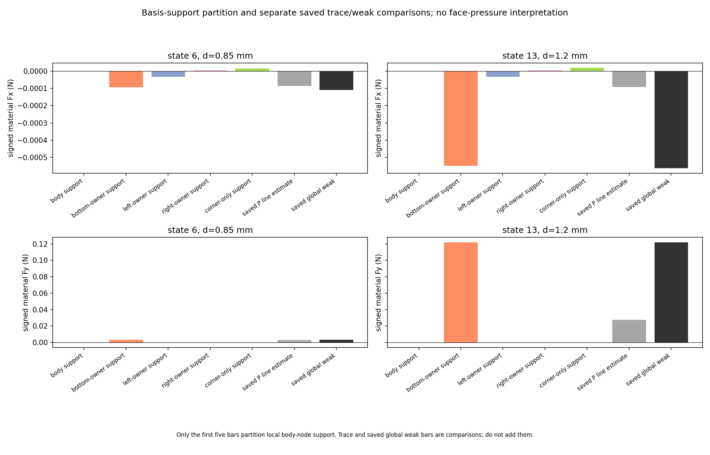

# M-SUPPORT1 实际结果：两态材料弱载荷的单元支撑来源

2026-10-11，Asia/Seoul。人类批准后本卡唯一运行 PASS，exit 0、stop reason 为 null，执行窗口已结束。[独立终态审阅](author/terminal_execution_review.json)通过；[物理结果解读](author/physical_results_review.json)说明了当前定位及其限制，不是新科学验收门。主任务已经读取两张实际 PNG 像素，[视觉记录](author/visual_review.json)保留人工检查及共同尺度的限制。本报告不授权下一阶段。

## 目标、本步功能与理由

整体目标仍是从普通 LF 几何出发，建立独立 HF 有限变形／TMC 前向器，提供可追溯、可解释的反力、工件载荷和实际变形，供外部研究层比较；HF 不承担 LF 优化。开发继续 main，origin 为 `https://github.com/dudaxing/Compliant-TO-TMC.git`。

上一步 [M-PTRACE1](../nested_material_trace_001/RESULTS.md) 发现峰值态的材料边界线估计 Fy 为 0.027662985836060965 N，而原材料节点弱载荷为 0.12191255705872141 N。这是材料与材料的差，不能用 Hu 补平。本步直接追溯原保存单元力在工件节点上的支撑贡献，先定位差异来自哪些单元，再判断下一步。

新增公共入口 [saved_material_support.py](../../../hf_repo/src/hf_eval/saved_material_support.py) 读取普通数组，重播原材料组装并输出局部出现、支撑单元、节点、五组与整体载荷；调用器见 [execute_saved_material_support.py](execute_saved_material_support.py)。仅分析原 loading 态 6／0.85 mm 和 13／1.2 mm，没有重做加载、扩大状态或调用力核。

## 实际完成与对账

本次受控读取 **3 个既存 NPZ／8 个数组字段**：模型的 coordinates／connectivity／edofs／workpiece_nodes，以及两态各自的 element_material_force／global_material_force。身体 cells／nodes／DOFs 与全部 fixed DOFs 使用原模型 JSON；原 state、result、nodal 和已存 PTRACE JSON／两张 CSV 实际读取并关联。没有新增 P／lift／fluctuation 数组解码，没有调用本构、force-kernel、tangent、solver 或 HP。

公共 API 完成 2 次、原 C-order 材料 `np.bincount` 重播完成 2 次。每次都与保存的完整 global_material_force **精确数值数组相等**，并与原 nodal／state／PTRACE 的材料节点和整体记录精确关联；这不表示字节或 signed-zero 门，也不是新的本构参考测试。

每态实际覆盖 **2738 个局部 body-node 出现、722 个支撑单元、703 个工件节点**。五组单元数为 body648／bottom_owner36／left_owner18／right_owner18／corner_only2。最多每节点 4 个局部贡献的前提已实际检查，局部出现只归一组；作用于工件的力为原内部材料力的负号，单位 N，已含原厚度 20 mm。不得把整个单元八分量之和归给身体。

输出为 [support.json](run_001/support.json)、[occurrences.csv](run_001/occurrences.csv) **5476 行**、[cells.csv](run_001/cells.csv) **1444 行**、[nodes.csv](run_001/nodes.csv) **1406 行**、[groups.csv](run_001/groups.csv) **10 行**、[whole_material_comparison.csv](run_001/whole_material_comparison.csv) **2 行**，以及两 PNG 和 helper 收据。绑定的原文件保持原字节。

局部重排采用 `fsum`，节点／整体使用本卡新定义的 **8eps × 被选原局部元素力 L1** 界，无绝对地板。原 M1/M2 的原节点 L1 门没有替换或放宽。整体对账中的保存值如下。

| 原态 | 原整体材料 Fx（N） | 原整体材料 Fy（N） | 局部重组 Fy 误差（N） | 对应局部 L1 界（N） |
| --- | ---: | ---: | ---: | ---: |
| 6／0.85 mm | −0.00010874115880239823 | +0.0034790753630243565 | +4.336808689942018e−19 | 6.236745013039355e−18 |
| 13／1.2 mm | −0.000561226821740675 | +0.12191255705872141 | 0 | 2.1662154724138899e−16 |

两态整体 Fx 重组误差均为 0。以上一致性说明本次保存数据的组装、节点来源与支撑重组相互吻合，不等于证明原力核或连续接触解的全部物理正确性。

## 主要数值效果与认识

下表聚焦差异最大的 Fy；完整有符号 Fx／Fy、身份与侧面线对照保留在 groups.csv。owner 名称表示原外邻单元的 **Q1 基函数支撑**，不是压力面分区。

| 支撑组 | 单元数／局部出现 | 态 6 材料 Fy（N） | 态 13 材料 Fy（N） |
| --- | --- | ---: | ---: |
| body | 648／2592 | 0 | 0 |
| bottom_owner | 36／72 | +0.0033910508870495064 | +0.12182859983276352 |
| left_owner | 18／36 | +1.4737051050858142e−7 | −5.097194596754657e−8 |
| right_owner | 18／36 | −0.000008292742268490472 | −0.000009479212505942134 |
| corner_only | 2／2 | +0.00009616984773283217 | +0.00009348741040979886 |

峰值态的大差已经定位到 bottom_owner 支撑与其对应边界迹之间。两个 corner_only 单元的合力较小，不能解释 0.094 N 量级的整体差；它们的材料相位本卡没有读取，不推断为 third_medium。body 组原值保留，未预先丢弃或强置零。

| 原态 | bottom_owner 支撑 Fy（N） | 原 bottom 侧线 Fy（N） | 已保存的 support−side-line（N） |
| --- | ---: | ---: | ---: |
| 6 | +0.0033910508870495064 | +0.0029375878559500844 | +0.00045346303109942195 |
| 13 | +0.12182859983276352 | +0.02767261448134528 | +0.09415598535141824 |

这两列同样关联原 bottom 外邻 owner，但计算对象不同：一列是投影到身体节点的材料体积弱式贡献，另一列是原外邻上缘 P 的参考线估计。因此不能强制相等。三 owner 组的旧侧线与解释性差已经保存；body／corner_only 没有对应侧线，JSON 保留 null、CSV 留空。

右端底边 owner **cell10407** 的两个被选身体节点为 10638／10637，其 Fy 支撑贡献在态 6 为 0.001323795449585901 N，在态 13 为 **0.08022435531475952 N**。该单元对应旧上缘线估计分别为 0.0010176156584012655／0.01938390857410906 N。这把后续检查进一步缩小到末端底边单元的局部表达。

峰值右下角 node10638（80,31 mm）的保存材料 Fy 为 **0.06463699536344664 N**。其四个原局部来源中，bottom_owner cell10407 的 TR 节点贡献为 0.06454458426460088 N；corner_only cell10408 的 TL 为 0.00009288774360512067 N；right_owner cell10576 的 BL 为 −4.766447593715984e−7 N；body cell10575 为保存的零值。这里的大角点节点载荷主要归属底边 owner 的基函数支撑，不能与 corner_only 类混同，更不能称为单面压力集中。

当前已定位了支撑来源，仍未解释同一单元体积弱式与边界迹差异的因果。基函数、其余面、Div(P)、单元应力跳跃、积分采样和保存应力表达都不能仅凭本卡确认为原因；也不能把这项差异称为舍入噪声或直接判定为求解器错误。

## 两张实际图与人工检查

主任务已实际读取两张 **2100×1350** PNG 的像素。第一张显示参考网格的单元工件节点贡献，Fx／Fy 各自让两态共用有符号色标；工件物理边、对称切面与 corner_only 单元标记清楚。它不是实际变形图，实际结构作用可对照 [M-PTRACE1 原图](../nested_material_trace_001/run_001/actual_material_trace.png)。

第二张显示五组支撑贡献与两项既存比较量，Fx／Fy 各自共用纵轴。**只有前五组构成支撑分解，旧 P 线估计与原 global weak 是比较项，不要相加。**共同尺度使侧组、corner_only 与态 6 的 Fy 看似接近零，应按 CSV 判断其实际值，不以图上近零代替数值或设置力阈值。原两图保持，不重绘。

## 成本、资格与最近一步

一次预算为 helper180 秒／outer240 秒／采样 RSS 8 GiB。实际 helper 为 **1.9246779000095557 秒、自身采样峰值 113950720 B**；outer 为 **2.116422799997963 秒、进程树采样峰值 129019904 B**。helper 数值在输出 SHA 与末 checkpoint 完成后、成功收据构造／写入前取得；outer 覆盖完整终态。采样合同不是 OS 硬限制。本次未重试、修复重跑、延期或 force。

实际状态见 [人类授权](author/authorization.json)、[helper 收据](run_001/execution_receipt.json) 和 [终态记录](support_launch.json)。批准源码提交为 `fa872739247a2a5d96043b1c05d28e9f08a77b88`；原卡／protocol 的准备标志与授权记录中的 executed_at_record=false 保留为启动前历史，不表示当前未执行。

本步实现了保存材料力的组装重播、节点来源和支撑分解功能，有新读取、投影、fsum、差值／界计算和绘图；没有新增材料本构或力核计算。压力、含 Hu 的总边界作用、有效夹持、自由工件／摩擦、系统多工况对比、网格收敛与正式 HF5 标签／排名仍未完成。原节点力与边界线估计均未改值，原资格保持。

最近一步应聚焦峰值态 **10406／10407 等末端 bottom_owner 单元**，规划同一单元九点保存 P／原体积弱收缩与上缘迹的局部对照，核清离散表达及采样的关系。这是据实际结果收窄的粗路线；新的 P／grad 读取、计算范围和额度尚未制定执行卡或取得授权。先解释当前局部差异，再决定实现改进与 Hu 总边界功能，不继续堆全路径账本。

本报告整理及独立解读仅读取本次与既存的普通保存 JSON／CSV／来源文件，没有再解码 NPZ、重运行 API、重新投影／积分／fsum、生成新图或更改门禁；人工像素观察由主任务提供。一次授权运行的实际计算与后续文档整理范围明确分开。
