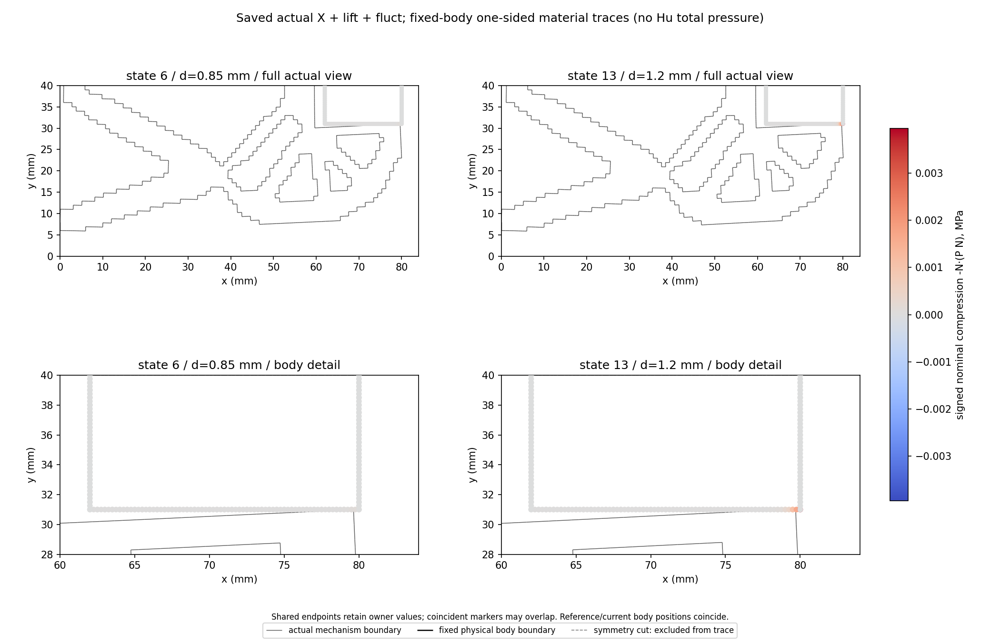
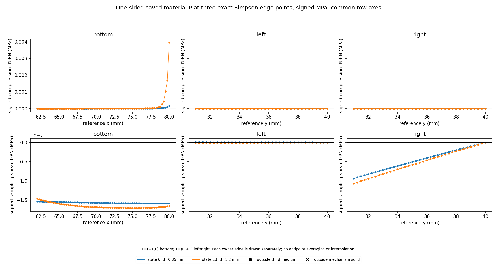

# M-PTRACE1 实际结果：两态工件外邻材料迹与原弱力对照

2026-10-11，客户端 Asia/Seoul。本卡唯一运行已 PASS，exit 0、stop reason 为 null；执行窗口已结束。两态材料迹与两张新图已实际生成。这里记录保存结果的功能与物理含义；独立终态审阅和实际图面核对已归档，详见文末。本报告不授予下一阶段执行额度。

## 整体目标、本步做什么及理由

整体目标是从普通 LF 几何出发，在独立 HF 有限变形／Third Medium Contact 前向任务中，获得可追溯、可解释的反力、工件载荷和真实变形，供外部研究层比较。HF 前向器不承担 LF 优化。开发仍在 main，origin 保持 `https://github.com/dudaxing/Compliant-TO-TMC.git`。原完整加载／卸载、保存态参考、实际变形、API 关联和全 24 态节点载荷账本的结果继续保留；历史依据见 [M-LEDGER2 实际结果](../nested_ledger_002/RESULTS.md)。

M-LEDGER2 表明，加载 0.85 mm 的底边与物理角点存在相反的 Hu 节点载荷，整体净值隐藏了局部抵消；加载峰值 1.2 mm 的整体材料 Fy 为 0.12191255705872141 N。本步选择这两个原 loading 态，直接读取已经保存的外邻材料第一 Piola 应力 P，明确“材料在工件边界附近如何传力”，并与既存整体材料弱载荷并列。它们分别是原 index 6、d=0.85 mm 和 index 13、d=1.2 mm；没有重做原加载路径或扩大到其余 22 态。

本步新增公共入口 [saved_material_trace.py](../../../hf_repo/src/hf_eval/saved_material_trace.py)，以普通数组为输入，返回外邻 owner、相位、原边界采样、材料 PN 和独立参考线积分。薄调用器见 [execute_saved_material_trace.py](execute_saved_material_trace.py)。本步发生了新的保存数组读取、PN／线积分派生计算和绘图；没有调用本构、force-kernel、tangent、solver 或 HP，没有重新构造力学模型。

## 实际完成及来源

唯一运行读取 5 个既存 NPZ、12 个指定数组字段：模型一次取 coordinates／connectivity／solid／workpiece_cells／points／thickness；两态 forces 各一次只取 stress_first_piola；两态 state 各一次只取 lift／fluctuation。原 archive SHA、选定字段 dtype／shape／C-order raw SHA 均按 descriptor 检查。两态身份同时与原 state.json、result.states 和 view summary.rows 关联；nodal／geometry JSON 不虚构 state SHA，依原文件绑定和同源身份链关联。

公共 API 开始／完成均 2 次；受控档案读取开始／完成均 5 次；PNG 写入 2 次。每态保留原 canonical physical72／cut36 无向节点边身份。物理边为 bottom36、left18、right18；top 对称切面排除。实际输出为 **432 个原边界样本、144 条边、6 个侧面、2 个整体对照**，所有绑定保持原字节。

当前事实以 [人类授权](author/authorization.json)、[helper 实际收据](run_001/execution_receipt.json) 和 [完整终态记录](trace_launch.json) 为依据。授权明确为“批准按 M-PTRACE1 卡执行”，批准源码提交 `d0704a7951f8bbf0bda967d05a07d820380a62e1`。原 [卡](M-PTRACE1_CARD.md) 与 [protocol](protocol.json) 的“源码准备／未批准／未执行”标志保留为冻结的历史快照，不代表当前运行状态。

## 数值效果

材料名义牵引采用外邻单元 `PN = P_outer · N_body`，单位 MPa，即 N/mm² 参考面积。body 外向参考法向分别为 bottom=(0,−1)、left=(−1,0)、right=(+1,0)。名义压缩为 `−N·PN`；剪量为 `T·PN`，采样正向 T 在 bottom 为 (+1,0)，left／right 为 (0,+1)。原符号保留，不截负值或用绝对值替代。

三个真实边界采样直接来自原 xi 慢／eta 快的九点 Simpson 数据：bottom 对外邻 top 的 [2,5,8]，left 对外邻 right 的 [6,7,8]，right 对外邻 left 的 [0,1,2]。共享端点按各 edge／owner 保留，不平均、不插值。

解释性材料线估计使用每边独立参考权 `L·[1,4,1]/6`，乘原厚度 20 mm 一次，结果单位 N。P 本身不含厚度；原节点弱载荷已含厚度。原体积积分 weights 没有用作线权。下表直接摘录保存的 [whole_material_comparison.csv](run_001/whole_material_comparison.csv)，差值为本次已经保存的“线估计减原整体材料弱载荷”。

| 原态／d（mm） | 分量 | 材料线估计（N） | 原整体材料弱载荷（N） | 保存差（N） |
| --- | --- | ---: | ---: | ---: |
| 6／0.85 | Fx | −0.00008694525462071682 | −0.00010874115880239823 | +0.000021795904181681408 |
| 6／0.85 | Fy | +0.0029293605006823825 | +0.0034790753630243565 | −0.0005497148623419741 |
| 13／1.2 | Fx | −0.00009155164704868371 | −0.000561226821740675 | +0.0004696751746919913 |
| 13／1.2 | Fy | +0.027662985836060965 | +0.12191255705872141 | −0.09424957122266045 |

各物理侧材料线估计如下，完整原精度与身份保留在 [sides.csv](run_001/sides.csv)。

| 原态 | 侧面／边数 | Fx（N） | Fy（N） |
| --- | --- | ---: | ---: |
| 6 | bottom／36 | −0.000056523042422433765 | +0.0029375878559500844 |
| 6 | left／18 | −0.00003365785450415484 | +0.00000007280391699754786 |
| 6 | right／18 | +0.000003235642305871789 | −0.00000830015918469907 |
| 13 | bottom／36 | −0.000059694259652775986 | +0.02767261448134528 |
| 13 | left／18 | −0.00003385010913471132 | −0.00000013616683250650892 |
| 13 | right／18 | +0.000001992721738803633 | −0.000009492478451806918 |

两态的正向 Fy 线估计主要出现在 bottom；峰值态的线估计与原整体材料弱载荷有明显差异。这是需要继续解释的实际发现，不能仅因原运行 PASS 就忽略，也不能直接当成力核错误。线估计取外邻单元边上的 P，而原弱载荷来自完整 body 节点的内部弱力投影，两种离散操作、基函数支持范围和应力表达并不相同。本卡没有设相等、百分比或近零科学门。

## 可视化与人工检查用途

第一张图显示两个原态的全域实际结构边界及工件附近细节，并以同一有符号色标显示材料名义压缩。坐标严格复用原 viewer 的左结合 `X + lift.reshape(-1,2) + fluctuation.reshape(-1,2)`，只用于显示，不替代精确 split 力学状态。工件固定，因此其参考与当前边界重合；结构以实际位移显示，未放大。

第二张图按 bottom／left／right 展示有符号名义压缩与约定剪量，两态共用每行纵轴，图例外置。每条 edge 的原三个点单独绘制，不跨 owner 平滑连接。第一张图中重合端点可能相互遮盖；原 owner 特异值完整保留在表中。

原 24 态实际变形路径仍见 [原 24 帧 GIF](../../../functional_views/native_nested_cycle_20261009/complete_001/run_001/view/fixed_square/actual_states.gif)。新两图帮助定位两态材料迹与实际结构作用位置，不代表全 24 态的新应力曲线、迟滞判定或接触压力资格。图件的实际观察实况见文末。

## 成本、限制与下一步

一次 helper／outer 预算为 180／240 秒、采样 RSS 8 GiB。实际 helper 为 **1.9568402000004426 秒／自身采样峰值 114257920 B**；outer 为 **2.2380354999913834 秒／进程树采样峰值 118493184 B**。helper 数值是输出 SHA 与末 checkpoint 完成后的成功收据构造／写入前快照；outer 覆盖完整进程终态。内存合同是采样限制，不是 OS 硬限制。没有重试、修复重跑、延期或 force。

本步完成的是“读取既存 P、核对外邻归属与原采样、显示材料名义传力、提供线估计与原弱力对照”。材料 P·N 不包含 Hu；这里没有总边界作用、Cauchy／当前面积压力、已合格夹持力、自由工件／摩擦、多工况或新网格收敛证据。固定 overlay 内部 P=0 也不能用来否定外邻传力。原完整路径及既有参考资格保持；HF 总目标和正式 HF5 标签／排名仍未完成。

下一步优先解释峰值态的材料差值：在独立规划中，核对原保存单元材料弱力投影到 body 节点的支持范围，尤其是角点外邻单元贡献，并梳理体积弱式与外邻面迹的不同离散求积和应力表达。当前证据尚未分解这些差异，不能指定哪一项是已确认原因。完成这层解释后，再决定 Hu 总边界作用和夹持功能应怎样推进；不强制修改原值来使两者相等，也不立即扩成全路径 P 分析。本卡关闭后，后续读取与派生计算需要新的具体范围与授权。

复核保存数值可从 [material_trace.json](run_001/material_trace.json)、[samples.csv](run_001/samples.csv)、[edges.csv](run_001/edges.csv)、[sides.csv](run_001/sides.csv) 和 [whole_material_comparison.csv](run_001/whole_material_comparison.csv) 开始。本结果记录仅读取这些保存输出和原收据／来源文件，没有解码 NPZ、重运 API、重算线积分、生成新图或更改验收门。

## 实际图面核对与接续

root 已通过 view_image 读取并检查两张实际 PNG 的像素，没有重新生成图。实际变形图可见下半结构、固定工件与接触邻域，1.20 mm 态材料压缩颜色集中在底边右端；载荷图保留三侧的有符号压缩／剪量和两态共同轴尺度。标题、MPa 色标、图外图例和采样切向说明均可读。重合 owner 端点可能遮挡；共同压缩轴使微小侧面负值看似接近零，完整样本仍在 CSV，不能按图将其归零。

本次两态各72外邻 owner均为原 third_medium；底边压缩为正，侧面保留微小负名义压缩。外邻材料迹和原完整工件节点弱力并列，不把 −0.09424957122266045 N 的峰值 Fy 差归为舍入噪声，也不用 Hu 补材料对材料的差。最近下一步优先定位原材料弱力的局部 Q1 支撑／体积积分与保存外邻面迹之间的关系，再规划总 Hu 边界作用与夹持功能；尚未批准或执行下一张卡。

[直接人类批准](author/authorization.json) · [实际 helper 收据](run_001/execution_receipt.json) · [完整终态](trace_launch.json) · [终态独立审阅](author/terminal_execution_review.json) · [物理结果独立审阅](author/physical_results_review.json) · [实际图面核对](author/visual_review.json) · [原源码提交发布恢复](author/M_PTRACE1_source_publication_receipt.json)

冻结 protocol/card 的 prepared／authorized／executed 是准备时历史字段，保持原字节以追溯来源；当前明确批准与实际一次执行分别由 authorization 和两终态收据证明。M-PTRACE1 资源窗口已关闭，实际 PASS 范围是两态保存读取／材料迹／线估计及显示，不升级原力核、切线、HP、总压力、有效夹持、收敛、正式标签或 HF5。
