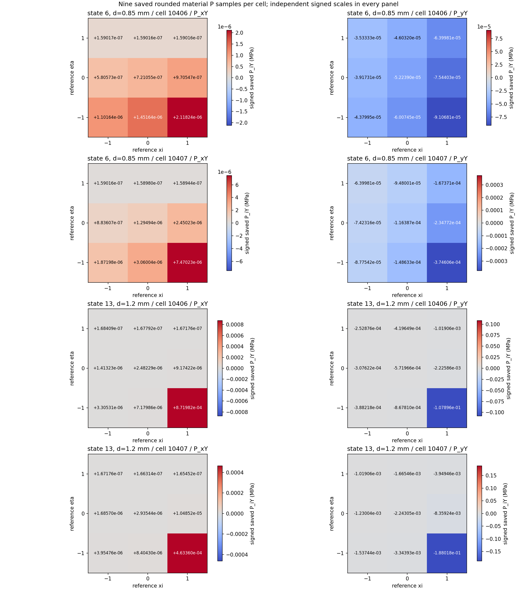
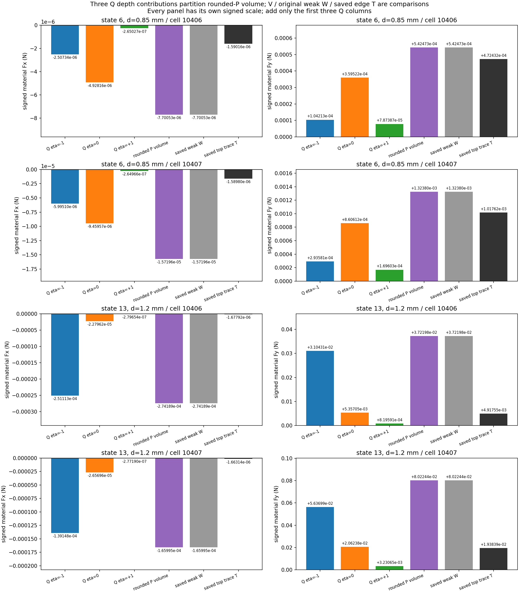

# M-VOLUME1 实际结果：末端底边单元的九点材料体积与上缘迹

2026-10-11，Asia/Seoul。人类批准后本卡唯一运行 PASS，exit 0、stop reason 为 null，执行窗口已结束。本报告依据实际保存 JSON／CSV 与收据整理；[独立终态核对](author/terminal_execution_review.json)通过，[独立物理解读](author/physical_results_review.json)已完成，后者是解释而非新增科学门。主任务已经实际查看两张原 PNG 像素，结论由其[视觉记录](author/visual_review.json)证明，独立文档作者没有代为声称亲看图像。本报告不授权下一阶段。

## 目标、本步功能与理由

整体目标仍是从普通 LF 几何出发，建立独立 HF 有限变形／TMC 前向器，提供可追溯、可解释的反力、工件载荷和实际变形，供外部研究层比较。HF 不承担 LF 优化、不调用 dmftd；继续 main，origin 保持 `https://github.com/dudaxing/Compliant-TO-TMC.git`。

[M-SUPPORT1](../nested_material_support_001/RESULTS.md) 已定位：峰值 bottom_owner 材料支撑 Fy 与旧 bottom line 的差为 +0.09415598535141824 N，corner_only 不能解释该量级。本步进一步聚焦原 loading 6／0.85 mm、13／1.20 mm 的 **cell10406／10407**，核同一单元九点保存 P、材料体积贡献和原上缘迹的离散关系，避免继续堆叠全路径账本。

新增公共入口 [saved_material_volume.py](../../../hf_repo/src/hf_eval/saved_material_volume.py) 现在可对普通保存数组给出九点材料体积观察、eta 三层贡献、原局部弱力与旧迹关联及描述性差；[薄执行器](execute_saved_material_volume.py) 完成受控读取和两张新图。本步没有重新求解加载／卸载，没有调用材料本构、力核、切线、HP 或 LF 优化。

## 实际范围、符号与算法

受控读取实际完成 **3 个既存 NPZ／9 个指定数组字段**：model.npz 的 coordinates／connectivity／points／grad／weights，以及两态 forces.npz 各自的 stress_first_piola／element_material_force。完整存储字段按既存格式读取一次，计算与输出只限四个 state/cell 组合；body cell/node IDs 来自原 model.json。原 state/result、旧材料 trace JSON 与原 M-SUPPORT1 cells.csv 已关联；没有读取大 support.json，没有解码 solid、位移、F／J／Hu、全局力或切线数组。

公共 API 实际完成 **2 次**；保存 **36 个九点样本、12 个 eta 层行、4 个单元对照行和 2 PNG**。31 个冻结绑定在首尾均保持。每 case 核原 node 顺序 BL／BR／TR／TL、h=0.5 mm 轴对齐矩形、xi 慢／eta 快的九点 Simpson、原 grad／含厚度 weights，以及与工件底边共享的 TR=2／TL=3 两节点。旧 top 三个 P／PN 与保存 P 精确关联；原八个单元局部材料内力保留，选中弱力 W 与原 support cell 向量精确对账。

所有 force 量均是 **作用于工件的材料力**，单位 N，原厚度 **20 mm 已包含一次**。W 是原选中局部材料内力的负和；保存 force 不再乘厚度。P_iY 单位 MPa，表示第一 Piola 应力的参考 Y 列两个分量；它不是含 Hu 的总压力。九点包含单元边界，不能称为九个内部 Gauss 点。三个参考 eta 层分别在 y=30.5／30.75／31.0 mm；最后一层对应身体底边的外邻上缘。

选中基函数 `chi=N_TR+N_TL=(1+eta)/2`，原梯度和精确为 `(0,2/mm)`。舍入 P 观察每点计算 `q_i=-w_q*P_iY*2/mm`，V 为九个 q 的 `fsum`；Q_-／Q_0／Q_+ 是同批 q 按 eta 三组的 `fsum`，三者构成可加的体积分贡献。原保存 W 来自补偿收缩后独立舍入的局部力，V 来自已经导出的舍入 P，定义仍分别保留。

另计算几何层 C_eta、V_geometry 和 D_geometry；C_+ 是本卡新计算的几何上层观察，原上缘线 T 则直接复制旧记录，不调用旧观察器重算 T。实数代数中 `V_geometry=(C_-+4C_0+C_+)/6`、`D_geometry=(C_-+4C_0-5C_+)/6`。独立浮点系数与原体积权重有不同舍入，所以这些跨表达差仅作描述。

## 四个 case 的实际 W、V、T

下表数值直接复制 [cell_comparisons.csv](run_001/cell_comparisons.csv)。本次四 case 的 Fy 中 V 与保存 W 显示为相同数值；这没有增加新的 W=V 科学门。

| 原态／cell | 保存弱 Fy W（N） | 舍入 P 体积 Fy V（N） | 原上缘 Fy T（N） | 已保存 W−V（N） | 已保存 W−T（N） |
| --- | ---: | ---: | ---: | ---: | ---: |
| 6／10406 | +0.0005424729467091343 | +0.0005424729467091343 | +0.00047243194122519885 | 0 | +7.004100548393542e−05 |
| 6／10407 | +0.001323795449585901 | +0.001323795449585901 | +0.0010176156584012655 | 0 | +0.00030617979118463556 |
| 13／10406 | +0.037219775006120934 | +0.037219775006120934 | +0.004917548552353244 | 0 | +0.03230222645376769 |
| 13／10407 | +0.08022435531475952 | +0.08022435531475952 | +0.01938390857410906 | 0 | +0.060840446740650464 |

有符号 Fx 也完整保留。下表中的微小 W−V 是实际保存的观察余差，不能截成零或据此声称原补偿收缩已经重播。

| 原态／cell | 保存弱 Fx W（N） | 舍入 P 体积 Fx V（N） | 原上缘 Fx T（N） | 已保存 W−V（N） |
| --- | ---: | ---: | ---: | ---: |
| 6／10406 | −7.700529398174155e−06 | −7.700529398174154e−06 | −1.5901648620005987e−06 | −1.6940658945086007e−21 |
| 6／10407 | −1.5719641123269165e−05 | −1.5719641123269165e−05 | −1.589798383234296e−06 | 0 |
| 13／10406 | −0.00027418896548745656 | −0.00027418896548745656 | −1.6779232225395858e−06 | 0 |
| 13／10407 | −0.00016599468624573286 | −0.00016599468624573288 | −1.663139545792432e−06 | +2.710505431213761e−20 |

在这四个 case，舍入 P 的体积观察已经数值解释了原材料弱力；与上缘 T 的明显差并未随 V 代替 W 消失。因此当前证据不支持把末端单元的主要体积／上缘差归给已导出 P 与原保存弱力之间的舍入分离。

## 三层实际贡献与算术门

下表直接复制 [depths.csv](run_001/depths.csv) 的同项 Q。仅这三个 Q 可以相加，C_eta 不是未经权重的体积贡献；V、W、T 是另外的对比量。

| 原态／cell | 下层 Q_- Fy（N） | 中层 Q_0 Fy（N） | 上层 Q_+ Fy（N） |
| --- | ---: | ---: | ---: |
| 6／10406 | +0.00010421267325071169 | +0.00035952161658755604 | +7.873865687086649e−05 |
| 6／10407 | +0.0002935810147878305 | +0.0008606118250645263 | +0.00016960260973354426 |
| 13／10406 | +0.031043132462937814 | +0.005357051117790915 | +0.0008195914253922073 |
| 13／10407 | +0.05636985514290049 | +0.020623848742840855 | +0.003230651429018177 |

态 6 中层 Q_0 较大；峰值态 13 中下层 Q_- 较大，上层 Q_+ 明显较小。这里比较的是原参考单元 y=30.5／30.75／31.0 mm 处已保存 P 在体积式中的加权贡献，不能把下层贡献改称另一个身体接触面。Q_+ 只是体积分的上层贡献，旧 T 是整条上缘线作用量，不能将两者当成同一个数。

| 原态／cell | 下层 Q_- Fx（N） | 中层 Q_0 Fx（N） | 上层 Q_+ Fx（N） |
| --- | ---: | ---: | ---: |
| 6／10406 | −2.50734404234846e−06 | −4.928157878825595e−06 | −2.6502747700009984e−07 |
| 6／10407 | −5.995102095454422e−06 | −9.459572630609028e−06 | −2.6496639720571606e−07 |
| 13／10406 | −0.00025111307830394907 | −2.279623331308422e−05 | −2.796538704232643e−07 |
| 13／10407 | −0.00013914785454333779 | −2.6569641778096357e−05 | −2.771899242987387e−07 |

唯一新增算术门是 **同九个已计算 q 项的三层重组**，逐分量使用 8×2^-52×同项 L1、无绝对地板。以下实际误差／界来自保存 JSON／CSV，四 case 均通过。

| 原态／cell | Fx 重组误差（N） | Fx 同项 L1 界（N） | Fy 重组误差（N） | Fy 同项 L1 界（N） |
| --- | ---: | ---: | ---: | ---: |
| 6／10406 | −1.6940658945086007e−21 | 1.3678888063449353e−20 | 0 | 9.636255290763783e−19 |
| 6／10407 | 0 | 2.792369202223662e−20 | 0 | 2.351533100838845e−18 |
| 13／10406 | 0 | 4.870574441317227e−19 | 0 | 6.611560189306142e−17 |
| 13／10407 | 0 | 2.948657962167063e−19 | 0 | 1.425070822498489e−16 |

几何三层关系也已经单独保存；峰值 case10406／10407 的 D_geometry Fy 为 +0.032302226453767686／+0.06084044674065046 N，对应 D_geometry−(V−T) 都为 −6.938893903907228e−18 N。这是跨表达的描述性余差，不采用新的 16／32eps 门，也不能借同项重组界给原 DD 力或连续接触解授予新资格。

## 两张实际产物与人工检查入口

本次实际写出两张新 PNG，主任务已实际查看原 **2100×2400** 图像像素。以下嵌入对应唯一受控运行的原产物，图像字节保留，没有重新绘制；本段人工检查结论来自主任务。

第一张按四 case、两个 P_iY 分量显示各九点。每 panel 独立有符号色标、原 xi／eta 顺序和数值注释；颜色表达保存 P_iY，不是 −P_iY，也不是总压力。主任务确认底 eta=-1、顶 eta=+1 及五位科学计数注释清楚；跨 panel 的相同颜色不能比较绝对量。态 13 的下层强样本使同 panel 小值颜色接近灰，数值注释与完整 [samples.csv](run_001/samples.csv) 保留这些小值，不能按颜色抹零。

第二张每 case、每 Fx／Fy 分量使用独立尺度，显示三层 Q、舍入 P 体积 V、原弱力 W 与旧上缘 T。主任务确认标签和有符号数值注释可读。**仅前三根 Q 柱构成分解，后三根为对比项，不要相加。**V／W 柱高度相同不能代替 CSV 中实际余差。参考采样／贡献图不能替代真实结构变形；可对照 [原 M-PTRACE1 实际变形图](../nested_material_trace_001/run_001/actual_material_trace.png) 和 [既存 24 帧实际状态 GIF](../../../functional_views/native_nested_cycle_20261009/complete_001/run_001/view/fixed_square/actual_states.gif)。没有读取位移重画这些图。

## 成本、资格与最近路线

批准预算为 helper180 秒／outer240 秒／采样 RSS8 GiB。实际 helper 为 **2.2876966999901924 秒、自身采样峰值 128356352 B**；outer 为 **2.5381053000019165 秒、进程树采样峰值 132591616 B**。helper 数值在输出 SHA 与末 checkpoint 后、成功收据构造／写入前取得，outer 覆盖完整进程终态。采样合同不是 OS 硬限制。本次一次启动，无重试、修复重跑、延期或 force；剩余窗口不授权额外计算。

实际状态见 [人类授权](author/authorization.json)、[helper 收据](run_001/execution_receipt.json)、[终态记录](volume_launch.json)。批准源码为 `7ea78ce19ba066dfce8a03892395d5604707dda6`；原 card／protocol 的 authorized=false、executed=false 与授权记录 executed_at_record=false 保留为启动前历史，不能当成当前运行状态。

保存产物还包括 [material_volume.json](run_001/material_volume.json)、三 CSV 与两 PNG，加收据合计七文件。本步新增数组读取、普通 float64 收缩／fsum、几何层观察、差值／界和可视化，没有调用原 DD 收缩、F/Hu 重建、DivP、其它面通量、应力跳跃积分、本构／力核、切线、HP 或平衡。范围结论依据绑定源码和收据；mechanical_hooks_monitored=false，没有声称动态机械钩子监测。

现有四 case 证据表明，原材料弱力与末端外邻九点体积观察吻合，体积／上缘差可通过所保存的 eta 分层及两种离散作用量说明。它没有提供真实连续应力场及其 DivP，也不证明应力场为什么形成这种分层、其它面通量或应力跳跃的连续因果，更不能据此判定求解器缺陷、接触压力或网格收敛。

最近粗路线应据该实际吻合转向把“原节点弱载荷／材料线迹／Hu 总边界作用”作为不同功能量明确组织；这四 case 没有出现需要立即重建原 DD 收缩的新分离证据。下一步实现选择应以独立物理解读为依据，优先推进可用的工件作用量及总边界功能，而非再扩大同类全路径账本。本报告不制定或授权新执行卡。含 Hu 的总压力、有效夹持、自由工件／摩擦、系统多工况、网格收敛与正式 HF5 标签排名仍未完成；原门与资格保持。

闭卡文档整理仅读取普通已保存 JSON／CSV／来源文件并复制实际值，没有新解码 NPZ、重运行 API、积分／fsum、跨 cell 汇总或比率计算、绘图或修改原数据／门。实际计算均属于这次已批准的唯一运行；独立终态、物理解读与主任务像素审阅均已由上述各自记录关联。闭卡与发布工具仅处理普通文件及 Git，不续用数值窗口。
