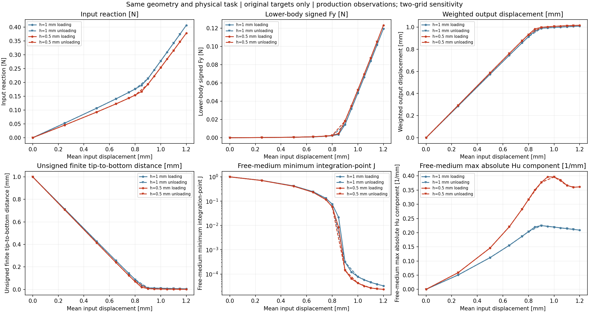

# 同任务物理敏感性准备：实际完成与下一候选

2026-10-11，准备基线 main `5af8b5e`。本轮完成普通源码／JSON／CSV与字节审计、候选源码及执行卡准备；**没有新 HF 导入、模型、NPZ 字段解码、力、切线、求解、HP 或绘图**。M-ALPHA1 是待明确批准的新数值窗口，不是已执行结果。

## 整体目标、当前能力与为什么推进此步

整体目标是从 LF 普通几何建立独立 HF 有限变形／TMC 前向评价，得到结构实际变形、输入反力及有明确含义的工件作用，支持外部研究层在同一物理任务下比较候选，最终形成正式 HF5。HF 与 LF 优化断开，研究层的生成／优化／评分不重新实现；后续在 main 开发，origin 保持 `https://github.com/dudaxing/Compliant-TO-TMC.git`。

已实现完整 NumPy 力、组装、切线、平均位移平衡、保存与复读、CLI／API／batch、固定方体完整加载／卸载、实际变形／有符号作用显示。原细网格24态／48HP参考已由 [M-REF2](../nested_reference_002/RESULTS.md)完成并经 M-LINK1 关联；原生产或旧视图中的 false/not_provided 是保留的历史快照，不能写成当前细网格没有独立参考。

[M-BOUND1 实际完成](../nested_hu_boundary_001/RESULTS.md)解释了当前 Q1 Hu 离散支撑来源：side owner 的顶点相消与组装后节点作用非零可同时成立，整体局部 Hu 来自两个 corner_only owner。它没有要求重开 Hu/DD 核或继续同类24态账本，也没有提供连续总压力。上一轮执行及 main 发布／恢复的真实证明已归档为 [M_BOUND1_execution_publication_receipt.json](author/M_BOUND1_execution_publication_receipt.json)。

最近缺口是响应对物理参数和离散是否足够稳定。现有功能能算出、显示作用，但不能仅凭数值通过或一个合力接近，就把它用作合格夹持标签或 HF5 排名。因此本轮核已有可比性，再选择最小缺少因素，而不重复已实现的接口、整路径参考或解释账本。

## 已有网格证据及实际效果

[网格任务审计](author/MESH_TASK_AUDIT.md)与[普通记录](author/mesh_task_audit.json)确认 h1／h0.5 的同物理任务关系：84×40mm下半域、固定18mm方体center(71,40)、E1MPa、nu0.3、厚20mm、gamma=alpha=1e−6、Lr80mm、2mm平均端口、支撑、背景对称及原24目标一致。h0.5的13440单元／13689节点为原二值几何嵌套细分。四掩码复制、算子缩放和区域／端口来自已保存 M-PREP1 的101项核查，本轮只核继承来源和身份，不重做数组实验。

179项本轮普通记录检查和原101项准备检查不等于新的科学验收门。当前 h1 API producer 自身参考仍 not_provided，早先另一个 producer 的HP不能移给它。两网格输入可比，不等于网格收敛。

以下峰值数值直接复用[原 M-VIEW1 报告](../../../functional_views/native_nested_cycle_20261009/complete_001/RESULTS.md)，本轮未重算百分比。

| 量 | h1 | h0.5 | 原记录相对变化 |
| --- | ---: | ---: | ---: |
| 输入反力 R，N | 0.4072527715 | 0.3787064524 | −7.0095% |
| 下半工件 ON-body Fy，N | 0.1193619515 | 0.1231794016 | +3.1982% |
| Hu Fy，N | 0.001510569912 | 0.001266844543 | −16.1347% |
| 有限钳尖到底面无符号距离，mm | 0.005730316194 | 0.001144362628 | −80.0297% |
| 介质积分点 minJ | 3.272299255e−5 | 2.339669248e−5 | −28.5008% |
| 最大绝对 Hu 分量，mm⁻¹ | 0.2088465634 | 0.361481586 | +73.0848% |

这张原图显示整体响应和局部场的敏感程度不同。图中 free-medium 为非solid且排除workpiece的单元；minJ是积分点极值，Hu是最大绝对分量。有限面距离无符号，不单独证明接触；场图的单元均值或范数不能替代这些极值。原像素已人工检查；本轮没有重绘。结构及三分量节点作用可继续检查[原24帧实际变形动画](../../../functional_views/native_nested_cycle_20261009/complete_001/run_001/view/fixed_square/actual_states.gif)。

## 旧参数实验的取舍

[参数审计](author/PARAMETER_TASK_AUDIT.md)与[来源记录](author/parameter_task_audit.json)区分了 gamma、alpha、Lr：gamma缩放介质Lamé；alpha通过原公式控制kr；Lr是80mm物理长度，不是单元h或84mm分析域长。原 kr 不额外乘材料factor。参数改变后需重新平衡，不能按比例缩放旧工件力。

| 旧证据 | 本轮取舍 |
| --- | --- |
| 真 gamma 单因素 1e−6→5e−7 | 保留其研究启发；使用 h1／80×40／零右余量，不能移作当前 h0.5／84×40 的控制证据 |
| 实体软化 | 同时 E减半、gamma／alpha加倍以保留绝对介质与kr，是耦合探索；不同工件、网格和路径，不能解释单alpha效果 |
| 右侧域余量 | 保留其域因素作用；不拼成 gamma 或 alpha 对照 |
| HF4 合成块体 Aalpha | 保留公式／实现启发；任务、E、Lr和BC不同，作用范围变化也不是alpha幅值控制 |

所审 native 固定工件证据中，没有当前任务的 alpha 或 Lr 单因素实验。这是有界来源审计，未宣称穷尽所有外部研究。审计文件中14或15目标尚未选择的文字是讨论历史；最终接口取舍已在下面的候选及协议冻结。

## 已准备的最小功能增量

[M-ALPHA1 卡](M-ALPHA1_CARD.md)、[任务](task.json)、[单例manifest](manifest.json)及[协议](protocol.json)只将 alpha 从1e−6降低到5e−7；gamma1e−6、Lr80mm、原h0.5几何、材料、工件、BC及端口保持。首次力计算前核实际材料与区域元数据。原 `native_project` 自动产生相应kr，不修改力核，不给新态借用原48HP。

从真实零起点执行原循环前15目标：14个起点／加载目标至1.20mm，再回撤一次至1.15mm。保留 `ordered_cycle` 的真实leg／original_target_index能直接复用保存态viewer；14目标 load_only 需要新增适配，所以舍弃。原控制器试探回溯／二分保留，额外接受态全部保存，不插值进原15目标对照。[实施取舍](author/IMPLEMENTATION_OPTIONS.md)说明为什么单例直接复用 batch/API、缓存和一个纯显示子进程，而不重写CLI或放宽batch的同任务合同。

未来成功后生成真实新态变形GIF、原三张PNG、六量alpha比较图及原值／差值表，共四PNG。基线只读取既存普通JSON／CSV，不重新观察、求解或绘图。显示半工件有符号total/material/Hu、保持反力、镜像净力及双侧法向幅值和；幅值和不是有效夹持力。

资源候选为 controller9000秒、helper9600秒、outer9660秒／采样8GiB，显示子上限min(600秒,helper剩余时间)，全在同一次窗口。实际旧前15目标累计6150.855067699915秒只是成本依据，不是新alpha成功或时间保证。采样RSS和协作检查不是硬时间／OS内存上限；首个终端错误停止，无包装重试、修复重跑、延期或force。

本轮源码只作AST／普通元数据和字节核查。[准备回执](author/preparation_receipt.json)、[源码作者回执](author/worker_author_receipt.json)和独立静审分别记录实际来源，不用准备PASS冒充候选执行PASS。准备协议authorized=false/executed=false保持；后续实际批准与终态另写，当前没有批准文件、run目录或新科学结果。

## 接下来的判断方式及尚未实现

新结果先回答“减半alpha时，同任务变形与有符号作用怎么变”。两值提供敏感性，不新增输出接近阈值，也不授予参数或网格收敛。若未完成，记录真实失败态、成本和停止原因，再审下一步；若完成，对照力、有限面距离、介质极值与变形后决定更小alpha、网格或另一个单因素，不同时改多项。

连续总压力、可移动工件／摩擦、有效夹持资格、参数／网格稳定性、其它形状自身任务、一般输入／全列切线、正式 HF5 批量标签排名及研究层同任务接入仍有缺口。科学版本0.5.0和原资格保持。本轮只完成可比性核查与可执行候选准备；整体目标未完成，M-BOUND1旧窗口不续用。
