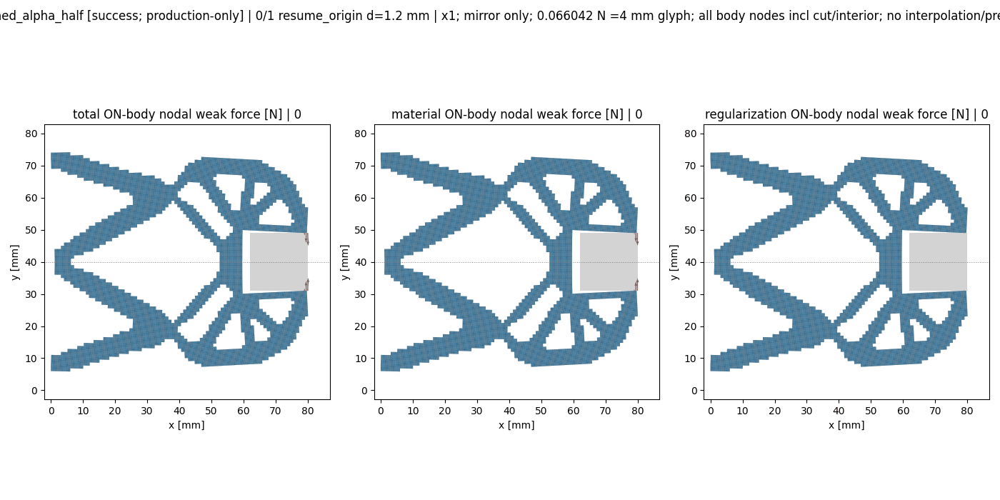
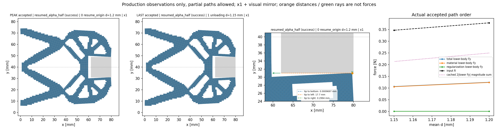

# M-RESUME1 实际结果：PASS

本卡经直接批准唯一启动，已按真实终态关闭；批准源码为 main `8b456dcdc2c0566fb2e927175a781712dd5e78ec`。整体目标仍是独立HF有限变形／TMC前向评价，读取普通几何，在一致任务下提供实际变形、反力及可解释工件作用，供外部研究层比较。HF不做优化，不调用dmftd或MPM。

本次解决公共入口的保存态起点限制：候选恢复原alpha5e−7接受态013的split位移和signed R，沿原绝对目标[1.20,1.15] mm执行第一次下降，避免重复已有14态长加载。保持原几何、h0.5／84×40下半域、固定side18方体center(71,40)、E1MPa／nu0.3／厚20mm、gamma1e−6／Lr80／alpha5e−7、BC与平均端口；原15目标task保持。

## 实际范围与验收

- 一次launcher／helper。局部测试状态 `pass`，pytest原stdout和[测试收据](run_001/focused_test_receipt.json)保留；四项代数／控制器合同与真实16单元公共保存／续算测试，与13440单元生产分开计数。
- 原非零锚点用initial_parameter1.20、target_origin0、保存原split/R，K=None重新F/T并按原门validate-only；不读取旧force/tangent/matrix。生产输入仅2旧NPZ／6字段（四几何掩码和双位移），配套4旧JSON；包装还继承原protocol gates。
- 原settings除controller新clock保持；mechanical／chunk256／port_projection保持。residual1e−9、原逐态constraint_bound、J>0、global balance1e−6、fixed split sum8e−11mm保留。实际缓存门：`True`。
- 实际新保存接受态2个，回调接受态2个；原目标13/14与child0/1分别记录，trial不作为accepted。新段成功仅表示原suffix完成，父M-ALPHA1的NOT_PASS、未完成卸载／完整任务标记不改。
- 原100 bindings保持，运行源码包60文件按原字节复制并叠加候选；[helper收据](run_001/execution_receipt.json)绑定实际执行路径。默认hf_repo尚未安装候选，NumPy力核和AD切线原字节保持。
- [真实保存结果](run_001/resumed_alpha_half/result.json) · [逐接受态进度](run_001/accepted_progress.jsonl) · [终态核查](author/TERMINAL_REVIEW.md) · [物理解读](author/PHYSICAL_RESULTS_REVIEW.md)。保存／摘要额外F/T来自实际计数对账，不依缓存声明泛化。

## 真正的耗时、调用与停止

| 记录 | 秒 | 采样峰RSS [B] |
| --- | ---: | ---: |
| focused plugin | 6.503412799997022 | 148578304 |
| helper最终收据写前 | 618.4817464999942 | 800935936 |
| outer完整退出 | 619.0985891000018 | 795955200 |

outer exit=0、stop_reason=None。限 tests120／controller1800／viewer600／helper2700／outer2760秒，采样8GiB；own与tree采样不同，不作同刻比较，也不是OS硬内存限制。真实外层非成功可覆盖provisional helper pass。无重试、修复重跑、延期或force。

实际生产调用（started/completed）：API 1/1，model 1/1，solve 1/1，F 17/16，T 9/9，save 1/1，summary 1/1，view child 1/1。局部测试机械调用不包含在这些原模型数字中。HP/JIT0限原NumPy路径及生产记录，不声称全局hook覆盖。

实际下降8次Newton检查、7次接受修正，未二分。第一次完整Newton步因invalid_J按原线搜索规则拒绝，factor0.5随后接受；因此F17 started／16 completed是一次无效J trial被拒绝的真实计数，不是终端失败或修复重跑。两个最终接受态均满足原门；中间trial不是新保存接受态。保存和摘要额外F/T均0。

实际失败／停止字段（未改写）：`null`。当前API状态 `success`、新result状态 `success`；完整原路径资格不因此改变。

## 可人工检查的数值

下表仅复制实际保存JSON，显示舍入，完整精度和stateSHA留在原记录中。Fy是模型／介质作用在固定下半工件上的有符号弱式合力。

| 新态 | leg | 原目标 | mean [mm] | R [N] | q_out [mm] | total Fy [N] | material Fy [N] | Hu Fy [N] |
| ---: | --- | ---: | ---: | ---: | ---: | ---: | ---: | ---: |
| 0 | resume_origin | 13 | 1.2 | 0.378654272 | 1.016934534 | 0.1249212163 | 0.1240571347 | 0.0008640816125 |
| 1 | unloading | 14 | 1.15 | 0.3470376815 | 1.015317424 | 0.1067128755 | 0.1058584215 | 0.0008544540447 |

## 实际图件

实际geometry/nodal各2次，5个新NPZ／63字段，3PNG和2帧GIF。纯viewer额外F/T/model/solver/HP0依据原源与导入closure，mechanical_hooks_monitored=false；没有新独立参考。

[距离与signed Fx](run_001/view/distances_forces.png) · [峰值分区场](run_001/view/peak_fields.png) · [全部状态原观察表](run_001/view/resumed_alpha_half/states.csv)。实际像素核查只覆盖三PNG，不声称人工检查了GIF全部帧。箭头包含physical/cut/interior节点贡献，镜像只显示；双侧幅值和不是有效夹持力。距离为原有限几何观察，cell mean J／Hu范数与积分点minJ／分量max不同。

## 当前功能进度与解释边界

完整NumPy力、全DOF未对称矩阵／组装、平均位移Mean、API／同任务batch、缓存保存及实际显示已有实现。本次新增隔离的公共保存态续算候选；是否可集成与下一步取舍以[最近复核](NEXT_STEP_REVIEW.md)和实际终态为准。源、准备卡及false准备记录作为历史保持；授权、人类原文、outer/helper/result/图件才是实际证据。

原M-ALPHA1失败、原14态和M-AVIEW1图件不改。child path_completed不等于完整原15目标在一个solver中完成；不自动组合资格。新alpha仍无独立HP，连续总压力、有效夹持、物理稳定性、可移动工件／摩擦、其他形状完整验证、任意新LF几何／任务的可靠性资格、全部切线列独立验证、正式标签／排名与HF5仍待完成。现有几何读取和API已经实现，尚待完成的是更广输入范围的验证与资格。旧24态48HP不转移给新段。
