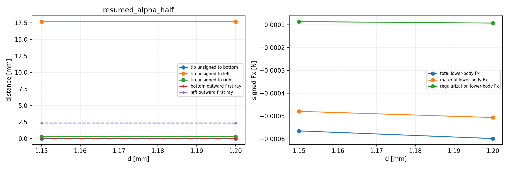

# 准备结果及物理进度

整体目标：独立HF读取普通LF几何，在明确物理任务下计算有限变形和TMC作用，向外部研究层提供可恢复响应与可核验图件。HF不优化、不调用dmftd，MPM暂不实现；开发main，origin保持指定仓库。

现已实现NumPy完整力、切线与稀疏组装、平均输入位移平衡、机械保存态与纯读取显示、固定方形工件材料/Hu合力、同任务保存态严格续算。旧alpha=1e−6细网格24态完整加载/卸载与48HP已完成；新alpha=5e−7已有14加载态、1.20→1.15两态成功child、两态4HP及M-ALINK1同态响应/图/参考关联。当前main c4d81620已推送及异地恢复，M-ALINK1实际outer1.448175400000764秒、PASS闭卡。

新alpha原两态R=0.37865427196005513→0.3470376815403639 N，下半固定工件total Fy=0.12492121630032427→0.10671287553103108 N。它们是既有保存值；固定工件合力可读，不等于连续表面总压力或自由物体有效夹持。旧14加载对照与材料体积/支撑/Hu边角诊断已完成，不重复生成相同证据。

最近作用是补实际入口缺口：从成功末态显式延伸任务并继续卸载，而不是改变原严格续算门。七份候选已静审，数学/controller保持；真执行与同字节安装尚未发生。只追加1.10 mm，资源、精确测试、读取、门和停止规则见[M-EXTEND1卡](M-EXTEND1_CARD.md)及[protocol](protocol.json)。本轮只源码/普通JSON/AST/stat准备，没有HF导入、NPZ/科学gzip/媒体字节读取、collect/测试、科学计算或新图。

源准备中发现两项并已记录纠正：初始任务身份草案误用普通sorted JSON，改用原float.hex canonical而任务字节不变；显式模式曾可能覆盖旧boundary task stamp后再比较，候选v2先核旧身份并新增拒绝用例。执行包装还补子进程异常finally等待、最终stop与真实child wall记录。旧草案/审阅保留历史，不声称执行失败或重试。

拟一次36有限测试→一次1.15→1.10真实段→原纯viewer实际图→PASS后六默认源安装；胶囊与默认执行来源分别记账，六候选源不会在批准前写入默认。运行结果未知，原资格保持。目标/理由/来源审阅/精确旧新SHA/执行合同和复原说明随本stage发布。

以下原图仅覆盖既有1.20→1.15段，不表示新的1.10结果。

完整旧新任务一次路径、新段独立HP、连续材料+Hu压力、有效夹持、移动/摩擦及其他形状、一般LF几何可靠性、网格/域/参数稳定性、独立全部切线列和HF5尚未完成。[后续取舍](NEXT_STEP_REVIEW.md)按实际下一步结果滚动，不把本次静审或预期当功能PASS。
