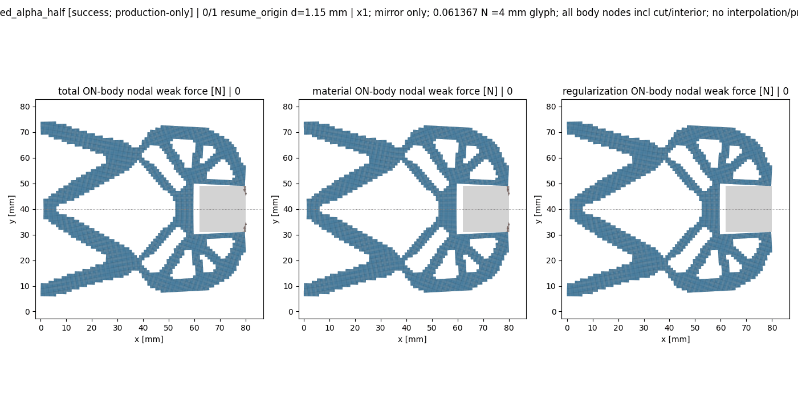
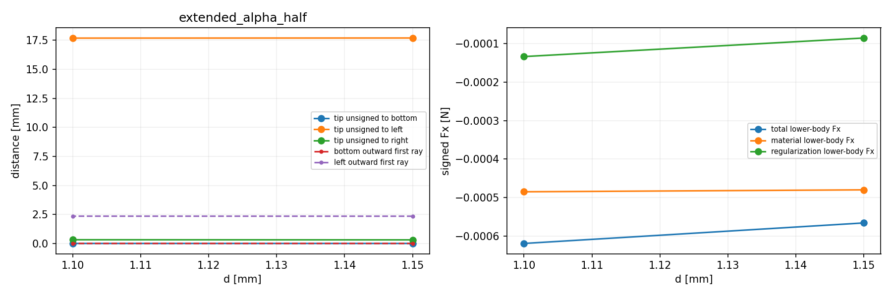

# M-EXTEND2实际结果：显式延伸成功并安装默认入口

2026-10-13，Asia/Seoul。直接批准main `781f408`／协议`30b5e7f…`后，唯一执行已成功关闭。36项兼容测试通过；成功保存两态1.15→1.10 mm；原纯viewer生成3PNG与两帧实际GIF；短runtime一次原字节封存通过；六份生产入口逐项安装为已测试候选的相同字节。没有重试、修复重跑、延期、force、自动回滚或新夹持器HP。

## 目标、做法与效果

整体目标是让独立HF读取普通LF几何，对有限变形与TMC作用进行前向评价，输出反力、位移、固定工件作用、可恢复状态和实际变形，供外部研究层使用。HF不承担拓扑优化，不调用dmftd，MPM暂未实现。本次最近功能目标是从已接受末态显式追加卸载目标，而不是重做原加载路径。

M-EXTEND1在Windows深层测试目录复制时失败，尚未运行任何测试或力学。M-EXTEND2仅把测试胶囊及pytest临时目录放到短、独占`D:/hf-extend2-runtime-20261012`，并增加一次原字节封存；七份核心候选、36测试选择、物理任务、控制器、力核、切线和原验收门保持。短目录在实际运行中越过了原失败点，且全部测试及后续功能成功；原M-EXTEND1 NOT_PASS记录保留。

默认入口现在支持`evaluate_native(..., saved_result=..., selected_state_index=..., extend_path=True)`与CLI `--saved-result --selected-state-index --task --extend-path`。显式新task必须保留完整旧目标前缀和其他字段，只追加后续目标；默认严格同任务续算仍保持。此次新task仅在旧15目标后追加1.10 mm，canonical `94671c3226afb193349324a91f15bd55923ba73e662e9ad76528c844000f74f6`。实际子段为global14/15、child0/1；原成功parent与更早failed/time_limit祖先分别保存。

## 实际物理响应

模型保持h=0.5 mm、13440单元／27378DOF、下半对称域；固定方形工件中心(71,40) mm、边长18 mm。E=1 MPa、ν=0.3、平面应变、厚20 mm、γ=1e−6、α=5e−7、Lr=80 mm、端口与边界保持。以下数值为已保存JSON和原纯viewer的观察，表中适当舍入，精确值见源结果。

| 量 | 1.15 mm起点 | 1.10 mm新终点 |
| --- | ---: | ---: |
| 输入R（执行器作用于模型），N | 0.347037682 | 0.315886017 |
| 输出端加权位移，mm | 1.015317424 | 1.012776370 |
| 下半固定工件total Fy，N | 0.106712876 | 0.088978471 |
| 其中材料Fy，N | 0.105858421 | 0.088182725 |
| 其中Hu正则项Fy，N | 0.000854454 | 0.000795747 |
| 镜像两侧法向大小之和，N | 0.213425751 | 0.177956942 |
| 尖端到工件下缘有限线段距离，mm | 0.001285048 | 0.001730505 |
| 固体最小J | 0.973581265 | 0.973801695 |
| 第三介质最小J | 2.3776667e−5 | 2.5827474e−5 |
| 固体最大Green主应变 | 0.046556237 | 0.043827152 |
| 相对自由力残差 | 4.5847733e−12 | 3.9516996e−12 |

R采用原保存合同`input_force_sign=actuator_on_model`的正号。保存观察显示：回撤后输入R、工件作用和输出位移下降，尖端下缘距离小幅增大，固体最大主应变减小；这与卸载回弹相符。第三介质仍高度压缩，尖端距离仍为微米量级。机制与工件的区域观察未报告严格内部重叠；该观察不覆盖完全包含或机构自交。下半工件力是包含材料与Hu的固定体弱形式合力；镜像两侧量是法向大小之和，并非完整装配净力。距离和这些合力没有被升级为连续压力或自由工件的有效夹持能力。

起点state SHA `999b581e…`与原parent精确相同；新终点state SHA `3dc492f8aef4751e643ddb1413a797ca39434d349bfed59844d46e4e730015ff`。终点11次Newton检查、bisection_depth=0。生产F开始／完成29／23，T为12／12，与原结果call_counts一致；结果保留六个invalid_J力试探事件，原回溯正常处理，不是外部执行重试。

## 实际可视化

下图为本次新两态、实际位移x1及对称镜像的动画。

[结构与端口对照](run_001/view/comparison.png) · [本段起点的J／应变／Hu图](run_001/view/peak_fields.png) · [数值观察摘要](run_001/view/extended_alpha_half/summary.json)。`peak_fields`和动画中的segment PEAK是本段1.15 mm起点，不是原加载峰1.20 mm；1.10 mm也不是完全释放。原viewer只读本次新保存态，未新调用F/T、构模、平衡求解或HP。

## 验证、资源和交付依据

36项精确测试实际pytest报告17.56秒，真实测试child wall18.449793600011617秒；原纯viewer child19.06994919999852秒。唯一outer总时961.3427620999864秒、真实helper wall961.2012513999944秒，helper快照960.4428117999923秒。outer tree RSS采样793395200B，helper自身峰值798400512B，两种采样口径分别保留，均低于8GiB；stop_reason=null。原180／1800／600／3000／3060秒范围内完成。

两态原门全部通过：最大相对自由力残差4.584773266448174e−12，最大均值约束残差2.7755575615628914e−17 mm且原bound通过，最大全局相对平衡误差5.816723361111447e−14，固定split位移和0，最小J=2.3776666991649372e−5>0。148冻结绑定在唯一运行前后保持，90份胶囊源及实际import身份核对，全部26项阶段计数按实际记录保留；六生产安装old→new→actual SHA一致，原力核和控制器算术保持。

runtime ZIP_STORED只封存原字节：249个精确成员、12252025未压缩字节，SHA `706cb0bdce8c8758bb45a477c848d2a07f2f4972a7b375e33e60401338b1c058`，包含90源及微型测试产物，归档在六源安装前通过。外部runtime未删除。跨机使用[归档](run_001/runtime_capsule.zip)和[成员清单](run_001/runtime_archive_manifest.json)时选择一个新的短解包目录；原绝对import位置是历史记录。正式新模型／接受态／response及图件另按相对路径保留，恢复无需依赖原runtime。

批准窗口内launcher/helper对原NPZ／媒体做字节身份核对，生产源NPZ仅原2份／6字段；测试微型数组另计。关闭后记录与增量发布只读普通记录，binary／CSV身份继承已闭helper.outputs及stat，不重读或解码数组、媒体、ZIP，不重做科学计算。Git传输保存实际文件；恢复binary检查不宣称额外重hash或重算。

[实际结果](run_001/extended_alpha_half/result.json) · [公开API响应](run_001/extended_alpha_half/response.json) · [helper回执](run_001/execution_receipt.json) · [唯一outer](production_launch.json) · [36测试及阶段报告](run_001/focused_test_receipt.json) · [终态独立审阅](author/execution_terminal_scope_review.md) · [下一步取舍](EXECUTION_NEXT_STEP_REVIEW.md)。

本次子段与安装成功，原M-ALPHA1和M-EXTEND1 NOT_PASS保持。完整旧／新路径、1.10新态独立HP、连续总压力、自由工件有效夹持、完整释放、稳定性、全部切线列、一般LF适用性与HF5仍未完成。项目整体未完成。
