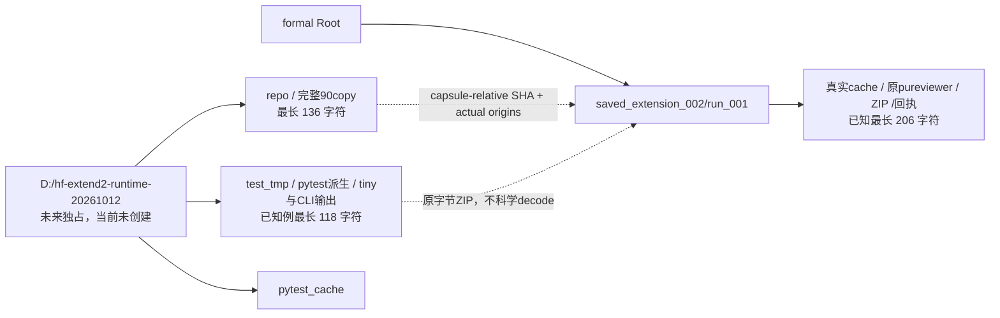

# M-EXTEND2 静态路径布局

仅源字符串／AST／普通JSON；没有IO probe、runtime创建、HF／pytest import/collect/run、数组／媒体读取。实际Root当前工作目录、依赖source与旧90copy映射为依据。

| 范围 | 静态已知最长字符 | 来源／限制 |
| --- | ---: | --- |
| 90capsule目的路径 | 136 | 旧same90完整映射，仅缩短prefix |
| tiny/CLI tmp已知后缀 | 118 | pytest源MAXVAL30＋本有限fresh集合2位counter余量；未collect／run |
| real cache/view/归档/回执 | 206 | 原writer/viewer已知3位index路径；每多1位index长度＋1，无新增N限制 |

两CLI在短capsule hf_repo/scripts；两个test fixture ROOT、--rootdir/--basetemp也在外部短树。真实evaluate repo_root、parent/source、新task、output仍formal；原pureviewer --repo=formalRoot/hf_repo不改。不用registry、drive/subst或ROOT deviceprefix；旧MEXTEND1 partial不删。

完整90及已知pytest/tiny/CLI/formal路径表见static_path_layout.json。它不是实际创建／收集／未来成功证明；新卡需绑定当前真实prefix并核完整来源，在其他formalRoot执行时仍要重新静态评估输出长度。
