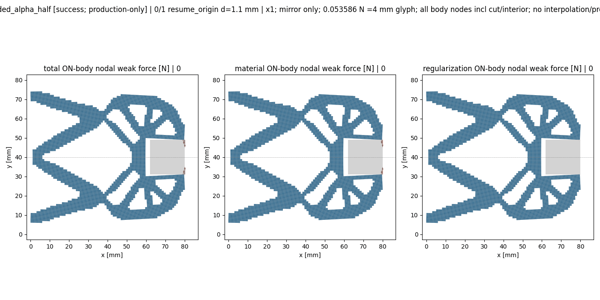

# M-UNLOAD1实际闭卡：PASS

2026-10-13（Asia/Seoul）。root确认唯一session20354真实终止，exit0；实际outer状态pass，独立terminal审阅状态pass_actual_independent_terminal_review_plain_records_only。执行源为main `3cf11e92bedb791855c7b01d314668eba1116ac6`、协议 `4980f164fdeface2839d6c0371d36a2ce4d310097d84d3991c2ba4266bc6ef5b`。本文件依据真实普通记录写入，静审或余时没有被当成新数值许可。

整体目标是独立HF读取普通LF几何，提供有限变形／TMC前向反力、端口位移、固定工件作用、可恢复状态与实际变形，服务外部研究层；HF不优化、不调用dmftd，MPM暂不实现。本步从成功1.10末态只追加绝对1.05，保完整旧16目标前缀及全部物理字段，复用已验证默认入口和原pure viewer，逐段观察卸载作用与间隙，不重做原加载路径或36项兼容测试。

实际阶段状态：helper=pass，新保存接受态记录数=2。本段的完成仅由真实result/closure给出；成功parent和更早failed/time_limit祖先继续保留，原M-ALPHA1／M-EXTEND1 NOT_PASS没有被改写。默认实现0改动，新HP／测试／候选复制／安装／外部重试均0，由root确认与独立闭卡审阅支持；本记录步骤科学postread为0。

原请求1.05末态已接受并保存，实际R=0.284972092043 N，工件total Fy=0.0714869286435 N，有限底边间隙=0.00218007304353 mm；新响应及真实变形作为下一段判断依据。

以下两表列出实际全部 2 个接受态，q_in按同态身份取原result，其余原值来自pure viewer普通summary。显示舍入不构成新计算；不计算新差值、比例或压力。

| child/global | 输入d mm | qin mm | R N | qout mm | 有限底边间隙 mm | solid minJ | solid最大Green主应变 | medium最大abs Hu /mm |
| --- | --- | --- | --- | --- | --- | --- | --- | --- |
| 0/15 | 1.1 | 1.1 | 0.3158860167 | 1.01277637013 | 0.00173050460459 | 0.973801694649 | 0.0438271516253 | 0.385039136686 |
| 1/16 | 1.05 | 1.05 | 0.284972092043 | 1.0098299039 | 0.00218007304353 | 0.974037395813 | 0.0411145274669 | 0.407888829567 |

| child/global | total Fx N | total Fy N | material Fx N | material Fy N | Hu Fx N | Hu Fy N |
| --- | --- | --- | --- | --- | --- | --- |
| 0/15 | -0.000618756393582 | 0.0889784710921 | -0.000484729276018 | 0.0881827245487 | -0.000134027117564 | 0.000795746543472 |
| 1/16 | -0.000653023035703 | 0.0714869286435 | -0.000472068712895 | 0.0707323853159 | -0.000180954322807 | 0.000754543327609 |

R为原actuator-on-model反力；工件Fx/Fy为固定下半工件signed weak-form节点合力，含material与Hu；端口加权位移不是表面间隙。有限底边距离沿原采样合同；solid J和Green主应变为原保存viewer观察，不是独立应力HP或连续压力。

实际调用：F开始／完成22／19，T开始／完成10／10。正常invalid_J／回溯拒绝与原bisection按原控制器记录，开始数可大于完成数。其他真实阶段计数及原缓存门如下，未重核科学阈值：

```json
{
  "api_started": 1,
  "api_completed": 1,
  "defaults_started": 2,
  "defaults_completed": 2,
  "model_started": 1,
  "model_completed": 1,
  "reader_started": 1,
  "reader_completed": 1,
  "solve_started": 1,
  "solve_completed": 1,
  "force_started": 22,
  "force_completed": 19,
  "tangent_started": 10,
  "tangent_completed": 10,
  "save_started": 1,
  "save_completed": 1,
  "summary_started": 1,
  "summary_completed": 1,
  "view_child_started": 1,
  "view_child_completed": 1
}
```

```json
{
  "actual_accepted_states": 2,
  "minimum_J": 2.5827473911918618e-05,
  "maximum_fixed_split_sum_mm": 0.0,
  "maximum_relative_residual": 3.95169962785264e-12,
  "native_constraint_bound_pass": true,
  "maximum_relative_global_force_balance": 1.3315668396036187e-13,
  "passed": true
}
```

资源合同controller1800／viewer600／helper2700／outer2760秒、采样8GiB；whole clock包含身份、导入、构模、API、保存、viewer及封存，viewer只获得原helper剩余窗口。outer 606.299786秒；实际helper终止墙钟 606.0487377秒；helper回执快照 605.7394645秒。树RSS采样峰 776675328B；helper采样峰 798011392B。两种采样口径分别保留，不宣称OS硬限制。 无force、修复重跑、延期或回滚；关闭后不补科学hash、复制、ZIP、GIF解码或绘图。

原viewer记录3PNG和实际N=2帧GIF，未在闭卡记录步骤读取或核媒体字节。



[结构与端口](run_001/view/comparison.png) · [力与有限距离](run_001/view/distances_forces.png) · [本段起点场](run_001/view/peak_fields.png)

segment PEAK是本段1.10起点，原加载峰仍为1.20；1.05不是完全释放。

root像素QA普通记录状态为 pass_display_with_documented_scale_limits；原记录view_image_calls=3，replot=0。仅读[实际QA](author/pixel_QA.json)，本写入器未看PNG/GIF或重绘。

原QA限制如下，按root文本保留：

> Three images display the actual successful suffix; segment PEAK denotes the 1.10 start, not the original 1.20 loading peak.

> The unsigned bottom gap in micrometres shares the distance chart scale with the roughly17.7mm left distance; use the zoom label and numerical table for small gap changes.

> The small Hu Fy curve is near zero on the total-force scale and partly under the force legend; numerical component values remain in the original summary and result table.

> The field image is the 1.10 segment-PEAK snapshot. Hu Frobenius colour is distinct from the maximum absolute Hu component reported in the scalar summary.

真实停止／错误记录：

```json
{
  "outer_stop_reason": null,
  "original_helper_error_fields": {
    "API_failure": null
  },
  "saved_failure": null,
  "independent_review_status": "pass_actual_independent_terminal_review_plain_records_only",
  "independent_review_findings": []
}
```

当前进度为本段实际PASS；完整原／延伸路径、连续总压力、自由工件有效夹持、完全释放、稳定性、全部切线列、一般LF和HF5资格均未升级。已有M-EREF1仍是旧result的1.10点2HP，不改绑本段或合成新全段参考。下一步据真实保存反力、工件作用、距离、变形或原错误选择必要参考／更低卸载；任何新科学阶段另成具体卡并直接批准，闭卡余时不是许可。

[实际执行回执](run_001/execution_receipt.json) · [唯一outer](production_launch.json) · [独立实际terminal审阅](author/independent_terminal_review.md) · [root真实终态确认](author/root_terminal_confirmation.json) · [本卡](M-UNLOAD1_CARD.md) · [父成功段](../saved_extension_002/RESULTS.md) · [既有1.10点参考](../extension_reference_001/RESULTS.md)。本记录不替代独立实际审阅或出版核对。
