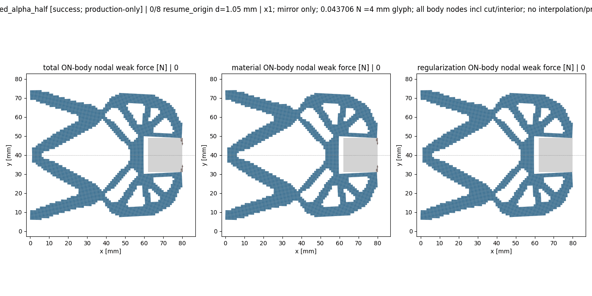

# M-UNLOAD2实际闭卡：PASS

2026-10-13（Asia/Seoul）。root确认唯一session96386真实终止，exit0；实际outer状态pass，独立terminal审阅状态pass_actual_independent_terminal_review_plain_records_only。执行源为main `21676e9bbae80505cfe719f0811fc77bc66fd55b`、协议 `c2c014cc21eee0b0c46abbfe73750c5c0afffd742db90a381f471f23c9c18473`。本文件依据真实普通记录写入，静审或余时没有被当成新数值许可。

整体目标是独立HF读取普通LF几何，提供有限变形／TMC前向反力、端口位移、固定工件作用、可恢复状态与实际变形，服务外部研究层；HF不优化、不调用dmftd，MPM暂不实现。本步从成功1.05末态追加旧尾[1,.9,.8,.75,.65,.5,.25,0]，保完整旧17目标前缀成25目标task及全部物理字段，复用已验证默认入口和原pure viewer，逐段观察卸载作用与间隙，不重做原加载路径或36项兼容测试。

实际阶段状态：helper=pass，新保存接受态记录数=9。本段的完成仅由真实result/closure给出；成功parent和更早failed/time_limit祖先继续保留，原M-ALPHA1／M-EXTEND1 NOT_PASS没有被改写。默认实现0改动，新HP／测试／候选复制／安装／外部重试均0，由root确认与独立闭卡审阅支持；本记录步骤科学postread为0。

原请求零位末态已接受并保存，实际R=-1.37324906426e-26 N，工件total Fy=-3.34467867947e-27 N，有限底边间隙=1 mm；新响应及真实变形作为下一段判断依据。

以下两表列出实际全部 9 个接受态，q_in按同态身份取原result，其余原值来自pure viewer普通summary。显示舍入不构成新计算；不计算新差值、比例或压力。

| child/global | 类型/leg | 输入d mm | qin mm | R N | qout mm | 有限底边间隙 mm | solid minJ | solid最大Green主应变 | medium最大abs Hu /mm |
| --- | --- | --- | --- | --- | --- | --- | --- | --- | --- |
| 0/16 | 原目标/resume_origin | 1.05 | 1.05 | 0.284972092043 | 1.0098299039 | 0.00218007304353 | 0.974037395813 | 0.0411145274669 | 0.407888829567 |
| 1/17 | 原目标/unloading | 1 | 1 | 0.25413673352 | 1.00672186587 | 0.00291136518177 | 0.974277342713 | 0.0384099326389 | 0.414745305977 |
| 2/18 | 原目标/unloading | 0.9 | 0.9 | 0.193413365531 | 0.998321785104 | 0.00653602050668 | 0.974808611151 | 0.0334776520338 | 0.387734952859 |
| 3/19 | 原目标/unloading | 0.8 | 0.8 | 0.152543853536 | 0.936858828374 | 0.0648825368502 | 0.976503505336 | 0.0298473072283 | 0.31205701218 |
| 4/20 | 原目标/unloading | 0.75 | 0.75 | 0.14185485751 | 0.879947805623 | 0.121452139593 | 0.977923789729 | 0.0279169042222 | 0.278847817068 |
| 5/21 | 原目标/unloading | 0.65 | 0.65 | 0.121625835389 | 0.763624054882 | 0.237285840514 | 0.980821517159 | 0.0240736664913 | 0.217740588322 |
| 6/22 | 原目标/unloading | 0.5 | 0.5 | 0.0925333065081 | 0.587232882891 | 0.413231877814 | 0.985220746104 | 0.0183735842967 | 0.144412234242 |
| 7/23 | 原目标/unloading | 0.25 | 0.25 | 0.0456657111613 | 0.292799309666 | 0.707304965518 | 0.99260208584 | 0.00906522591046 | 0.0586405357115 |
| 8/24 | 原目标/unloading | 0 | 0 | -1.37324906426e-26 | -9.47999393351e-25 | 1 | 1 | 2.59206125048e-24 | 2.5429089052e-24 |

| child/global | 类型/leg | total Fx N | total Fy N | material Fx N | material Fy N | Hu Fx N | Hu Fy N |
| --- | --- | --- | --- | --- | --- | --- | --- |
| 0/16 | 原目标/resume_origin | -0.000653023035703 | 0.0714869286435 | -0.000472068712895 | 0.0707323853159 | -0.000180954322807 | 0.000754543327609 |
| 1/17 | 原目标/unloading | -0.000637371869036 | 0.0540156611499 | -0.000445493594446 | 0.0532862110893 | -0.00019187827459 | 0.000729450060532 |
| 2/18 | 原目标/unloading | -0.000398851007357 | 0.0198430044604 | -0.000268285808126 | 0.0191076390624 | -0.000130565199231 | 0.000735365397988 |
| 3/19 | 原目标/unloading | -0.000182894324302 | 0.00234515886586 | -8.9581564319e-05 | 0.00159629372835 | -9.33127599833e-05 | 0.000748865137511 |
| 4/20 | 原目标/unloading | -0.000222790297199 | 0.00164286904214 | -8.31854378534e-05 | 0.00102977998976 | -0.000139604859346 | 0.000613089052383 |
| 5/21 | 原目标/unloading | -0.000238188852118 | 0.000960732906758 | -7.27309857692e-05 | 0.000580075555107 | -0.000165457866349 | 0.00038065735165 |
| 6/22 | 原目标/unloading | -0.000190170829038 | 0.000499232281412 | -5.53029340794e-05 | 0.000306973822374 | -0.000134867894958 | 0.000192258459039 |
| 7/23 | 原目标/unloading | -9.13203451896e-05 | 0.000169965821705 | -2.69566037625e-05 | 0.000106343532125 | -6.43637414271e-05 | 6.36222895798e-05 |
| 8/24 | 原目标/unloading | 7.12901227971e-28 | -3.34467867947e-27 | 1.14729788563e-28 | -3.09265440115e-28 | 5.98171439408e-28 | -3.03541323935e-27 |

R为原actuator-on-model反力；工件Fx/Fy为固定下半工件signed weak-form节点合力，含material与Hu；端口加权位移不是表面间隙。有限底边距离沿原采样合同；solid J和Green主应变为原保存viewer观察，不是独立应力HP或连续压力。

实际调用：F开始／完成147／127，T开始／完成68／68。正常invalid_J／回溯拒绝与原bisection按原控制器记录，开始数可大于完成数。其他真实阶段计数及原缓存门如下，未重核科学阈值：

```json
{
  "api_started": 1,
  "api_completed": 1,
  "defaults_started": 2,
  "defaults_completed": 2,
  "model_started": 1,
  "model_completed": 1,
  "reader_started": 1,
  "reader_completed": 1,
  "solve_started": 1,
  "solve_completed": 1,
  "force_started": 147,
  "force_completed": 127,
  "tangent_started": 68,
  "tangent_completed": 68,
  "save_started": 1,
  "save_completed": 1,
  "summary_started": 1,
  "summary_completed": 1,
  "view_child_started": 1,
  "view_child_completed": 1
}
```

```json
{
  "actual_accepted_states": 9,
  "minimum_J": 3.137725547236966e-05,
  "maximum_fixed_split_sum_mm": 0.0,
  "maximum_relative_residual": 5.072334977346608e-10,
  "native_constraint_bound_pass": true,
  "maximum_relative_global_force_balance": 1.1256462060839124e-11,
  "passed": true
}
```

资源合同controller9000／viewer600／helper10200／outer10260秒、采样8GiB；whole clock包含身份、导入、构模、API、保存、viewer及封存，viewer只获得原helper剩余窗口。outer 4750.0128177秒；实际helper终止墙钟 4749.5614208秒；helper回执快照 4748.9804秒。树RSS采样峰 1145487360B；helper采样峰 1166176256B。两种采样口径分别保留，不宣称OS硬限制。 无force、修复重跑、延期或回滚；关闭后不补科学hash、复制、ZIP、GIF解码或绘图。

原viewer记录3PNG和实际N=9帧GIF，未在闭卡记录步骤读取或核媒体字节。



[结构与端口](run_001/view/comparison.png) · [力与有限距离](run_001/view/distances_forces.png) · [本段起点场](run_001/view/peak_fields.png)

segment PEAK是本段1.05起点，原加载峰仍为1.20；末态零只是input endpoint，不代表完全释放。API自己的views/reference仍为not_provided；本节是另行一次原pure viewer实际产物，reference=None。

root像素QA普通记录状态为 pass_display_with_documented_scale_limits；原记录view_image_calls=3，replot=0。仅读[实际QA](author/pixel_QA.json)，本写入器未看PNG/GIF或重绘。

原QA限制如下，按root文本保留：

> The x1 mirrored comparison visibly shows the jaws withdrawing from the fixed square between the 1.05 segment start and the zero-input last state. The original loading peak remains 1.20.

> The distance/force graph uses input d as its horizontal coordinate; the actual saved chronological order is decreasing d. Orange distances and green rays in the geometry view are distances, not forces.

> The roughly 18mm left distance shares a scale with the small bottom gap. Near-contact micrometre changes should be read from the table/zoom label; the final 1mm gap is visible.

> The small regularization Fy curve lies near zero on the total-force scale; its actual components remain in the summary and result table. Fx is signed and is not monotone in magnitude over all targets.

> The field image is the 1.05 segment-PEAK snapshot. The displayed medium mean J is not the minimum Gauss-point J; Hu Frobenius colour is not the maximum absolute component.

> The ordinary saved summary reports tip bottom gap 0.7073049655183432mm and nonzero total body Fy 0.00016996582170512745N at d=0.25. Fixed-workpiece weak-form nodal force includes material and Hu; nonzero Fy alone is not proof of continued gripping.

> At zero input the ordinary summary records a 1mm tip bottom gap, body Fy -3.3446786794667874e-27N and negligible strain. These observations concern this fixed-workpiece model and do not upgrade pressure, free-object gripping, or stability qualification.

真实停止／错误记录：

```json
{
  "outer_stop_reason": null,
  "original_helper_error_fields": {
    "API_failure": null,
    "output_identity_seal": "complete_inside_original_helper_window",
    "view_child_terminal": {
      "exit_code": 0,
      "elapsed_seconds": 27.42145210003946,
      "limit_seconds": 600,
      "stop_reason": null,
      "cleanup": "Real cooperative child waited; no force or orphan"
    }
  },
  "saved_failure": null,
  "independent_review_status": "pass_actual_independent_terminal_review_plain_records_only",
  "independent_review_findings": []
}
```

当前进度为本段实际PASS；完整原／延伸路径、连续总压力、自由工件有效夹持、完全释放、稳定性、全部切线列、一般LF和HF5资格均未升级。已有M-EREF1仍是旧result的1.10点2HP，不改绑本段或合成新全段参考。下一步据真实保存反力、工件作用、距离、变形或原错误选择必要参考／原路径与资格补足；任何新科学阶段另成具体卡并直接批准，闭卡余时不是许可。

[实际执行回执](run_001/execution_receipt.json) · [唯一outer](production_launch.json) · [独立实际terminal审阅](author/independent_terminal_review.md) · [root真实终态确认](author/root_terminal_confirmation.json) · [本卡](M-UNLOAD2_CARD.md) · [父成功段](../saved_extension_003/RESULTS.md) · [既有1.10点参考](../extension_reference_001/RESULTS.md)。本记录不替代独立实际审阅或出版核对。
