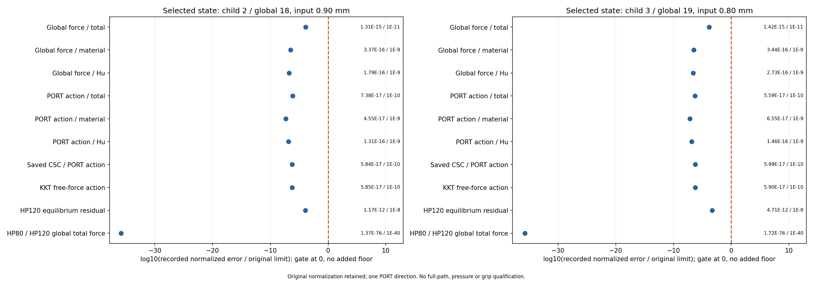

# M-PREF1实际闭卡：PASS

2026-10-13（Asia/Seoul）。用户直接批准后，root观察唯一session90472真实终态exit0；源`ea5b55cc4f2ace87a78ed512d6bb14382e826a5d`、协议`651ef450c19d499486b0478d386e4b545a0e1bad99f478faafcebec1eb29ee7d`，outer=pass、helper=pass。本记录来自真实普通摘要与独立终态审阅；本writer没有读科学或媒体字节，出版核对另由真实receipt确认。

整体目标仍为独立HF读取普通LF几何，给出有限变形／TMC前向反力、位移、固定工件作用、可恢复保存态及可检查变形，供外部研究层使用；HF不优化、不调用dmftd。已保存加载／卸载至零和25点统一显示，本步补两个变化显著的卸载点：原child2/global18/0.90与child3/global19/0.80，原工件Fy衰减且有限底边距离增大，因此先核保存力、材料／Hu分量及同一PORT方向切线，避免重复平衡或变形绘图。

本步实际PASS。B850与aa86原方法、11数学源、全部物理参数／生产settings和十五门保持；raw accepted_018/019，顶层child2/3与reference_execution_index18/19保留。实际完成计数如下（开始／完成原值分别保留）：

```json
{
  "HP_calls_started": 4,
  "HP_calls_completed": 4,
  "accepted_mechanical_states_completed": 2,
  "workpiece_states_completed": 2,
  "checks_completed": 161513,
  "plot_started": 1,
  "plot_completed": 1,
  "JAX_module_loaded": true,
  "AD_or_JIT_calls_by_wrapper": 0
}
```

通过时只取得这两个source result/state的四次HP80／120与原方向参考，不关联公开API。工件检查完成数来自原不可变aa86返回及实际生命周期；其科学gz不在闭卡后读取或重算body误差。

| child/global | d mm | R N | qin mm | qout mm | total Fx N | total Fy N | material Fx N | material Fy N | Hu Fx N | Hu Fy N | 原tip-to-bottom mm |
| --- | --- | --- | --- | --- | --- | --- | --- | --- | --- | --- | --- |
| 2/18 | 0.9 | 0.193413365531 | 0.9 | 0.998321785104 | -0.000398851007357 | 0.0198430044604 | -0.000268285808126 | 0.0191076390624 | -0.000130565199231 | 0.000735365397988 | 0.00653602050668 |
| 3/19 | 0.8 | 0.152543853536 | 0.8 | 0.936858828374 | -0.000182894324302 | 0.00234515886586 | -8.9581564319e-05 | 0.00159629372835 | -9.33127599833e-05 | 0.000748865137511 | 0.0648825368502 |

这些signed Fx/Fy与R/qout原值复制自成功UNLOAD2普通result并与原pure viewer同SHA/child/global普通行对账；最后列取该既有viewer原tip-to-bottom有限距离，不是新HP距离、连续表面间隙或压力。本次没有创建新变形或GIF。工件力是固定下半工件weak-form节点合力，含material/Hu；原材料Fy随这两点下降，Hu Fy两值接近且在后一态略高。这是保存标量观察，未计算新差值、比例或工件相对误差。作用衰减和距离增大支持保存态的卸载观察，不能据此认定自由工件有效夹持或完全释放。

| child/global | 原显示项 | 原normalized error | 原limit | 原pass gate |
| --- | --- | --- | --- | --- |
| 2/18 | Global force / total | 1.314320E-15 | 1.000000E-11 | true |
| 2/18 | Global force / material | 3.368676E-16 | 1.000000E-9 | true |
| 2/18 | Global force / Hu | 1.794062E-16 | 1.000000E-9 | true |
| 2/18 | PORT action / total | 7.380671E-17 | 1.000000E-10 | true |
| 2/18 | PORT action / material | 4.552880E-17 | 1.000000E-9 | true |
| 2/18 | PORT action / Hu | 1.312453E-16 | 1.000000E-9 | true |
| 2/18 | Saved CSC / PORT action | 5.839923E-17 | 1.000000E-10 | true |
| 2/18 | KKT free-force action | 5.851448E-17 | 1.000000E-10 | true |
| 2/18 | HP120 equilibrium residual | 1.168231E-12 | 1.000000E-8 | true |
| 2/18 | HP80 / HP120 global total force | 1.368615E-76 | 1.000000E-40 | true |
| 3/19 | Global force / total | 1.417194E-15 | 1.000000E-11 | true |
| 3/19 | Global force / material | 3.435493E-16 | 1.000000E-9 | true |
| 3/19 | Global force / Hu | 2.727976E-16 | 1.000000E-9 | true |
| 3/19 | PORT action / total | 5.594231E-17 | 1.000000E-10 | true |
| 3/19 | PORT action / material | 6.547875E-17 | 1.000000E-9 | true |
| 3/19 | PORT action / Hu | 1.457568E-16 | 1.000000E-9 | true |
| 3/19 | Saved CSC / PORT action | 5.985277E-17 | 1.000000E-10 | true |
| 3/19 | KKT free-force action | 5.904230E-17 | 1.000000E-10 | true |
| 3/19 | HP120 equilibrium residual | 4.707877E-12 | 1.000000E-8 | true |
| 3/19 | HP80 / HP120 global total force | 1.720443E-76 | 1.000000E-40 | true |

误差显示只格式化原字符串，完整精度、原分母／floor／limits和全部原检查仍在新raw普通摘要与已封存科学产物中。十项显示不替代十五门，工件误差不是Fy相对百分比。原十五阈值如下，未放宽或新算gate：

```json
{
  "production_residual": "1e-9",
  "independent_residual": "1e-8",
  "force_evaluation": "1e-9",
  "average_constraint": "1e-10",
  "global_force_balance": "1e-6",
  "fixed_displacement_mm": "8e-11",
  "hp80_hp120": "1e-40",
  "total_force": "1e-11",
  "material_force": "1e-9",
  "regularization_force": "1e-9",
  "total_tangent": "1e-10",
  "material_tangent": "1e-9",
  "regularization_tangent": "1e-9",
  "augmented_force_tangent": "1e-10",
  "augmented_constraint_tangent": "1e-10"
}
```



root实际一次original像素QA记录；状态字段：pass_one_actual_pixel_inspection

- 两面板真实标题为child2/global18/0.90 mm和child3/global19/0.80 mm，与新普通摘要一致。
- 每面板十行标签、蓝点、原误差/阈值文字和x轴log10说明可读，无明显裁切或重叠。
- 全部显示点位于原门0虚线左侧；右侧数值文字仍准确记录error/limit，正x轴空间只供文字排版。
- HP80/HP120一致性点约在log10比值-36处，图没有新增显示floor。
- 底部说明保留原归一化、单一PORT方向及不授全路径/压力/有效夹持资格。
- 该图只显示参考误差，不是实际变形图，也不把十项显示当作十五门的全部覆盖。

新资源合同helper900／outer960秒、采样8GiB。实际helper回执175.5430477秒、helper终端墙钟177.0447613秒、outer178.6413457秒；helper采样峰1271930880B、树采样峰1280548864B。最早clock包含imports、身份／归档、四HP、比较、一次plot和封存；采样／合作stop不宣称OS硬限制。Inherited dependencies实际可能加载／注册JAX；AD/JIT wrapper调用按原记录，不伪称未import。新生产F/T、solver、API、tests、安装、重试／修复／延期／force均0，闭窗不补科学hash或图。

原UNLOAD2九态及成功父链保持，深层ALPHA failed/time_limit与M-EXTEND1 NOT_PASS历史保留；source era保持实际producer mechanics map，本参考只归原child2/3 state。旧1.20／1.15／1.10三点仍各归原result/state，不搬移。本卡不能匹配公共reader所需全九态／18HP；完整9态、组合25点路径、全部切线列、压力、有效夹持／完全释放、稳定性、一般LF／HF5资格均不升级。

当前效果是所选两态的实际参考结论及一次原误差显示；若NOT_PASS，仅保已完成部分和原错误。下一步基于真实结果选择必要的功能／验证缺口，任何新科学范围须另拟具体卡并取得直接批准，闭卡余时不是许可。

实际停止／部分记录：

```json
{
  "outer_stop_reason": null,
  "outer_failure": null,
  "helper_error": null,
  "final_write_stop": null,
  "lifecycle_error": null,
  "output_identity_seal": "complete_inside_original_helper_window",
  "actual_reference_states": [
    {
      "index": 2,
      "child_accepted_index": 2,
      "reference_execution_index": 18,
      "original_target_index": 18,
      "status": "pass",
      "target_mm": 0.9,
      "state_sha256": "fa1cffaa2d9911c01752d702ab7cbc91d048b2c41a2f701d555953f91c7e598f",
      "leg": "unloading"
    },
    {
      "index": 3,
      "child_accepted_index": 3,
      "reference_execution_index": 19,
      "original_target_index": 19,
      "status": "pass",
      "target_mm": 0.8,
      "state_sha256": "8b834bcae162345adb6036970a91ccbb427455f84a07b2bdb0e111ee05db437a",
      "leg": "unloading"
    }
  ]
}
```

[原raw18摘要](run_001/reference/accepted_018/summary.json) · [原raw19摘要](run_001/reference/accepted_019/summary.json) · [顶层摘要](run_001/reference/summary.json) · [误差原记录](run_001/reference/reference_observations.json) · [执行回执](run_001/reference/execution_receipt.json) · [外层回执](reference_launch.json) · [独立实际审阅](author/independent_terminal_review.md) · [root终态](author/root_terminal_confirmation.json) · [实际QA](author/pixel_QA.json) · [直接批准](author/actual_human_context.json) · [具体卡](M-PREF1_CARD.md) · [原卸载结果](../saved_extension_004/RESULTS.md) · [25点保存显示](../../../functional_views/native_alpha_composed_20261013/complete_001/RESULTS.md)。
